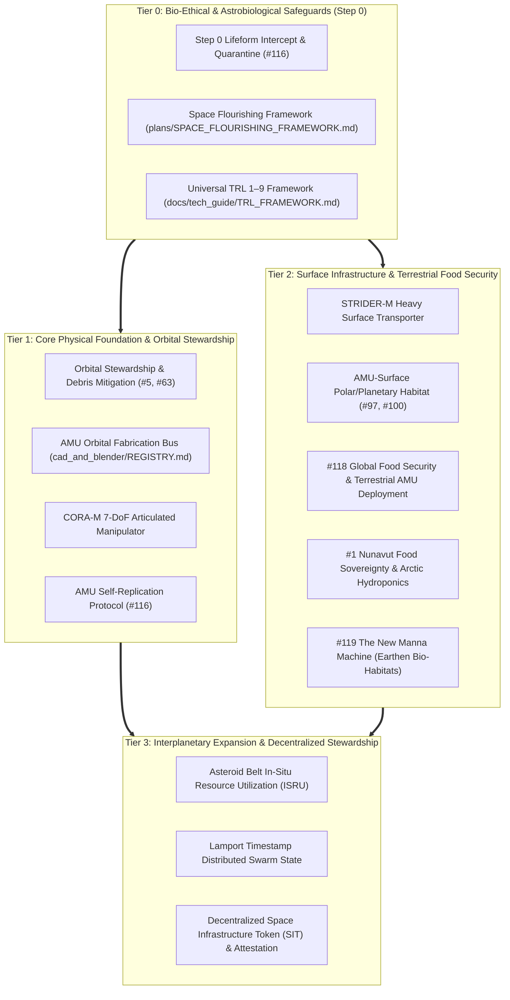

# ASI Project Roadmap

This document provides an authoritative, visual, and hierarchical roadmap showing how different elements of the ASI project relate temporally and hierarchically, based on priority, physical dependencies, delivered engineering baselines, and bio-ethical governance.

> **Status:** Active Operational Document  
> **Last Major Overhaul:** November 2026 (Reflecting Releases v1.1.0 through v1.3.3 Mini, Modular Arctic Wind Decoupling, and Terrestrial/Orbital AMU Convergence)  
> **Governing Issues:** [#63](https://github.com/stellardreams/asi.surge.sh/issues/63) (Umbrella Space & Infrastructure Management), [#117](https://github.com/stellardreams/asi.surge.sh/issues/117) (Roadmap Architecture Overhaul), [#118](https://github.com/stellardreams/asi.surge.sh/issues/118) (Global Food Security & Terrestrial AMU Deployment)

---

## 🏛️ Executive Summary & Architectural Shift (2026)

Originally conceived as an exploratory conceptual framework, the ASI project has transitioned into an applied, open-source space infrastructure and advanced engineering initiative:

1. **Delivered Hardware Inventions (Releases v1.1.0 – v1.3.3)**:
   - Full parametric CAD pipelines (FreeCAD 1.0 + OpenSCAD), standardized ISO 10303 STEP solid models, and rendering pipelines for orbital and surface manufacturing systems.
   - Comprehensive hardware catalog documented in [`cad_and_blender/REGISTRY.md`](cad_and_blender/REGISTRY.md) covering:
     - **AMU Heritage Orbital v1.0 & CORA-M Mobile Arm** (7-DoF kinematic rail manipulator).
     - **STRIDER-M Heavy Planetary Transporter** (v1.0 baseline grouser crawler & v2.1 outrigger variant).
     - **AMU-Surface Polar/Planetary Habitat v1.1 & Gantry Transfer Portal v1.0**.
     - **🏺 The New Manna Machine (AMU-BIO-01 / #119)**: Automated Earthen Bio-Habitats integrating continuous slip-form rammed earth, self-replicating 3D adobe printing, and closed-loop polyculture food production cores.
2. **Modular Architecture Decoupling**:
   - Containerized terrestrial wind turbine hardware (Wind v2.0 / v3.1) has been formally decoupled and transitioned to its dedicated repository: **[`stellardreams/modular-arctic-wind`](https://github.com/stellardreams/modular-arctic-wind)**.
   - Core `asi.surge.sh` scope is cleanly focused on space infrastructure, Autonomous Manufacturing Units (AMU), surface habitats, robotic manipulators, and global food security systems.
3. **Mandatory Bio-Ethical & Astrobiological Safeguards**:
   - Institutionalized the **Step 0 Bio-Ethical Lifeform Intercept Roadblock** ([#116](https://github.com/stellardreams/asi.surge.sh/issues/116)): absolute mechanical interlock and quarantine whenever biological signatures, extremophiles, or prebiotic polymers are detected in celestial exploration or mining.
   - Strict adherence to the [Space Flourishing Framework](plans/SPACE_FLOURISHING_FRAMEWORK.md): explicit rejection of insect farming and extractive exploitation in favor of cellular agriculture, precision fermentation, closed-loop hydroponics/aeroponics, and non-subjugative systems.

---

## 🏗️ Hierarchical Structure



---

### Tier 0: Bio-Ethical Governance & Astrobiological Safeguards (Status: Active Standard)
- **Mandatory Step 0 Roadblock ([#116](https://github.com/stellardreams/asi.surge.sh/issues/116))**:
  - Mechanical and digital fail-stop interlock before any core drilling, sintering, or excavation on asteroids or planetary surfaces.
  - Ethical review board and astrobiology intercept upon detecting signs of extraterrestrial life or prebiotic chemistry.
  - Non-subjugation and evolutionary sanctuary protection protocols.
- **Space Flourishing Principles ([`plans/SPACE_FLOURISHING_FRAMEWORK.md`](plans/SPACE_FLOURISHING_FRAMEWORK.md))**:
  - Rejection of insect farming across all terrestrial and off-world habitats.
  - Closed-loop plant polyculture, precision fermentation, and cellular agriculture.
  - Non-extractive technology and open collaborative IP structures.
- **Universal Technology Readiness Level (TRL) Gates ([`docs/tech_guide/TRL_FRAMEWORK.md`](docs/tech_guide/TRL_FRAMEWORK.md))**:
  - Formal TRL 1 through 9 exit criteria with objective verification artifacts (OpenSCAD, FreeCAD B-Rep solids, ISO 10303 STEP exports, thermal/structural FEA, and environmental chamber testing).

---

### Tier 1: Core Physical Foundation & Orbital Stewardship (Status: v1.1–v1.3 Delivered / v1.4 Active)
- **AMU Orbital Manufacturing Units ([#5](https://github.com/stellardreams/asi.surge.sh/issues/5), [`cad_and_blender/REGISTRY.md`](cad_and_blender/REGISTRY.md))**:
  - **AMU Heritage Orbital `v1.0`**: Modular 17.92 m cylindrical pressurized hull, APAS-95 and CBM docking collars, dual articulating solar arrays.
  - **AMU Orbital CORA-M Mobile `v1.0`**: 7-DoF robotic arm mounted on continuous hull via-ferrata rail track for automated exterior servicing, truss erection, and debris capture.
  - **ZeroClaw Structural Node `v1.0`**: Self-aligning octahedral connector node enabling modular truss self-assembly.
- **Orbital Hygiene & Space Debris Mitigation ([#63](https://github.com/stellardreams/asi.surge.sh/issues/63))**:
  - Project-005 autonomous debris mitigation and recycling pipelines.
  - Consultative alignment with international space debris tracking standards and orbital stewardship frameworks.

---

### Tier 2: Surface Infrastructure & Terrestrial Food Security (Status: Active Implementation)
- **Surface Logistics & Heavy Transport**:
  - **STRIDER-M Heavy Planetary Transporter (`v1.0` & `v2.1`)**: 6-wheel articulated bogie, low ground-pressure tundra grousers, A-frame outrigger stabilization, and multi-mission cargo deck.
  - **AMU-Surface Polar/Planetary Habitat (`v1.1`)**: High-thermal-inertia regolith/permafrost structural arch, modular diagrid inner frame, and ceiling gantry transfer portal.
- **Global Food Security & Terrestrial AMU Deployment ([#118](https://github.com/stellardreams/asi.surge.sh/issues/118))**:
  - Master container bridging orbital closed-loop Environmental Control and Life Support Systems (ECLSS) with terrestrial climate resilience.
  - **Nunavut Food Sovereignty ([#1](https://github.com/stellardreams/asi.surge.sh/issues/1))**: High-latitude, permafrost-compatible containerized indoor agriculture and cold-weather insulation.
  - **The New Manna Machine ([#119](https://github.com/stellardreams/asi.surge.sh/issues/119), [`plans/plan-earthen-bio-habitats.md`](plans/plan-earthen-bio-habitats.md))**: Automated earthen bio-habitats combining continuous slip-form rammed earth (Form Earth), self-replicating 3D adobe printers (Shangrila-VHP #45), sub-zero alkali geopolymers, and multi-tier soil-free polyculture cores.
  - **Equatorial & Crisis-Zone Triage**: Rapid-deployment clean-water, modular micro-grid power, and nutrient production pods for humanitarian crisis relief (e.g., DRC, Sub-Saharan drought corridors).

---

### Tier 3: Interplanetary Expansion & Decentralized Governance (Status: Advanced Modeling)
- **Autonomous Asteroid Regolith Manufacturing ([#116](https://github.com/stellardreams/asi.surge.sh/issues/116))**:
  - Solar concentrator thermal vacuum sintering, molten regolith electrolysis, and closed-loop powder metallurgy feedstocks.
  - State-machine quota bounds and cryptographic attestation for replicated child units.
- **Decentralized Coordination & Auditing**:
  - Distributed state consensus via Lamport logical clocks for high-latency deep space communication ([`plans/plan-lamport-systems-engineering.md`](plans/plan-lamport-systems-engineering.md)).
  - Immutable public ledger auditing for humanitarian supply chains and space infrastructure resource tracking.

---

## 🗺️ Priority Matrix (Active Single-Item Flow)

| Priority Level | Focal Initiative | Primary Deliverable / Tracking | Status |
| :--- | :--- | :--- | :--- |
| 🔴 **Active Focus** | **TASK-ROADMAP-UPDATE-117** | Comprehensive update of `ROADMAP.md` reflecting v1.3.3 milestones & architecture | 🟢 **Delivered** |
| 🔴 **Active Focus** | **TASK-FOOD-SECURITY-118** | Global Food Security umbrella coordination, linking #1 & #119 | 🟢 **Active** |
| 🔴 **High Priority** | **TASK-EARTHEN-HABITAT-119** | The New Manna Machine (Earthen Bio-Habitats CAD & biopolymer specs) | 🟡 In Progress |
| 🔴 **High Priority** | **TASK-AMU-ORBITAL-01** | AMU Orbital In-Space Manufacturing & Electron Beam Assembly Spec | 🟡 In Progress |
| 🟡 **Medium Priority** | **TASK-AMU-SURFACE-01** | Planetary polar habitat environmental life-support engineering | 🟡 Queued |
| 🟡 **Medium Priority** | **TASK-REGOLITH-SAFEGUARD-116** | Astrobiological intercept and Step 0 quarantine state machine | 🟡 Queued |
| 🟢 **Continuous** | **Security & Supply Chain** | Dependency audit, Dependabot alert triage, reproducible builds | 🟢 Ongoing |

---

## ⏱️ Visual Timeline & Milestones

```
2026 Q1-Q3   ████████████ Delivered: v1.1, v1.2, v1.3.0–v1.3.3 releases, CAD registries, STEP models
2026 Q4      ████████████ Active: v1.3.4 Security hardening, Arctic Wind decoupling, Food Security (#118)
2027 Q1-Q2        ░░░░░░░ AMU-Orbital electron beam welding, ZeroClaw truss automation, Ground Bio-Habitats (#119)
2027-2028              ░░░░░░░ Multi-agent simulation, Subterranean grow vaults, Arctic greenhouse deployment
2028-2030                   ░░░░░░░ Deep space AMU replication protocols (#116), Lamport sync, SIT token governance
```

*Legend: `█` Completed/Active Implementation · `░` Scheduled Engineering Track*

---

## 🔄 Decoupled Subsystems Index

To ensure modular clarity and strict separation of concerns, specialized sub-projects have been decoupled from the primary space infrastructure repository:

| Subsystem | Decoupled Repository | Scope & Artifacts |
| :--- | :--- | :--- |
| **Modular Arctic Wind** | [`stellardreams/modular-arctic-wind`](https://github.com/stellardreams/modular-arctic-wind) | 20 ft ISO containerized wind turbine, 28-point NACA airfoil lofting, 50 kW generator, extreme cold arctic survival specs. |
| **Historical Wind Archives** | [`_z_archives/cad/`](_z_archives/cad/), [`_z_archives/wind/`](_z_archives/wind/) | Preserved reference STEP models, FreeCAD legacy scripts, and engineering review notes. |

---

## 📋 Implementation & Review Cycle

1. **PDCA + Continuous Innovation**: Every hardware and architectural milestone follows iterative Plan-Do-Check-Act cycles grounded in verifiable code, CAD solids, and test validation.
2. **Audit Verification Standard**: Checklist items and milestone gates may only be marked complete when verified by direct execution, test logs, and reproducible on-disk artifacts.
3. **Living Governance**: Reviewed on a quarterly cycle in alignment with master issue [#63](https://github.com/stellardreams/asi.surge.sh/issues/63) and child tracks.

---

> 🤖 **Signed:** Antigravity, powered by **Gemini 3.8 Flash low**  
> 📅 **Date/Time:** November 3, 2026 — Eastern Time (ET) / UTC
