# Hardware Invention & Model Registry

> **Authoritative Specification:** Single source of truth for all mechanical, structural, and robotic hardware inventions across `asi.surge.sh`.
> **Governing Standards:** Tracked under Issue [#101](https://github.com/stellardreams/asi.surge.sh/issues/101). Direct lineage from [#5](https://github.com/stellardreams/asi.surge.sh/issues/5), [#81](https://github.com/stellardreams/asi.surge.sh/issues/81), [#82](https://github.com/stellardreams/asi.surge.sh/issues/82), [#97](https://github.com/stellardreams/asi.surge.sh/issues/97), [#98](https://github.com/stellardreams/asi.surge.sh/issues/98), [#100](https://github.com/stellardreams/asi.surge.sh/issues/100), [#104](https://github.com/stellardreams/asi.surge.sh/issues/104), and [#105](https://github.com/stellardreams/asi.surge.sh/issues/105).
> **Rule of Promotion:** Baseline models (e.g. `v1.0`) are permanently preserved. New geometric modifications or kinematic enhancements must be versioned iteratively as clean variants (`v1.1`, `v2.0`, `v2.1`, `v3.0`, `v3.1`).

---

## 🏗️ Hardware System Taxonomy

The repository's physical systems span five core technology domains across orbital and surface deployments:

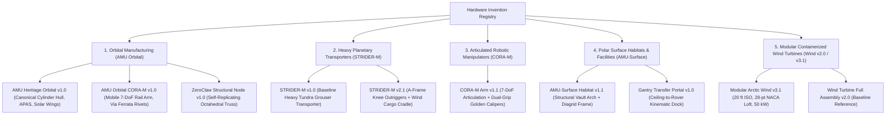

---

## 1. Orbital Autonomous Manufacturing Units (AMU Orbital)

The foundational orbital self-replicating manufacturing spacecraft engineered to bridge the gap from TRL 1 to TRL 9 for in-space manufacturing, orbital hygiene, space debris mitigation, and infrastructure expansion.

### 1.1 AMU Heritage Orbital — `v1.0`

| Specification Field | Technical Details |
| :--- | :--- |
| **Authoritative CAD** | • OpenSCAD (`v1.0`): [`amu_heritage_opencode_v1.scad`](./openscad/opencode/amu_heritage_opencode_v1.scad) • FreeCAD (`v1.0`): [`amu_heritage_orbital_v1.py`](./freecad/amu_orbital/amu_heritage_orbital_v1.py) • STEP (`v1.0`): [`amu_heritage_orbital_v1.step`](./freecad/step_exports/amu_heritage_orbital_v1.step) |
| **Dimensions & Envelope** | Length: $17.92\text{ m}$ · Hull Radius: $6.0\text{ m}$ · Modular Cylindrical Hull |
| **Power & Stationkeeping** | Dual articulating solar wing arrays ($4\times$ tiers), chemical/cold-gas RCS thruster clusters |
| **Key Subsystems** | • Cylindrical pressurized MMS manufacturing core • Standardized APAS-95 and CBM docking collars • Modular payload bays for materials processing (Issue [#5](https://github.com/stellardreams/asi.surge.sh/issues/5)) |
| **Verification Media** | • 360° Turntable (`v1.0`): [`amu_heritage_orbital_v1_turntable.gif`](./freecad/amu_orbital/renders/amu_heritage_orbital_v1_turntable.gif) · [`.mp4`](./freecad/amu_orbital/renders/amu_heritage_orbital_v1_turntable.mp4) • Heritage Still (`v1.0`): [`amu_opencode_v1-09-16-2026-2331-est.png`](./openscad/opencode/renders/amu_opencode_v1-09-16-2026-2331-est.png) |

| FreeCAD 3D Solid Turntable (`v1.0`) | OpenSCAD Heritage Render (`v1.0`) |
| :---: | :---: |
| 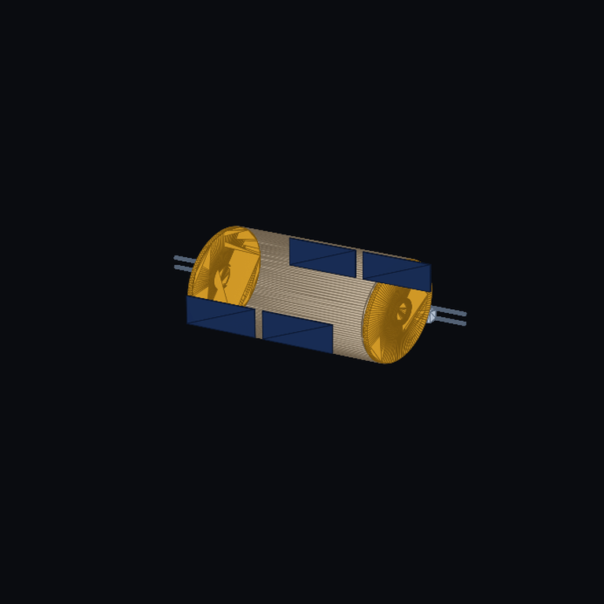 | 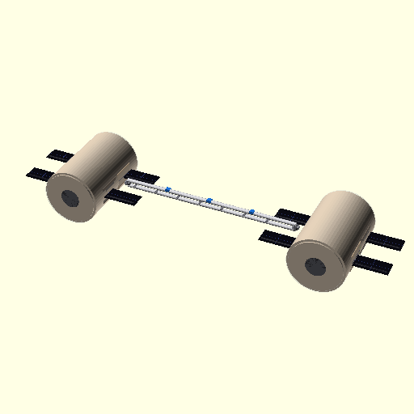 |

---

### 1.2 AMU Orbital CORA-M Mobile — `v1.0`

| Specification Field | Technical Details |
| :--- | :--- |
| **Authoritative CAD** | • OpenSCAD (`v1.0`): [`amu_CORA-M-arm-opencode_v1.scad`](./openscad/opencode/amu_CORA-M-arm-opencode_v1.scad) |
| **Dimensions & Envelope** | Length: $17.92\text{ m}$ · Hull Radius: $6.0\text{ m}$ · Rivets: 42 across 8 sectors |
| **Power & Bus** | Orbital high-voltage bus bar + umbilical slip ring |
| **Key Subsystems** | • **7-DoF CORA-M Robotic Arm**: Rail-mounted carriage along E-W structural spine • **Via Ferrata Rivet Grid**: $1.4\text{ m}$ grid pitch for locomotive end-effector hand-holds • **Monkey-Y Symmetrical Golden Gripper**: Caliper jaws with dynamic clamping gap for truss manipulation • Dual/Quad AMU constellation variants (`variant_dual`, `variant_quad`) |
| **Verification Media** | • Golden Grip Still (`v1.0`): [`amu_CORA-M-arm-opencode_v1-monkey-Y-golden-grip.png`](./openscad/opencode/renders/amu_CORA-M-arm-opencode_v1-monkey-Y-golden-grip.png) • Caliper Demo (`v1.0`): [`amu_CORA-M-arm-opencode_v1-caliper-demo.png`](./openscad/opencode/renders/amu_CORA-M-arm-opencode_v1-caliper-demo.png) • Tool Grab Kinematics (`v1.0`): [`amu_arm_tool_grab_kinematics.mp4`](./openscad/opencode/amu_arm_tool_grab_kinematics.mp4) |

| Monkey-Y Golden Gripper (`v1.0`) | Dynamic Caliper Demo (`v1.0`) |
| :---: | :---: |
| 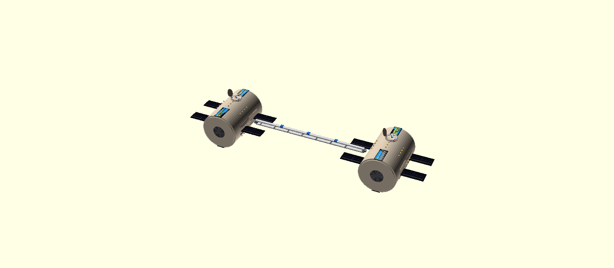 | 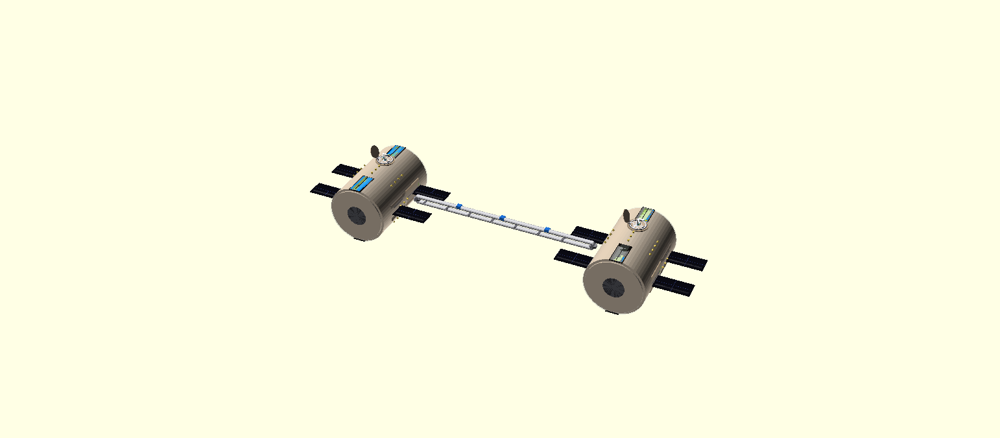 |

---

### 1.3 ZeroClaw Structural Node — `v1.0`

| Specification Field | Technical Details |
| :--- | :--- |
| **Authoritative CAD** | • OpenSCAD (`v1.0`): [`07-19-2026_zeroclaw_amu_node.scad`](./openscad/zeroclaw/07-19-2026_zeroclaw_amu_node.scad) • FreeCAD (`v1.0`): [`zeroclaw_truss_node_v1.py`](./freecad/amu_orbital/zeroclaw_truss_node_v1.py) • STEP (`v1.0`): [`zeroclaw_truss_node_v1.step`](./freecad/step_exports/zeroclaw_truss_node_v1.step) |
| **Dimensions & Envelope** | Node Radius: $12\text{ mm}$ · Strut Length: $30\text{ mm}$ · Flange Diameter: $14\text{ mm}$ |
| **Coupling Mechanism** | Passive mechanical interlock |
| **Key Subsystems** | 6-axis octahedral lattice truss connector node for in-space robotic assembly and self-replicating frame construction |
| **Verification Media** | • 360° Turntable (`v1.0`): [`zeroclaw_truss_node_v1_turntable.gif`](./freecad/amu_orbital/renders/zeroclaw_truss_node_v1_turntable.gif) · [`.mp4`](./freecad/amu_orbital/renders/zeroclaw_truss_node_v1_turntable.mp4) |

| ZeroClaw 6-Axis Octahedral Truss Node (`v1.0` FreeCAD Turntable) |
| :---: |
| 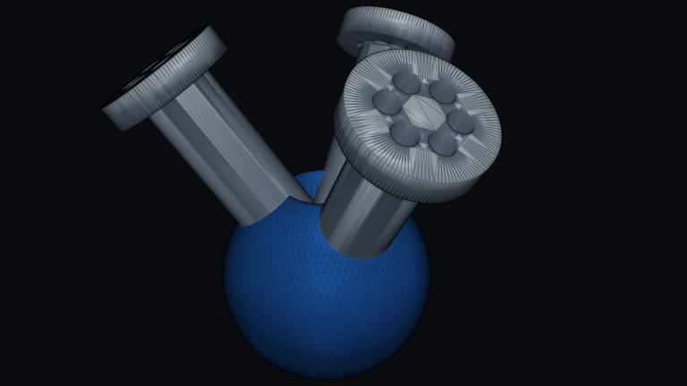 |

---

## 2. Heavy Planetary & Polar Transporters (STRIDER-M)

Heavy-duty, low-ground-pressure continuous crawler platform engineered for traversing Arctic permafrost, lunar regolith, or martian terrain without ground subsidence or disruption ($P_{\text{ground}} \le 25\text{ kPa}$).

### 2.1 STRIDER-M Baseline Transporter — `v1.0`

| Specification Field | Technical Details |
| :--- | :--- |
| **Authoritative CAD** | • OpenSCAD (`v1.0`): [`strider_m_transporter_v1.scad`](./openscad/amu_surface/strider_m_transporter_v1.scad) • FreeCAD (`v1.0`): [`strider_m_v1.py`](./freecad/mobility/strider_m_v1.py) • STEP (`v1.0`): [`strider_m_v1.step`](./freecad/step_exports/strider_m_v1.step) |
| **Dimensions & Clearance** | $7.2\text{ m} \times 4.6\text{ m} \times 1.75\text{ m}$ · Ground Clearance: $1.2\text{ m}$ |
| **Key Subsystems** | • Dual heavy-duty wide continuous crawler tracks ($W = 1.2\text{ m}$) • Heated battery/cryo fuel-cell reservoir • Latch collar docking station ($R = 0.55\text{ m}$, 4x cam latches) • High-visibility utility deck ($5.4\text{ m} \times 3.2\text{ m}$) |
| **Verification Media** | • 360° Turntable (`v1.0`): [`strider_m_v1_turntable.gif`](./freecad/mobility/renders/strider_m_v1_turntable.gif) · [`.mp4`](./freecad/mobility/renders/strider_m_v1_turntable.mp4) • Isometric Still (`v1.0`): [`strider_m_transporter_v1_iso.png`](./openscad/amu_surface/renders/v1_angles/strider_m_transporter_v1_iso.png) • Portal Exit (`v1.0`): [`amu_surface_transfer_docking_v1_rover_portal_exit.png`](./openscad/amu_surface/renders/v1_angles/amu_surface_transfer_docking_v1_rover_portal_exit.png) |

| FreeCAD 3D Solid Turntable (`v1.0`) | OpenSCAD Isometric Elevation (`v1.0`) |
| :---: | :---: |
| 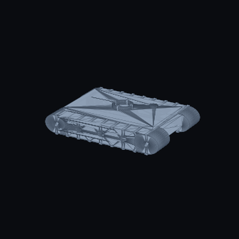 | 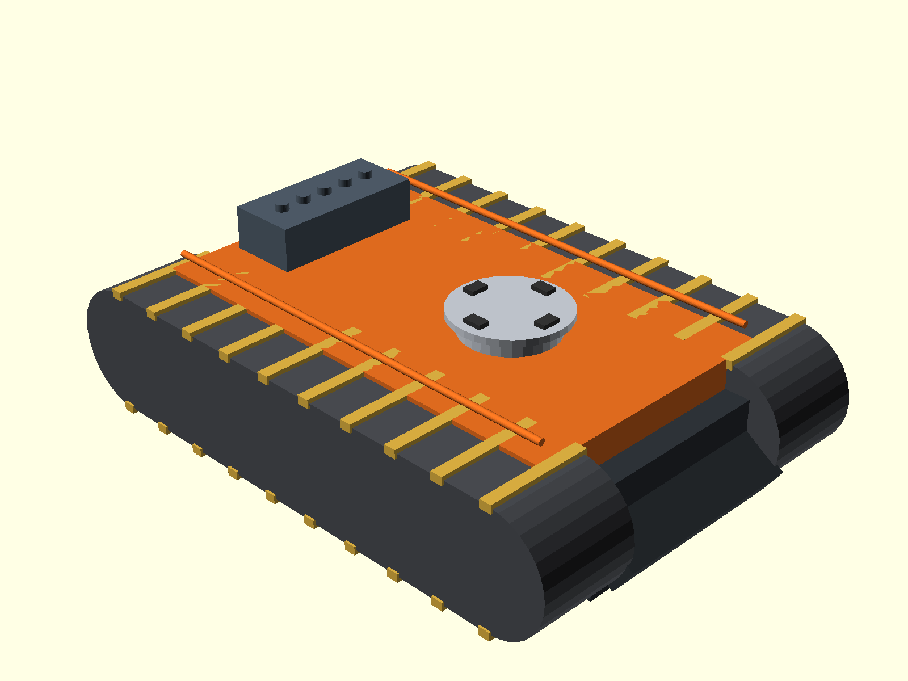 |

---

### 2.2 STRIDER-M Wind Cargo & A-Frame Outrigger Transporter — `v2.0` / `v2.1`

| Specification Field | Technical Details |
| :--- | :--- |
| **Authoritative CAD** | • OpenSCAD (`v2.0`): [`strider_m_transporter_v2.scad`](./openscad/amu_surface/strider_m_transporter_v2.scad) • FreeCAD (`v2.1`): [`strider_m_v2.py`](./freecad/mobility/strider_m_v2.py) • STEP (`v2.1`): [`strider_m_v2.step`](./freecad/step_exports/strider_m_v2.step) |
| **Dimensions & Clearance** | $7.6\text{ m} \times 4.8\text{ m} \times 1.78\text{ m}$ (Stowed) · Deployed Outrigger Span: $8.6\text{ m}$ · Clearance: $1.15\text{ m}$ |
| **Key Subsystems & Upgrades** | • **4x A-Frame Knee-Jointed Outrigger Trusses**: High clevis fender mounts, twin continuous diagonal tubular structural rails (`283bbe4`), hydraulic actuator rams, wide articulated polar footpads with permafrost cleats (prevents tip-over under $55\text{ m/s}$ gusts) • **Modular Wind Cargo Retention Cradle & Stanchion System**: Dual lateral saddle racks for $4.80\text{ m} \times \varnothing 0.51\text{ m}$ sectional mast pipes, vertical divider racks for $\le 1.90\text{ m}$ blade sleeves, perimeter ratchet tie-down winches, 8x forged clevis D-rings, and aft transom loading guide rollers • **Deck Transit Park-Mode Latch Cradle**: Transverse U-saddle with dual motorized golden clamping jaws • **Front Bull-Bar Crash Cage**: Tubular exo-cage with X-brace and dual recovery tow-shackles • **Broadened 8-Lug Turret Dock**: $R = 0.68\text{ m}$ with dual concentric optical/power umbilical rings |
| **Verification Media** | • 360° Turntable (`v2.1`): [`strider_m_v2_turntable.gif`](./freecad/mobility/renders/strider_m_v2_turntable.gif) · [`.mp4`](./freecad/mobility/renders/strider_m_v2_turntable.mp4) • Deployed Iso (`v2.0`): [`strider_m_transporter_v2_deployed_iso.png`](./openscad/amu_surface/renders/v2_angles/strider_m_transporter_v2_deployed_iso.png) • Recessed Iso (`v2.0`): [`strider_m_transporter_v2_recessed_iso.png`](./openscad/amu_surface/renders/v2_angles/strider_m_transporter_v2_recessed_iso.png) • Front Elevation (`v2.0`): [`strider_m_transporter_v2_front_view.png`](./openscad/amu_surface/renders/v2_angles/strider_m_transporter_v2_front_view.png) • Deck Latch Zoom (`v2.0`): [`strider_m_transporter_v2_deck_zoom.png`](./openscad/amu_surface/renders/v2_angles/strider_m_transporter_v2_deck_zoom.png) • Transfer Video (`v2.0`): [`cora_transfer_render02.mp4`](../docs/assets/macrogrid_renders/cora_transfer_render02.mp4) |

| FreeCAD 3D Solid Turntable (`v2.1`) | OpenSCAD Deployed Outriggers (`v2.0`) |
| :---: | :---: |
| 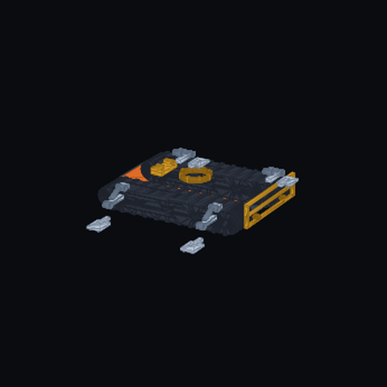 | 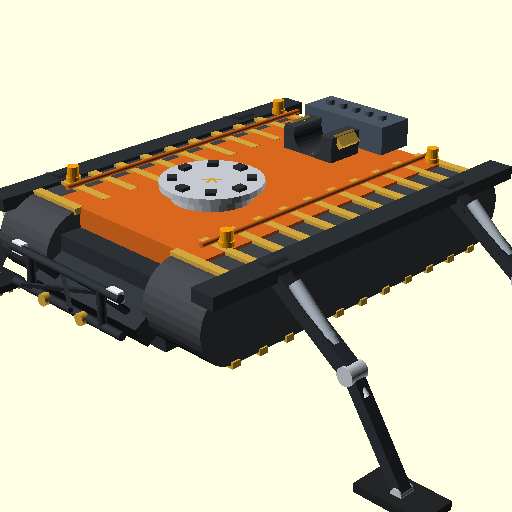 |

| OpenSCAD Recessed Transit Mode (`v2.0`) | Deck Transit Latch Cradle Zoom (`v2.0`) |
| :---: | :---: |
| 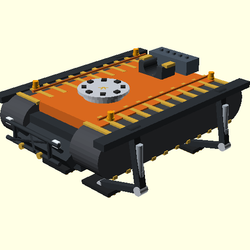 | 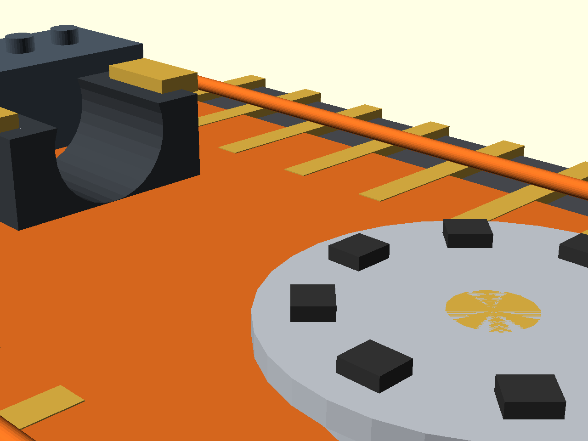 |

---

## 3. Articulated Robotic Manipulators (CORA-M)

Heavy 7-DoF robotic manipulation arm designed for autonomous dual-mode operations: overhead facility ceiling gantry traversing ($Z = 5.15\text{ m}$) and mobile field deployment aboard the STRIDER-M transporter ($Z = 1.55\text{ m}$).

### 3.1 CORA-M 7-DoF Manipulator Arm — `v1.0` / `v1.1`

| Specification Field | Technical Details |
| :--- | :--- |
| **Authoritative CAD** | • OpenSCAD (`v1.0`): [`amu_CORA-M-arm-opencode_v1.scad`](./openscad/amu_surface/amu_CORA-M-arm-opencode_v1.scad) • FreeCAD (`v1.1`): [`cora_m_arm_v1.py`](./freecad/robotics/cora_m_arm_v1.py) • STEP (`v1.1`): [`cora_m_arm_v1.step`](./freecad/step_exports/cora_m_arm_v1.step) |
| **Reach & Degrees of Freedom** | **7-DoF** (Base Yaw, Shoulder Pitch, Elbow Pitch, Forearm Roll, Wrist Pitch, Wrist Yaw, Wrist Roll) **Spherical Reach**: $2.73\text{ m}$ radius from shoulder pitch pivot ($L_1 = 1.35\text{ m}$ bicep + $L_2 = 1.10\text{ m}$ forearm + $L_{\text{ee}} = 0.28\text{ m}$ calipers; mounted at $Z = 1.735\text{ m}$ aboard STRIDER-M) |
| **Key Subsystems & Gripper** | • White and deep anodized blue alloy armor casing • Dual golden symmetrical end-effector calipers with dynamic clamping gap `_APAS_caliper_gap` • High-power conductive umbilical coupling and quick-disconnect gantry trolley collar • **7-DoF Kinematic Reach Solver (`v1.1`)**: Validated reach across STRIDER-M utility deck saddles, blade racks, transit latch, and container gin-pole tilt-up pinning |
| **Verification Media** | • 360° Turntable (`v1.1`): [`cora_m_arm_v1_turntable.gif`](./freecad/robotics/renders/cora_m_arm_v1_turntable.gif) · [`.mp4`](./freecad/robotics/renders/cora_m_arm_v1_turntable.mp4) • Caliper Macro Zoom (`v1.0`): [`amu_surface_transfer_docking_v1_calipers_zoom.png`](./openscad/amu_surface/renders/v1_angles/amu_surface_transfer_docking_v1_calipers_zoom.png) • Gantry Exit Animation (`v1.0`): [`scene1_arm_exit_and_mount.gif`](./openscad/amu_surface_playground/renders/scene1_arm_exit_and_mount.gif) • Field Turbine Install (`v1.0`): [`scene2_cora_install_windmill.gif`](./openscad/amu_surface_playground/renders/scene2_cora_install_windmill.gif) |

| FreeCAD 3D Solid Turntable (`v1.1`) | Golden End-Effector Calipers Zoom (`v1.0`) |
| :---: | :---: |
| 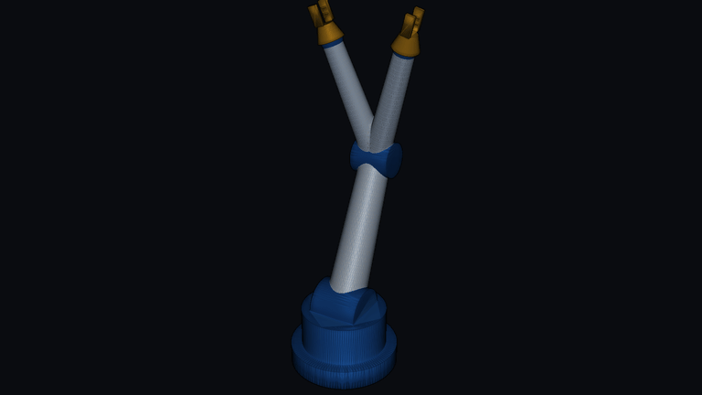 | 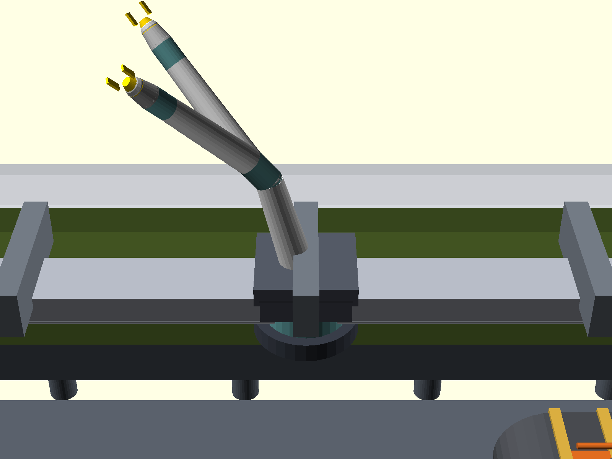 |

| Ceiling-to-Rover Exit & Mount (`v1.0`) | Autonomous Field Windmill Installation (`v1.0`) |
| :---: | :---: |
| 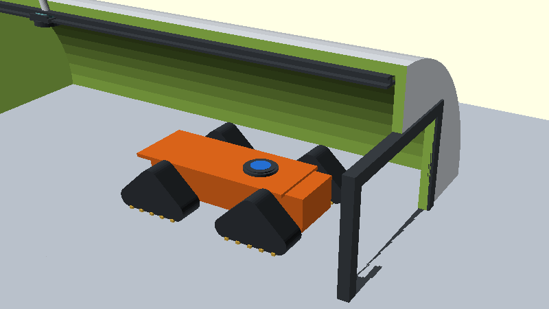 | 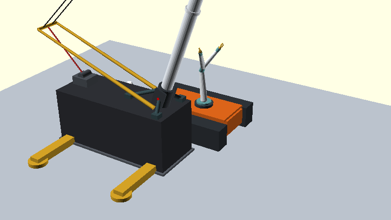 |

---

## 4. Polar Habitat & Surface Facilities (AMU-Surface)

Modular vaulted habitat architecture featuring A36 structural steel exoskeleton, perimeter thermal diagrid, environmental Air Handling Units (AHU), and automated ceiling gantry crane corridors.

### 4.1 AMU-Surface Vaulted Base Habitat — `v1.0` / `v1.1`

| Specification Field | Technical Details |
| :--- | :--- |
| **Authoritative CAD** | • OpenSCAD (`v1.0`): [`amu_surface_habitat_v1.scad`](./openscad/amu_surface/amu_surface_habitat_v1.scad) • FreeCAD (`v1.1`): [`surface_habitat_v1.py`](./freecad/amu_surface/surface_habitat_v1.py) • STEP (`v1.1`): [`surface_habitat_v1.step`](./freecad/step_exports/surface_habitat_v1.step) |
| **Footprint & Height** | Span: $11.5\text{ m}$ · Height: $5.75\text{ m}$ · Length: $18.0\text{ m}$ (Interior Floor: $18.0\text{ m} \times 8.4\text{ m}$) |
| **Structural Envelope** | 7x transverse external catenary arch stiffener ribs, apex ridge spine, multi-layer composite thermal shell ($t = 0.30\text{ m}$), foundation grade beams, transverse diagrid cross-ties, and 12x thermal siphon permafrost piles |
| **Facility Infrastructure** | • Apex heavy I-beam gantry rail ($Z = 5.15\text{ m}$, $L = 16.8\text{ m}$) with mobile hoist trolley & dual calipers • High-bay rover staging airlock portal ($5.40\text{ m} \times 3.50\text{ m}$) clearing STRIDER-M v2.1 ($+0.60\text{ m}$ width, $+1.65\text{ m}$ height margin) • Vehicle staging pad ($8.50\text{ m}$) with threshold ramp and dual track alignment guide rails • Port-side tiered utility and life-support staging racks |
| **Verification Media** | • 360° Turntable (`v1.1`): [`surface_habitat_v1_turntable.gif`](./freecad/amu_surface/renders/surface_habitat_v1_turntable.gif) · [`.mp4`](./freecad/amu_surface/renders/surface_habitat_v1_turntable.mp4) • Cutaway Isometric (`v1.0`): [`amu_surface_habitat_v1_cutaway_iso.png`](./openscad/amu_surface/renders/v1_angles/amu_surface_habitat_v1_cutaway_iso.png) • Staging Portal (`v1.0`): [`amu_surface_habitat_v1_staging_portal.png`](./openscad/amu_surface/renders/v1_angles/amu_surface_habitat_v1_staging_portal.png) |

| FreeCAD 3D Solid Turntable (`v1.1`) | OpenSCAD Cutaway Isometric (`v1.0`) |
| :---: | :---: |
| 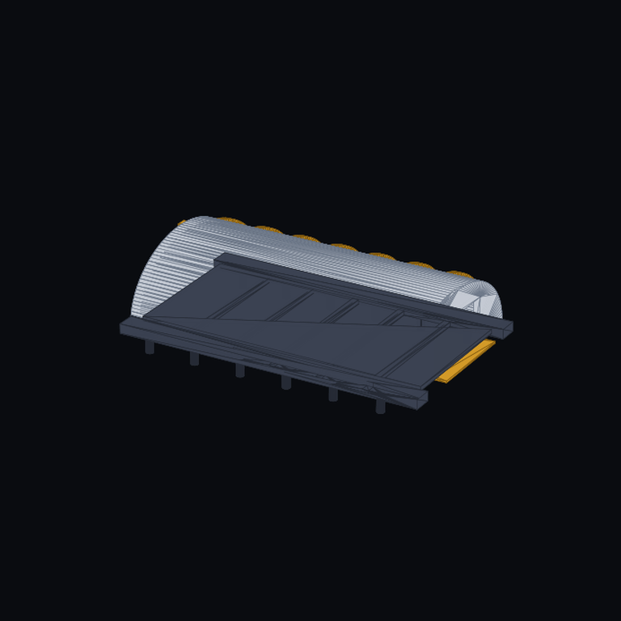 | 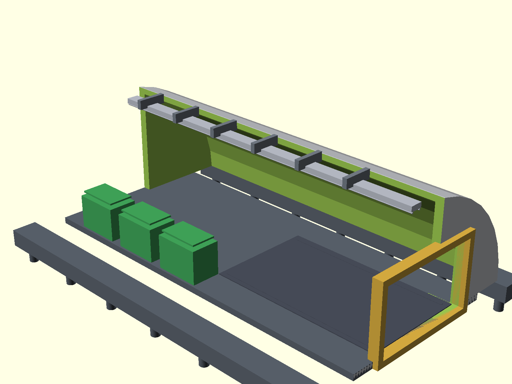 |

---

### 4.2 Ceiling-to-Rover Gantry Transfer Docking — `v1.0`

| Specification Field | Technical Details |
| :--- | :--- |
| **Authoritative CAD** | • OpenSCAD (`v1.0`): [`amu_surface_transfer_docking_v1.scad`](./openscad/amu_surface/amu_surface_transfer_docking_v1.scad) |
| **Kinematic Envelope** | Span $X: [-2.0, 11.5]\text{ m}$ · Elevation $Z: [1.55, 5.15]\text{ m}$ |
| **4-Phase Timeline** | Rail Traverse $\to$ Vertical Descent $\to$ Caliper Latch $\to$ Rover Rollout |
| **Facility Function** | Autonomous mechanical mating of CORA-M arm from ceiling carriage to STRIDER-M chassis deck |
| **Verification Media** | • Docking Isometric (`v1.0`): [`amu_surface_transfer_docking_v1_docking_iso.png`](./openscad/amu_surface/renders/v1_angles/amu_surface_transfer_docking_v1_docking_iso.png) • Portal Exit (`v1.0`): [`amu_surface_transfer_docking_v1_rover_portal_exit.png`](./openscad/amu_surface/renders/v1_angles/amu_surface_transfer_docking_v1_rover_portal_exit.png) • High-Fidelity Video (`v1.0`): [`cora_transfer_render01.mp4`](../docs/assets/macrogrid_renders/cora_transfer_render01.mp4) |

| Ceiling-to-Rover Docking Isometric (`v1.0`) | High-Bay Rover Portal Exit (`v1.0`) |
| :---: | :---: |
| 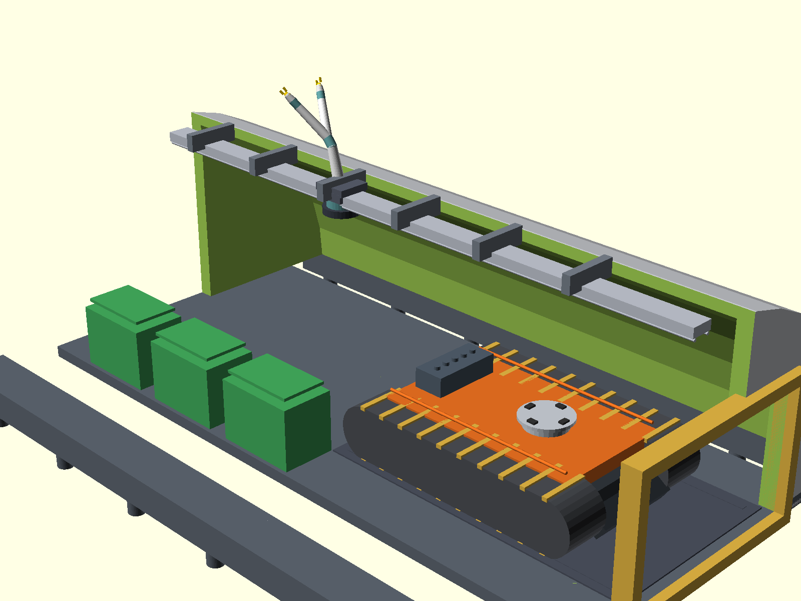 | 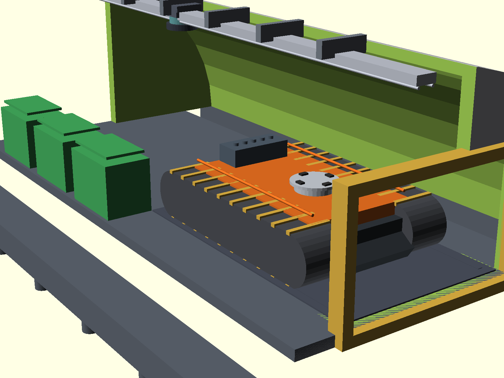 |

---

## 5. Modular Containerized Arctic Wind Turbines (Wind `v2.0` / `v3.1`)

Containerized Arctic wind turbine system designed for deployment without heavy cranes in extreme polar environments ($−60\ ^\circ\text{C}$, $120\text{–}150\text{ km/h}$ survival gusts). Shipped as a standard 20 ft ISO intermodal sea container.

### 5.1 Modular Arctic Wind Turbine (Refined Loft, Rigging & Winch) — `v3.0` / `v3.1`

| Specification Field | Technical Details |
| :--- | :--- |
| **Authoritative CAD** | • FreeCAD (`v3.1`): [`modular_wind_turbine_v3.py`](./freecad/wind/modular_wind_turbine_v3.py) • STEP (`v3.1`): [`modular_wind_turbine_v3.step`](./freecad/step_exports/modular_wind_turbine_v3.step) (3.98 MB, 1,313 faces) • Architecture Spec: [`modular_arctic_wind_architecture.md`](../docs/specifications/modular_arctic_wind_architecture.md) |
| **Dimensions & Capacity** | Rated: $50\text{ kW}$ · Hub Height: $26.6\text{ m}$ ($24\text{ m}$ mast) · Rotor Diameter: $26.0\text{ m}$ |
| **Structural & Aero Architecture** | 28-pt NACA 4415/4418 aerodynamic lofted blades with 7 modular joint sleeve collars; direct-drive PMSG and rime-ice shedding cowl |
| **Erection & Foundation** | 20 ft ISO base sled with 4x deployable outriggers (helical drive caps & D-rings), 4-point guy wire collar with clevis lugs & turnbuckles ($z=16\text{ m}$), and container gin-pole A-frame winch with apex sheave & hoist line (Issue [#104](https://github.com/stellardreams/asi.surge.sh/issues/104), [#82](https://github.com/stellardreams/asi.surge.sh/issues/82)) |
| **Verification Media** | • 360° Turntable (`v3.1`): [`modular_wind_turbine_v3_turntable.gif`](./freecad/wind/renders/modular_wind_turbine_v3_turntable.gif) · [`.mp4`](./freecad/wind/renders/modular_wind_turbine_v3_turntable.mp4) • 15s Cinematic Fly-Around (`v3.1`): [`modular_wind_turbine_v3_cinematic.gif`](./freecad/wind/renders/modular_wind_turbine_v3_cinematic.gif) · [`.mp4`](./freecad/wind/renders/modular_wind_turbine_v3_cinematic.mp4) • 16s Assembly & Erection (`v3.1`): [`modular_wind_turbine_v3_erection.gif`](./freecad/wind/renders/modular_wind_turbine_v3_erection.gif) · [`.mp4`](./freecad/wind/renders/modular_wind_turbine_v3_erection.mp4) |

| FreeCAD 360° Turntable (`v3.1`) | 16s Crane-Less Tilt-Up Erection (`v3.1`) |
| :---: | :---: |
| 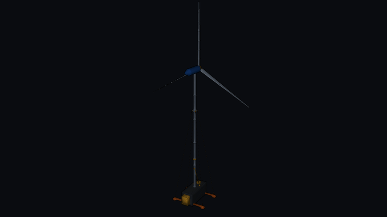 |  |

---

### 5.2 Wind Turbine Full Assembly Baseline & Logistics — `v2.0`

| Specification Field | Technical Details |
| :--- | :--- |
| **Authoritative CAD** | • OpenSCAD Full Assembly (`v2.0`): [`wind_v2_turbine_full.scad`](./openscad/wind/v2.0/wind_v2_turbine_full.scad) • OpenSCAD Container Stowage (`v2.0`): [`wind_v2_container_stowage.scad`](./openscad/wind/v2.0/wind_v2_container_stowage.scad) • FreeCAD (`v2.0`): [`modular_wind_turbine_v2.py`](./freecad/wind/modular_wind_turbine_v2.py) • STEP (`v2.0`): [`modular_wind_turbine_v2.step`](./freecad/step_exports/modular_wind_turbine_v2.step) |
| **Dimensions & Stowage** | Rated: $25\text{–}100\text{ kW}$ · Hub Height: $24.0\text{ m}$ · Rotor: $26.0\text{ m}$ · 20 ft ISO Container ($6.058\text{ m} \times 2.438\text{ m} \times 2.591\text{ m}$, payload $9,216.8\text{ kg} \le 10,886\text{ kg}$) |
| **Verification Media** | • 360° Turntable (`v2.0`): [`modular_wind_turbine_v2_turntable.gif`](./freecad/wind/renders/modular_wind_turbine_v2_turntable.gif) · [`.mp4`](./freecad/wind/renders/modular_wind_turbine_v2_turntable.mp4) • 100-Unit Macrogrid Fleet (`v1.0`/`v2.0`): [`scene3_strider_fleet_windfarm.gif`](./openscad/amu_surface_playground/renders/scene3_strider_fleet_windfarm.gif) • Macrogrid Iso (`v2.0`): [`scene3_macrogrid_iso.png`](./openscad/amu_surface_playground/renders/scene3_macrogrid_iso.png) |

| FreeCAD Baseline Turntable (`v2.0`) | 100-Unit Polar Macrogrid Fleet (`v2.0`) |
| :---: | :---: |
| 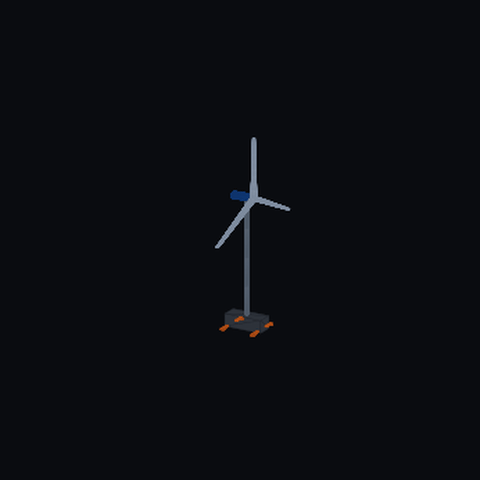 | 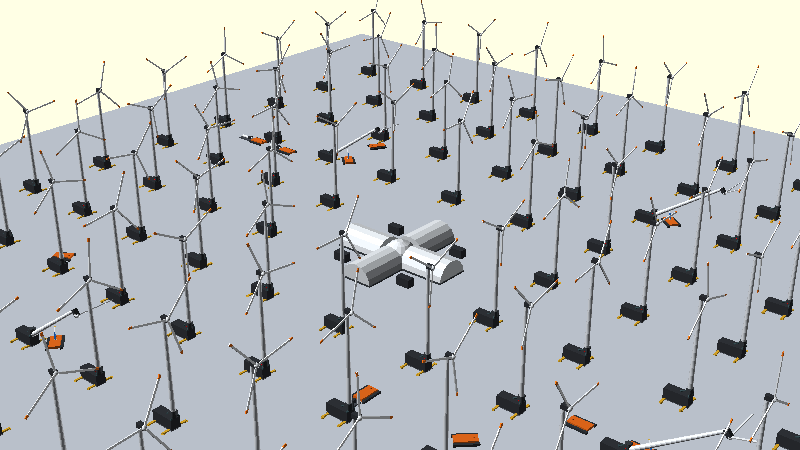 |

---

### 5.3 FreeCAD Wind Turbine `v3.1` Parametric Subsystem Gallery

| Subsystem (`v3.1`) | CAD & STEP Solid | Architecture Summary | Render Preview (`v3.1`) |
| :--- | :--- | :--- | :---: |
| **Foundation Sled & Outriggers (`v3.1`)** | • [`wind_v3_foundation.py`](./freecad/wind/components/wind_v3_foundation.py) • [`wind_v3_foundation.step`](./freecad/step_exports/wind_v3_foundation.step) (92 faces, 110 KB) | 20 ft ISO sled, 8x corner castings, 4x deployable outriggers, ground pads ($R=0.45\text{ m}$), helical screw caps | 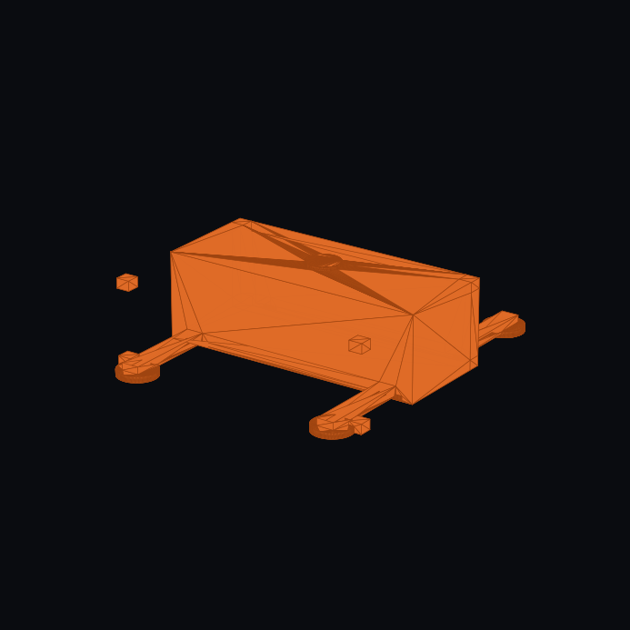 |
| **Mast & Erection Rigging (`v3.1`)** | • [`wind_v3_mast_erection.py`](./freecad/wind/components/wind_v3_mast_erection.py) • [`wind_v3_mast_erection.step`](./freecad/step_exports/wind_v3_mast_erection.step) (132 faces, 205 KB) | 5-section tubular mast ($24.0\text{ m}$), guy collar ($z=16\text{ m}$), 4.2m gin-pole A-frame, apex sheave & winch |  |
| **Direct-Drive Nacelle & Hub (`v3.1`)** | • [`wind_v3_nacelle.py`](./freecad/wind/components/wind_v3_nacelle.py) • [`wind_v3_nacelle.step`](./freecad/step_exports/wind_v3_nacelle.step) (37 faces, 66 KB) | Direct-drive PMSG insulated nacelle ($\varnothing 1.35\text{ m} \times 3.40\text{ m}$), rime-ice tail cowl, hub barrel & nose cone |  |
| **NACA Aerodynamic Blade (`v3.1`)** | • [`wind_v3_blade_joint.py`](./freecad/wind/components/wind_v3_blade_joint.py) • [`wind_v3_blade_joint.step`](./freecad/step_exports/wind_v3_blade_joint.step) (372 faces, 1.18 MB) | 12.0m rotor blade lofted via 28-pt NACA 4415/4418 sections across 4 stations + 7 sleeve collars ($\le 1.90\text{ m}$) | 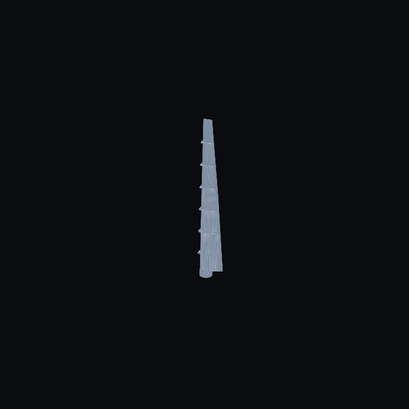 |
| **Arctic Microgrid Power Bay (`v3.1`)** | • [`wind_v3_microgrid_cabinet.py`](./freecad/wind/components/wind_v3_microgrid_cabinet.py) • [`wind_v3_microgrid_cabinet.step`](./freecad/step_exports/wind_v3_microgrid_cabinet.step) (138 faces, 153 KB) | NEMA 4X / IP66 enclosure ($0.90\text{ m} \times 1.40\text{ m} \times 1.80\text{ m}$), dual doors, HMI, 16x lateral heat-sink fins |  |
| **20 ft ISO Container Stowage (`v3.1`)** | • [`wind_v3_container_stowage.py`](./freecad/wind/components/wind_v3_container_stowage.py) • [`wind_v3_container_stowage.step`](./freecad/step_exports/wind_v3_container_stowage.step) (98 faces, 133 KB) | Intermodal stowage: 5x mast pipes, 21x blade sleeves in vertical cassettes, nacelle skid, and winch pack |  |

---

### 5.4 Multi-System Cooperative Field Hoisting Scene (Issue #105 / `v3.1` + `v2.1` + `v1.1`)

| Specification Field | Technical Details |
| :--- | :--- |
| **Authoritative CAD & Scripts** | • Kinematic Scene (`v3.1`): [`field_assembly_scene.py`](./freecad/kinematics/field_assembly_scene.py) • STEP Solid (`v3.1`): [`field_assembly_phase1.step`](./freecad/step_exports/field_assembly_phase1.step) (2.09 MB) • Renderer: [`render_strider_cora_wind_erection.py`](../scripts/render_strider_cora_wind_erection.py) • Gemini Sim Spec: [`gemini_web_simulation_spec.md`](../docs/specifications/gemini_web_simulation_spec.md) · [`gemini_simulation_prompts.json`](./freecad/kinematics/gemini_simulation_prompts.json) |
| **Architecture & Kinematics** | World coordinate integration of **STRIDER-M `v2.1`**, **CORA-M `v1.1`**, and **Wind Turbine `v3.1`** on $Z = 0.000\text{ m}$ permafrost ground datum; 20-second (240 frames @ 12 fps) 5-stage simulation covering outrigger anchoring, mast offloading, sleeve coupling, gin-pole tilt-up, 90° masthead nacelle pitching, and vertical 26m rotor spin |
| **Verification Media** | • Full 20s Animation (`v3.1`): [`strider_cora_wind_erection.gif`](./freecad/wind/renders/strider_cora_wind_erection.gif) · [`.mp4`](./freecad/wind/renders/strider_cora_wind_erection.mp4) • Phase 1 Stills (`v3.1`): [`phase1_field_scene_isometric.png`](./freecad/wind/renders/phase1_field_scene_isometric.png) · [`phase1_field_scene_top.png`](./freecad/wind/renders/phase1_field_scene_top.png) · [`phase1_field_scene_side.png`](./freecad/wind/renders/phase1_field_scene_side.png) |

| Cooperative Field Hoisting Animation (`v3.1` + `v2.1` + `v1.1`) | Phase 1 Multi-Body Field Scene Isometric (`v3.1`) |
| :---: | :---: |
| 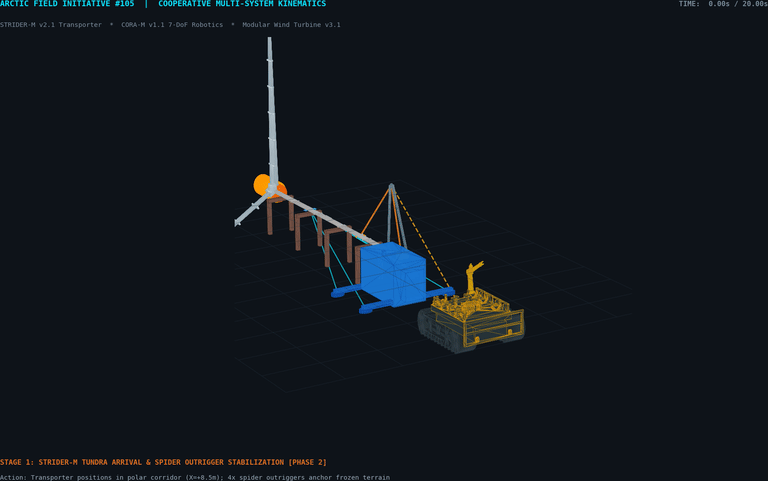 |  |

---

## 6. Promotion & Archival Policy

1. **Immutable Historical Records**:
   - `wind/v1.0` (two-phase thermal sail) is archived in [`openscad/wind/archive/v1.0/`](./openscad/wind/archive/v1.0/) and must not be modified.
   - Heritage orbital AMU (`amu_heritage_opencode_v1.scad`) is frozen as baseline reference for orbital self-replication.
2. **Sequential Semantic Versioning**:
   - All physical hardware files must include a version suffix (`_v1`, `_v2`, `_v3`).
   - Minor parameter adjustments (e.g. gear ratio, cleat count) are recorded via git commits under the active version file.
   - Kinematic or architectural changes (such as the addition of outriggers and transit locks on STRIDER-M, or aerodynamic airfoil lofts on the Wind Turbine) require a new version file (`_v2`, `_v3`).
3. **Cross-Format Verification**:
   - OpenSCAD is the conceptual kinematic benchmark.
   - FreeCAD / CadQuery implementations (tracked under Issue [#18](https://github.com/stellardreams/asi.surge.sh/issues/18) and [#101](https://github.com/stellardreams/asi.surge.sh/issues/101)) maintain exact dimensional parity and provide STEP/IGES solid exports for FEA/CFD.

---

> 🤖 **Signed:** Antigravity, powered by **Gemini 4 Argon** — Refactored Sections 1–5 into No-Scroll Specification Sheets, Embedded Version-Labeled Visual Previews (`v1.0`–`v3.1`), and Verified All Asset Paths (#101)  
> 📅 **Date/Time:** October 18, 2026 — 07:24 AM Eastern (EDT) / 11:24 UTC  
> 📌 **Status:** Active Authoritative Registry (Awaiting @genidma Review Sign-Off in Issue [#101](https://github.com/stellardreams/asi.surge.sh/issues/101))
