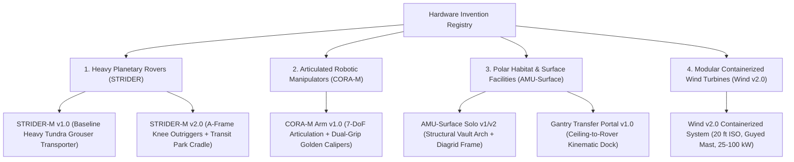

# Hardware Invention & Model Registry

> **Authoritative Specification:** Single source of truth for all mechanical, structural, and robotic hardware inventions across `asi.surge.sh`.
> **Governing Standards:** Tracked under Issue [#101](https://github.com/stellardreams/asi.surge.sh/issues/101). Direct lineage from [#81](https://github.com/stellardreams/asi.surge.sh/issues/81), [#82](https://github.com/stellardreams/asi.surge.sh/issues/82), [#97](https://github.com/stellardreams/asi.surge.sh/issues/97), [#98](https://github.com/stellardreams/asi.surge.sh/issues/98), and [#100](https://github.com/stellardreams/asi.surge.sh/issues/100).
> **Rule of Promotion:** Baseline models (e.g. `v1.0`) are permanently preserved. New geometric modifications or kinematic enhancements must be versioned iteratively as clean variants (`v2.0`, `v3.0`).

---

## 🏗️ Hardware System Taxonomy

The repository's physical systems are categorized into four core technology domains:

---

## 1. Heavy Planetary & Polar Transporters (STRIDER-M)

### System Summary
Heavy-duty, low-ground-pressure continuous crawler platform engineered for traversing Arctic permafrost, lunar regolith, or martian terrain without ground subsidence or disruption ($P_{\text{ground}} \le 25\text{ kPa}$).

| Variant | Authoritative CAD Source | Dimensions ($L \times W \times H$) | Ground Clearance | Key Subsystems & Upgrades | Derived Verification Assets |
|:---|:---|:---|:---|:---|:---|
| **STRIDER-M v1.0** | [`openscad/amu_surface/strider_m_transporter_v1.scad`](file:///vms_and_github/Github/asi.surge.sh/cad_and_blender/openscad/amu_surface/strider_m_transporter_v1.scad) | $7.2\text{ m} \times 4.6\text{ m} \times 1.75\text{ m}$ | $1.2\text{ m}$ | • Dual heavy-duty wide continuous crawler tracks ($W = 1.2\text{ m}$) • Heated battery/cryo fuel-cell reservoir • Latch collar docking station ($R = 0.55\text{ m}$, 4x cam latches) • High-visibility utility deck ($5.4\text{ m} \times 3.2\text{ m}$) | • Stills: [`strider_m_transporter_v1_iso.png`](file:///vms_and_github/Github/asi.surge.sh/cad_and_blender/openscad/amu_surface/renders/strider_m_transporter_v1_iso.png) • Transfer Still: [`amu_surface_transfer_docking_v1_rover_portal_exit.png`](file:///vms_and_github/Github/asi.surge.sh/cad_and_blender/openscad/amu_surface/renders/v1_angles/amu_surface_transfer_docking_v1_rover_portal_exit.png) |
| **STRIDER-M v2.0** | [`openscad/amu_surface/strider_m_transporter_v2.scad`](file:///vms_and_github/Github/asi.surge.sh/cad_and_blender/openscad/amu_surface/strider_m_transporter_v2.scad) | $7.6\text{ m} \times 4.8\text{ m} \times 1.78\text{ m}$ (Stowed) Width with deployed outriggers: $8.6\text{ m}$ | $1.15\text{ m}$ | • **4x A-Frame Knee-Jointed Outrigger Trusses**: High clevis fender mounts, upper box booms, silver hydraulic ram cylinders, wide articulated polar footpads with permafrost cleats (prevents tip-over under $55\text{ m/s}$ gusts) • **Deck Transit Park-Mode Latch Cradle**: Transverse U-saddle with dual motorized golden clamping jaws locking folded arm against vibration • **Front Bull-Bar Crash Cage**: Tubular exo-cage with X-brace and dual forged recovery tow-shackles • **Broadened 8-Lug Turret Dock**: $R = 0.68\text{ m}$ with dual concentric optical/power umbilical rings | • Deployed Still: [`strider_m_transporter_v2_deployed_iso.png`](file:///vms_and_github/Github/asi.surge.sh/cad_and_blender/openscad/amu_surface/renders/v2_angles/strider_m_transporter_v2_deployed_iso.png) • Recessed Still: [`strider_m_transporter_v2_recessed_iso.png`](file:///vms_and_github/Github/asi.surge.sh/cad_and_blender/openscad/amu_surface/renders/v2_angles/strider_m_transporter_v2_recessed_iso.png) • Front Elevation: [`strider_m_transporter_v2_front_view.png`](file:///vms_and_github/Github/asi.surge.sh/cad_and_blender/openscad/amu_surface/renders/v2_angles/strider_m_transporter_v2_front_view.png) • Deck Zoom: [`strider_m_transporter_v2_deck_zoom.png`](file:///vms_and_github/Github/asi.surge.sh/cad_and_blender/openscad/amu_surface/renders/v2_angles/strider_m_transporter_v2_deck_zoom.png) • Video: [`cora_transfer_render02.mp4`](file:///vms_and_github/Github/asi.surge.sh/docs/assets/macrogrid_renders/cora_transfer_render02.mp4) |

---

## 2. Articulated Robotic Manipulators (CORA-M)

### System Summary
Heavy 7-DoF robotic manipulation arm designed for autonomous dual-mode operations: overhead facility ceiling gantry traversing ($Z = 5.15\text{ m}$) and mobile field deployment aboard STRIDER-M transporter ($Z = 1.55\text{ m}$).

| Variant | Authoritative CAD Source | Reach / Scale | DoF | Key Subsystems & Gripper | Derived Verification Assets |
|:---|:---|:---|:---|:---|:---|
| **CORA-M Arm v1.0** | [`openscad/amu_surface/amu_CORA-M-arm-opencode_v1.scad`](file:///vms_and_github/Github/asi.surge.sh/cad_and_blender/openscad/amu_surface/amu_CORA-M-arm-opencode_v1.scad) | Reach: $1.20\text{ m}$ (at nominal model scale $s=0.01$; full scale $\sim 8.4\text{ m}$) | 7-DoF (Base Yaw, Shoulder Pitch, Elbow Pitch, Forearm Roll, Wrist Pitch, Wrist Yaw, Wrist Roll) | • White and deep anodized blue alloy armor casing • Dual golden symmetrical end-effector calipers with dynamic clamping gap `_APAS_caliper_gap` • High-power conductive umbilical coupling and quick-disconnect gantry trolley collar | • Caliper Macro Zoom: [`amu_surface_transfer_docking_v1_calipers_zoom.png`](file:///vms_and_github/Github/asi.surge.sh/cad_and_blender/openscad/amu_surface/renders/v1_angles/amu_surface_transfer_docking_v1_calipers_zoom.png) • Arm Animation: [`scene1_arm_exit_and_mount.gif`](file:///vms_and_github/Github/asi.surge.sh/cad_and_blender/openscad/amu_surface_playground/renders/scene1_arm_exit_and_mount.gif) • Field Turbine Install: [`scene2_cora_install_windmill.gif`](file:///vms_and_github/Github/asi.surge.sh/cad_and_blender/openscad/amu_surface_playground/renders/scene2_cora_install_windmill.gif) |

---

## 3. Polar Habitat & Surface Facilities (AMU-Surface)

### System Summary
Modular vaulted habitat architecture featuring A36 structural steel exoskeleton, perimeter thermal diagrid, environmental Air Handling Units (AHU), and automated ceiling gantry crane corridors.

| Variant | Authoritative CAD Source | Footprint / Height | Structural Envelope | Facility Infrastructure | Derived Verification Assets |
|:---|:---|:---|:---|:---|:---|
| **AMU-Surface Habitat v1.0** | [`openscad/amu_surface/amu_surface_habitat_v1.scad`](file:///vms_and_github/Github/asi.surge.sh/cad_and_blender/openscad/amu_surface/amu_surface_habitat_v1.scad) | Span: $9.0\text{ m}$, Height: $5.8\text{ m}$, Length: $12.0\text{ m}$ | Vaulted gothic/catenary structural ribs, reinforced cold-weather steel skin | • Apex heavy I-beam gantry rail at $Z = 5.15\text{ m}$ • Transporter staging airlock bay with motorized roll-up doors • High-voltage buffer bus and staging platform | • Stills: [`amu_surface_habitat_v1_iso.png`](file:///vms_and_github/Github/asi.surge.sh/cad_and_blender/openscad/amu_surface/renders/amu_surface_habitat_v1_iso.png) • Playground Suite: [`scene1_iso.png`](file:///vms_and_github/Github/asi.surge.sh/cad_and_blender/openscad/amu_surface_playground/renders/scene1_iso.png), [`scene1_top.png`](file:///vms_and_github/Github/asi.surge.sh/cad_and_blender/openscad/amu_surface_playground/renders/scene1_top.png) |
| **Ceiling-to-Rover Gantry Transfer Docking v1.0** | [`openscad/amu_surface/amu_surface_transfer_docking_v1.scad`](file:///vms_and_github/Github/asi.surge.sh/cad_and_blender/openscad/amu_surface/amu_surface_transfer_docking_v1.scad) | Kinematic envelope spanning $X: [-2.0, 11.5]\text{ m}$, $Z: [1.55, 5.15]\text{ m}$ | 4-Phase Kinematic Timeline: Rail Traverse $\to$ Vertical Descent $\to$ Caliper Latch $\to$ Rover Rollout | Autonomous mechanical mating of CORA-M arm from ceiling carriage to STRIDER-M chassis deck | • Docking Iso: [`amu_surface_transfer_docking_v1_docking_iso.png`](file:///vms_and_github/Github/asi.surge.sh/cad_and_blender/openscad/amu_surface/renders/v1_angles/amu_surface_transfer_docking_v1_docking_iso.png) • Kinematic Loop: [`amu_surface_transfer_docking_v1.gif`](file:///vms_and_github/Github/asi.surge.sh/cad_and_blender/openscad/amu_surface/amu_surface_transfer_docking_v1.gif) • High-Fidelity MP4: [`cora_transfer_render01.mp4`](file:///vms_and_github/Github/asi.surge.sh/docs/assets/macrogrid_renders/cora_transfer_render01.mp4) |

---

## 4. Modular Containerized Arctic Wind Turbines (Wind v2.0)

### System Summary
Containerized Arctic wind turbine system designed for deployment without heavy cranes in extreme polar environments ($−60\ ^\circ\text{C}$, $55\text{ m/s}$ survival gusts). Shipped as a standard 20 ft ISO sea container.

| Variant | Authoritative CAD Source | Dimensions / Capacity | Structural & Power Architecture | Erection & Foundation Mechanics | Derived Verification Assets |
|:---|:---|:---|:---|:---|:---|
| **Wind Turbine Full Assembly v2.0** | [`openscad/wind/v2.0/wind_v2_turbine_full.scad`](file:///vms_and_github/Github/asi.surge.sh/cad_and_blender/openscad/wind/v2.0/wind_v2_turbine_full.scad) | Rated: $25\text{–}100\text{ kW}$ Hub Height: $18\text{–}24\text{ m}$ Rotor Diameter: $14\text{–}20\text{ m}$ | Direct-drive permanent magnet generator with integrated passive snow-shedding nacelle | Sectional lattice/tubular mast with modular guyed gin-pole winch erection directly out of the container chassis | • Full Turbine Still: [`cad_and_blender/openscad/wind/renders/`](file:///vms_and_github/Github/asi.surge.sh/cad_and_blender/openscad/wind/renders/) • Macrogrid Array: [`scene3_macrogrid_iso.png`](file:///vms_and_github/Github/asi.surge.sh/cad_and_blender/openscad/amu_surface_playground/renders/scene3_macrogrid_iso.png) • 100-Unit Fleet: [`scene3_strider_fleet_windfarm.gif`](file:///vms_and_github/Github/asi.surge.sh/cad_and_blender/openscad/amu_surface_playground/renders/scene3_strider_fleet_windfarm.gif) |
| **Wind Container Stowage & Logistics** | [`openscad/wind/v2.0/wind_v2_container_stowage.scad`](file:///vms_and_github/Github/asi.surge.sh/cad_and_blender/openscad/wind/v2.0/wind_v2_container_stowage.scad) | Standard 20 ft ISO Container ($6.058\text{ m} \times 2.438\text{ m} \times 2.591\text{ m}$) | Internal nesting racks for 3x sectional blades, 4x mast sections, nacelle, microgrid battery cabinet, and ground anchors | Self-contained intermodal shipping with zero external crane requirements | Fully decoupled and prepared for standalone repository spin-off ([`docs/repo_extraction_manifest.md`](file:///vms_and_github/Github/asi.surge.sh/docs/repo_extraction_manifest.md)) |

---

## 5. Promotion & Archival Policy

1. **Immutable Historical Records**:
   - `wind/v1.0` (two-phase thermal sail) is archived in [`openscad/wind/archive/v1.0/`](file:///vms_and_github/Github/asi.surge.sh/cad_and_blender/openscad/wind/archive/v1.0/) and must not be modified.
2. **Sequential Semantic Versioning**:
   - All physical hardware files must include an explicit version suffix (`_v1`, `_v2`).
   - Minor parameter adjustments (e.g. gear ratio, cleat count) are recorded via git commits under the active version file.
   - Kinematic or architectural changes (such as the addition of outriggers and transit locks on STRIDER-M) require a new version file (`_v2.scad`).
3. **Cross-Format Verification**:
   - OpenSCAD is the conceptual kinematic benchmark.
   - FreeCAD / CadQuery implementations (tracked under Issue [#18](https://github.com/stellardreams/asi.surge.sh/issues/18)) will maintain exact dimensional parity and provide STEP/IGES solid exports for FEA/CFD.
