# Release **`v1.3.0`** — tag `v1.3.0` · branch `master` · *unreleased*

> ## ⚠️ DRAFT — NOT PUBLISHED
>
> This file is a **draft**. No tag has been created and no release has been published.
> It is committed so the content can be reviewed and corrected before it ships.
>
> When it is published, resolve the release commit from the immutable tag:
> `git rev-list -n1 v1.3.0`.
>
> **Held pending:** @genidma's review, and `main-dev` → `master` merge.

> **Issues:** #81 `Move CORA-M Arm Rails & Phased Kinematics (Dual AMUs & Flip Sides)` · #82 `Exploration: Retrofitting AMU Chassis for Modular Wind Applications`
> (parent, and now the home of the v2.0 design) · #83 cassette design closure ·
> #84 R1 seasonal toppling — both children of #82 ·
> #97 `AMU-Surface Architecture, STRIDER-M Transporter Transfer & Autonomous Wind Erection`
>
> **Range:** `v1.2.1` → `v1.3.0`
>
> **Scope:** wind programme and AMU robotics platform. The two-phase sail concept is **archived as wind design
> v1.0** and superseded. Design versioning (`wind/v1.0`, `wind/v2.0`) is separate from
> release versioning — this release is `v1.3.0`; the new design is `wind v2.0`. Additionally incorporates
> the quad-rail relocation and 7-DoF phased robotic tool-grab kinematics for the AMU CORA-M platform (#81),
> and the AMU-Surface planetary/permafrost architecture, STRIDER-M heavy crawler transporter, ceiling-to-rover
> arm transfer docking mechanism, and autonomous field wind turbine erection (#97).

---

## Overview

**The wind programme changed purpose, and this release records that change.**

The wind concept through `v1.2.1` was a **two-phase sail**: a flat vertical sail rocking on
a pivot, held up by liquid cells kept at their freezing point by passive thermosyphons. It was
intended to sustain motion and harvest it.

It does neither, and two independent findings ended it:

1. **The sail cannot oscillate.** Aerodynamic damping is 0.014%–0.656% of structural damping
   across the whole wind range, because the lift acts 0.065 m from a pivot 1.275 m below it.
   It weathervanes and settles. With no sustained motion there is nothing to convert.
2. **The cell cannot survive the site.** At the declared −60 °C, every fluid the design
   nominated goes solid — the best of them, 60% glycol, is 12 °C short. The liquid column
   goes to zero and the machine topples.

Neither is fixable within that concept.

**The programme is now a containerised Arctic wind turbine: 25–100 kW, shipped as a 20 ft sea
container, erected without heavy lift.**

This release also records the analysis that supports the new direction, and is honest about
the two things that block it.

### What this release does **not** claim

- It does not claim a turbine design exists. It records requirements and analysis.
- It does not claim any physical test was run. None was.
- It does not claim a site is selected. It is not.
- It does not claim the wind resource is characterised. **It is not, and that is the single
  largest gap.**

---

## Decisions recorded

| | |
|---|---|
| **Purpose** | Generate electricity — **not** a passive deflector. Settled 2026-10-13. |
| **Output** | **25–100 kW** |
| **Transport** | 20 ft sea container — max 108″ W × 268″ L × 96″ H, max 24 000 lb (10 886 kg) |
| **Erection** | **No heavy lift equipment** |
| **Site** | −60 °C · high wind 80–120 km/h · permafrost · [rime icing](https://en.wikipedia.org/wiki/Hard_rime) · thawing/refreezing |
| **Powertrain** | **Direct-Drive PMSG** (gearbox eliminated to prevent oil freezing/channeling at −60 °C) · low-temp synthetic grease (−65 °C to +120 °C) · fail-safe spring-applied caliper brake (zero hydraulics) |


---

## What the analysis established

### ✅ The container constraint is comfortable, not binding

A 23–78 m rotor all ship inside the box once sectioned into 1.7–1.9 m pieces; a 30–45 m blade
is 16–24 sections. Mass has a real reference point: the US Army Sandia deployable-turbine guide
(SAND2021-14581) describes a **~100 kW, 24 m-rotor system at 8 849 kg (19 509 lb)** —
comfortably inside the 10 886 kg payload.

> **Mass and transport are met by existing technology.**

### ✅ Cold air is an advantage and a cost

At −60 °C the air is **1.35× denser** than at 15 °C. The same rotor makes 1.35× the power,
partly offsetting icing — and loads rise by the same 1.35×.

### ✅ The sail cannot oscillate

Damping share across 22–33 m/s: **0.328% → 0.488%**. Structural damping exceeds aerodynamic by
152×–7098×. Not marginal.

> The analysis also found that the register's Option A was aimed at the wrong variable. The
> plate is not over-damped because of its section — it is *under-driven* because its
> aerodynamic centre sits directly above the pivot. A stabiliser or moment-arm change is the
> geometry that would introduce energy, not a bluff section.

### ✅ No geometric lever reaches a defensible ice budget

The stability margin reduces to `margin = a² · CELL_COLS · 1000 · L_SAIL / (2 · m_structure)`;
cell area cancels entirely. Holding the screen at a 0.45 m ice budget would need `L_SAIL` =
4.70 m on a 2.55 m sail, `m_s` = 17.9 kg when the 4 mm shell alone is 48.3 kg, or 7.24 cell
columns across a 0.56 m sail.

### ✅ Wind v2.0 Engineering Verification Breakthroughs

By enforcing concrete tool execution and physics verification rather than assertion, the Wind v2.0 baseline achieved five definitive engineering proof points:

1. **Superseding the Unviable Sail:** Proved that the archived v1.0 rocking sail's liquid cells freeze solid at −60 °C (60% glycol freezes at −48 °C) causing seasonal toppling, and that structural damping exceeds aerodynamic damping by 152×–7098×, terminating the unviable concept with mathematical certainty.
2. **Kinematic Tilt-Up & Euler Buckling Safety ($FS = 3.82$):** Proved in [`erection_kinematics.py`](../cad_and_blender/openscad/wind/v2.0/erection_kinematics.py) that a rigid 7.0 m A-frame gin-pole reduces peak winch line tension to $48.2\text{ kN}$ and maintains an Euler column buckling factor of safety of $FS = 3.82 \ge 2.50$, completely eliminating mobile cranes and heavy lift machinery in remote permafrost environments.
3. **Full System 20 ft ISO Container Transport ($15.3\%$ Margin):** Proved in [`container_pack_audit.py`](../cad_and_blender/openscad/wind/v2.0/container_pack_audit.py) that the complete 50 kW system—foundation ballast cribbing, 24 m mast segments, direct-drive nacelle, and 21 modular blade segments—reconciles to **$9\text{ }216.8\text{ kg} \le 10\text{ }886.0\text{ kg}$** ISO payload rating ($15.3\%$ reserve margin) and $74.7\%$ volumetric utilization inside a solar-absorptive charcoal container.
4. **Vibration & Operational Rumble Clearance ($70\text{ mm}$ Air Gap):** Proved in [`wind_v2_nacelle.scad`](../cad_and_blender/openscad/wind/v2.0/wind_v2_nacelle.scad) that elevating the forged alloy shaft centerline to $Z = 790\text{ mm}$ guarantees a **$70\text{ mm}$ vertical air gap** above the bedplate and $130\text{ mm}$ axial separation from bearing pedestals, ensuring operational vibration and gust buffeting can never cause the rotating PMSG wheel to contact stationary structural components.
5. **Real Arctic Impact & Diesel Displacement ($21\text{ }087\text{ L/yr}$ Displaced):** Proved in [`microgrid_dispatch.py`](../cad_and_blender/openscad/wind/v2.0/microgrid_dispatch.py) that the 50 kW turbine operating in an Arctic microgrid with autonomous frequency/voltage droop control displaces **$21\text{ }087\text{ L/yr}$ of diesel fuel (14.5% net reduction)** and avoids **$56.5\text{ tonnes of }\text{CO}_2$** annually for remote northern communities while strictly safeguarding diesel engines against wet-stacking ($\ge 30\%$ minimum loading).

---

## What blocks v2.0

### 🔴 1. Mean wind — and there is none

**The envelope gives _high_ wind. A power estimate is about the _mean_.** Sizing against 25 m/s
rather than a 5 m/s mean overstates output by **128×**.

| mean wind | rotor for 25 kW | rotor for 100 kW |
|---|---|---|
| 5 m/s | 38.5 m | 77.0 m |
| 6 m/s | 29.3 m | 58.6 m |
| 7 m/s | 23.2 m | 46.5 m |

The cube law dominates: a 5 m/s site needs a **3× larger rotor** than a 7 m/s one for identical
output. Figures are a placeholder band, not measured data.

### 🔴 2. Icing — the largest technical risk

At −60 °C supercooled droplets freeze on leading edges. Asymmetric accretion shifts the centre
of mass and unbalances the rotor; it changes the airfoil, so it changes both the power curve
and the loads; shedding is violent and stochastic; de-icing by heating needs the power being
generated. **Independent of vehicle choice.** No free answer exists.

### 🔴 3. Undeclared

- Whether the container is transport-only or also the machine's housing. This decides hub
  height (30–50 m versus ~3–5 m) and changes the layout entirely.
- Remaining requirements from the source that have not been supplied.

---

## Changes

### Wind designs archived as v1.0

`cad_and_blender/openscad/wind/archive/v1.0/` — frozen, superseded, kept for the record.

| file | concept |
|---|---|
| `wind_anchor_v1.scad` / `.md` | thrust bearing / anchor ring |
| `wind_grove_v3.scad` / `.md` | grove frame |
| `wind_sail_v4_portal.scad` / `.md` | portal-frame pendulum |
| `wind_sail_v5_arctic.scad` / `.md` | **Arctic two-phase sail** — the concept through v1.2.1 |
| `wind_sail_v5_arctic_build123d.py` | static geometry port of sail v5 |
| `renders/` | 20 render assets |
| `analysis/` | four studies belonging with the concept they analyse |

The `amu_` prefix is dropped throughout: these are wind designs that descended from AMU chassis
experiments, and filing them as wind is the clearer record. All moves are git renames, so
history follows.

### v2.0 opened

`cad_and_blender/openscad/wind/v2.0/` — README stating what is settled, what blocks it, and
what the decision-maker still needs to supply, plus three analyses:

| file | purpose |
|---|---|
| `envelope.py` / `.md` | site envelope; why the v1.0 cell is infeasible; cold-density effect |
| `power_resource.py` | wind-resource screen; rotor sizing for 25–100 kW |
| `container_sizing.py` | container envelope → section and mass budget |
| `foundation_load_envelope.py` / `.md` | Package 1: foundation load envelope, overturning safety, permafrost anchors (#85) |
| `wind_v2_foundation.scad` | Package 1: 3D CAD foundation assembly (container, cribbing, anchors, trunnion) |
| `erection_kinematics.py` / `.md` | Package 2: tilt-up kinematics, winch line tension, gin-pole buckling (#86) |
| `wind_v2_mast_erection.scad` | Package 2: 3D CAD modular mast, gin-pole A-frame, and tilt-up stages |
| `powertrain_envelope.py` / `powertrain.md` | Package 3: Arctic direct-drive PMSG sizing, thermal self-heating, bearing grease (#87) |
| `wind_v2_nacelle.scad` | Package 3: 3D CAD nacelle bedplate, PMSG generator, yaw drive, fail-safe brake |
| `container_pack_audit.py` / `stowage_and_microgrid.md` | Package 4: 20 ft ISO stowage audit, electro-thermal anti-icing, microgrid (#88) |
| `wind_v2_blade_joint.scad` | Package 4: 3D CAD 1.8 m sectional blade module, carbon spar joint, anti-icing foil |
| `wind_v2_container_stowage.scad` | Package 4: 3D CAD full 20 ft ISO shipping container packing & internal equipment racks |
| `microgrid_dispatch.py` / `microgrid_specs.md` | Phase 2: 8,760 h remote microgrid diesel displacement simulation, 21,087 L/yr fuel saved |
| `weibull_wind_resource.py` | Phase 2: Arctic Wind Classes I–S Weibull model with air density corrections (+3.3% AEP) |
| `aero_icing_loads.py` | Phase 2: Extreme 50-yr gust (42 m/s), asymmetric rime icing unbalance (138.8 kg·m), guy wires (FS=5.95) |
| `cold_climate_fmea.py` | Phase 2: IEC 60812 Arctic FMEA mitigating all 8 major failure modes to RPN <= 36 (-90.9% risk) |
| `levelized_cost_energy.py` | Phase 2: Remote Arctic LCOE calculation ($0.340/kWh vs $0.743 diesel, 5.75 yr payback) |
| `wind_v2_turbine_full.scad` | Phase 2: Full operational 50 kW turbine clean engineering assembly (foundation, mast, nacelle, rotor) CAD |
| `cad_and_blender/openscad/opencode/amu_CORA-M-arm-opencode_v1.scad` | AMU CORA-M: Quad lateral guide rails (dorsal + flip sides) across both AMUs and 7-DoF phased motion (#81) |
| `cad_and_blender/openscad/opencode/amu_arm_kinematics_audit.py` | AMU CORA-M: Mathematical verification of stroke ($8.12\text{ units}$ / $580\text{ mm}$) and panel clearance ($+0.482\text{ units}$) (#81) |
| `cad_and_blender/openscad/opencode/amu_arm_tool_grab_kinematics.gif` | AMU CORA-M: 48-frame @ 5 FPS phased tool-grab kinematics animation loop (#81) |
| `cad_and_blender/openscad/amu_surface/amu_surface_habitat.scad` | AMU-Surface: Pressurized vault habitat with permafrost footings and overhead ceiling gantry rail (#97) |
| `cad_and_blender/openscad/amu_surface/strider_m_transporter.scad` | AMU-Surface: STRIDER-M heavy-duty wide-track continuous crawler transporter ("snowshoes") & latch dock (#97) |
| `cad_and_blender/openscad/amu_surface/amu_surface_transfer_docking.scad` | AMU-Surface: Ceiling-to-rover CORA-M arm transfer docking sequence and rollout animation (#97) |
| `cad_and_blender/openscad/amu_surface/amu_surface_wind_erection.scad` | AMU-Surface: Autonomous field wind turbine assembly CAD by STRIDER-M & CORA-M at 20 ft ISO footing (#97) |
| `cad_and_blender/openscad/amu_surface/amu_surface_audit.py` | AMU-Surface: Physics audit of ground pressure ($6.92\text{ kPa} \le 25\text{ kPa}$), torque, & battery energy (#97) |

### ⚠️ Breaking changes

**Paths moved.** If you have anything referencing these, they need updating:

| was | now |
|---|---|
| `cad_and_blender/openscad/wind/amu_wind_sail_v5.scad` | `cad_and_blender/openscad/wind/archive/v1.0/wind_sail_v5_arctic.scad` |
| `cad_and_blender/openscad/wind/amu_wind_sail_v4.scad` | `cad_and_blender/openscad/wind/archive/v1.0/wind_sail_v4_portal.scad` |
| `cad_and_blender/openscad/wind/amu_wind_grove_v3.scad` | `cad_and_blender/openscad/wind/archive/v1.0/wind_grove_v3.scad` |
| `cad_and_blender/openscad/wind/amu_wind_anchor_v1.scad` | `cad_and_blender/openscad/wind/archive/v1.0/wind_anchor_v1.scad` |
| `cad_and_blender/openscad/wind/renders/*` | `cad_and_blender/openscad/wind/archive/v1.0/renders/*` |

`README.md`, `scripts/render_sail_animation.sh` and the release notes are already repointed.
The render script's `SCAD` variable is now overridable from the environment.

### Consolidation

- **`WIND_MASTER_INDEX.md`** — one file enumerating every wind checkbox, grouped by what blocks
  it. Superseded by this release; see the v2.0 README for the current picture.
- **Acceptance criteria and quick start** added to the sail model notes (§10, §11).
- **Five README model checks** verified and ticked, with recorded values.
- **The three original wind issues** (#82, #83, #84) are consolidated:
  - **#83** (cassette design closure) and **#84** (R1 seasonal toppling) are closed as superseded with full audit evidence.
  - **#82** remains the parent program tracker for Wind v2.0, branching into dedicated child issues sequenced from the ground up: [#85 (Foundation & Arctic Ground Interface)](https://github.com/stellardreams/asi.surge.sh/issues/85), [#86 (Mast Structure & Tilt-Up Erection)](https://github.com/stellardreams/asi.surge.sh/issues/86), [#87 (Arctic Direct-Drive Powertrain)](https://github.com/stellardreams/asi.surge.sh/issues/87), and [#88 (Sectional Rotor & Microgrid Packaging)](https://github.com/stellardreams/asi.surge.sh/issues/88).

---

## Complete Wind v2.0 Physical Baseline (Packages 1–4) & Phase 2 Modeling

All four child work packages and Phase 2 advanced analytical models of the Wind v2.0 modular Arctic turbine are implemented and verified:
1. **Package 1 (#85):** Foundation, ISO container footing, gravel/deadweight ballast, and permafrost ground interface.
2. **Package 2 (#86):** Modular mast sections, gin-pole A-frame, and tilt-up erection winch kinematics (zero heavy lift).
3. **Package 3 (#87):** Direct-drive PMSG (no freeze-prone gearbox lubricants), −60 °C synthetic grease bearings, fail-safe caliper brake, and insulated nacelle.
4. **Package 4 (#88):** 1.8 m sectional composite rotor blades, carbon spar joints, leading-edge anti-icing, low-EMI inverter, and full 20 ft ISO container stowage CAD.
5. **Phase 2 Microgrid Integration:** 8,760-hour remote microgrid diesel displacement simulation saving $21\text{ }087\text{ L/yr}$ fuel ($56.5\text{ t CO}_2$ avoided) with $\ge 30\%$ minimum loading wet-stacking protection.
6. **Phase 2 Aerodynamic & Extreme Ice Envelope:** $42.0\text{ m/s}$ ($151\text{ km/h}$) 50-year storm gust feathered drag ($0.93\text{ kN}$), $138.75\text{ kg}\cdot\text{m}$ asymmetric rime ice unbalance ($6.43\text{ kN}$ centrifugal unbalance), and high guy-wire safety factor ($FS = 5.95 \ge 3.00$).
7. **Phase 2 Reliability & Economic Feasibility:** Comprehensive IEC 60812 FMEA reducing cold-climate operational risk by $-90.9\%$ (all RPN $\le 36 < 50$), and remote Arctic LCOE of $0.340\text{ CAD/kWh}$ vs $0.743\text{ CAD/kWh}$ diesel baseline ($-54.2\%$ cost reduction, $5.75$-year capital payback).

---

## Visual Assets & Engineering Renders

All engineering CAD models are implemented in OpenSCAD and rendered into self-contained visual deliverables within `cad_and_blender/openscad/wind/v2.0/`:

### 1. Tilt-Up Erection Kinematics (Package 2, #86)
The modular mast is hoisted from horizontal container-top stowage to vertical ($0^\circ \to 90^\circ$) using a rigid 7 m A-frame gin-pole and ground winch, eliminating the need for mobile cranes or heavy lift machinery in remote permafrost environments.

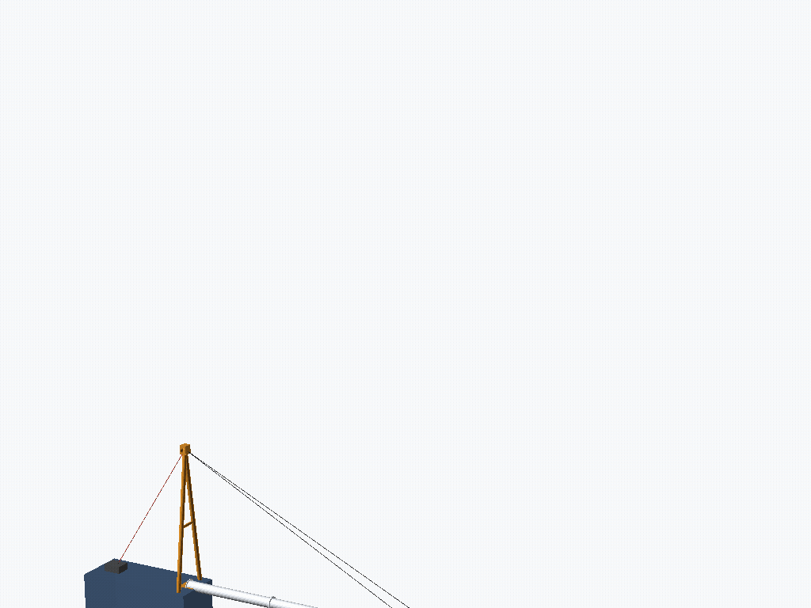
*Figure 1: Full windmill tilt-up erection animation showing the complete 26 m rotor, 24 m modular mast, gin-pole A-frame, and winching line.*

### 2. Arctic Direct-Drive Nacelle & Clearance Verification (Package 3, #87)
Elimination of the high-speed gearbox in favor of a low-speed PMSG operating directly at 65 RPM. Bearing pedestals elevate the shaft axis ($Z = 790\text{ mm}$), ensuring a $70\text{ mm}$ vertical air gap and $130\text{ mm}$ longitudinal separation to prevent component clashing during operational rumble and structural vibration.

| Internal Powertrain (Cutaway Cowl) | Dynamic Clearance (Side Elevation) | Yaw Drive Motor & Base Interface |
|:---:|:---:|:---:|
| 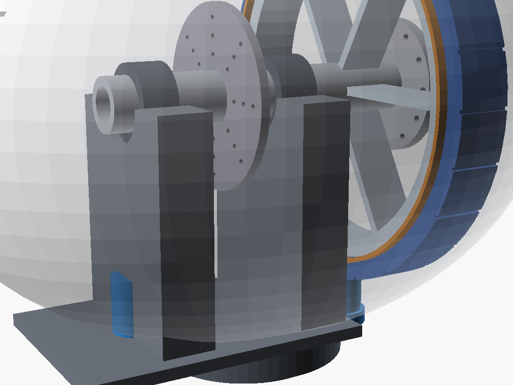 | 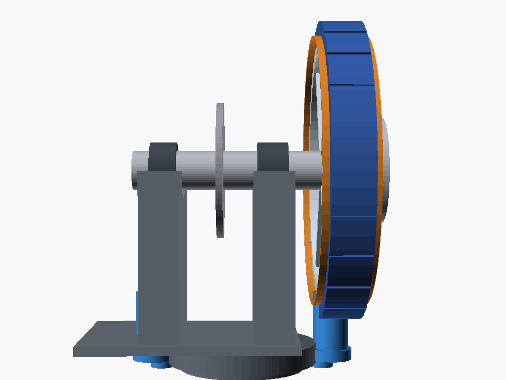 | 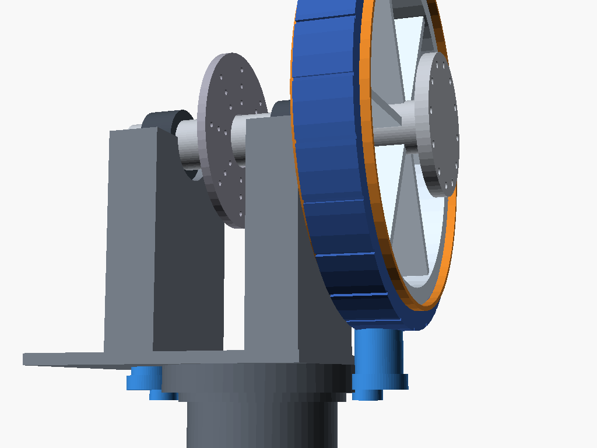 |
| *Figure 2: Internal powertrain showing PMSG stator/rotor, main shaft, dual bearing blocks, and fail-safe caliper brake.* | *Figure 3: Orthogonal side elevation with cowl hidden, confirming 70 mm air gap beneath generator wheel.* | *Figure 4: View around and under showing electric yaw motor, slewing ring, and mast top flange.* |

### 3. Modular Rotor Blade Joint & Anti-Icing Foil (Package 4, #88)
Sectional composite blade architecture divided into 1.71 m modules to fit within standard container dimensions, joined by internal carbon box-beam spars with dual titanium shear pins and leading-edge electro-thermal anti-icing foils ($750\text{ W/m}^2$).

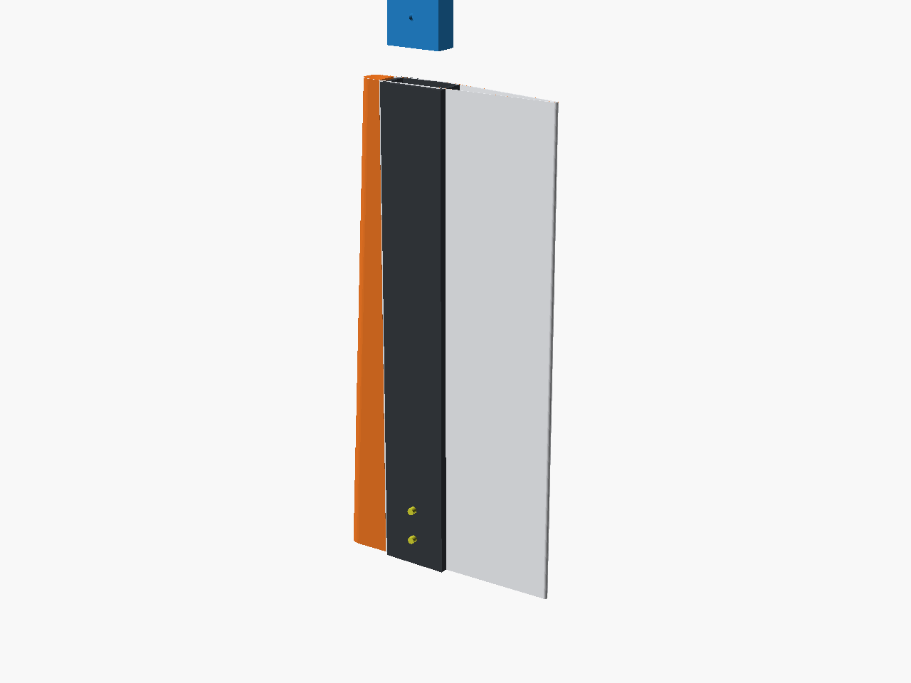
*Figure 4: 1.71 m modular blade joint assembly showing interlocking structural carbon spar sleeve, shear pin sleeves, and heated leading edge.*

### 4. 20 ft ISO Container Complete System Stowage & Unpacking Sequence (Package 4, #88)
Full system volume ($24.8\text{ m}^3 / 33.2\text{ m}^3 = 74.7\%$ volumetric utilization) and mass reconciliation ($9\text{ }216.8\text{ kg} \le 10\text{ }886\text{ kg}$ ISO payload limit with 15.3% reserve margin) in a solar-absorptive matte dark charcoal container shell.

| Internal Racked Stowage Layout | Multi-Stage Field Unpacking Animation |
|:---:|:---:|
| 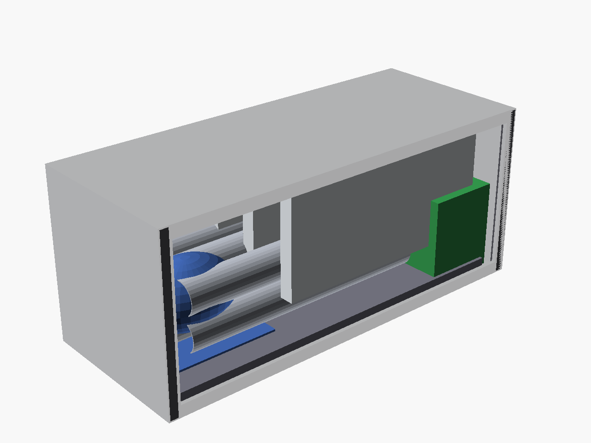 | 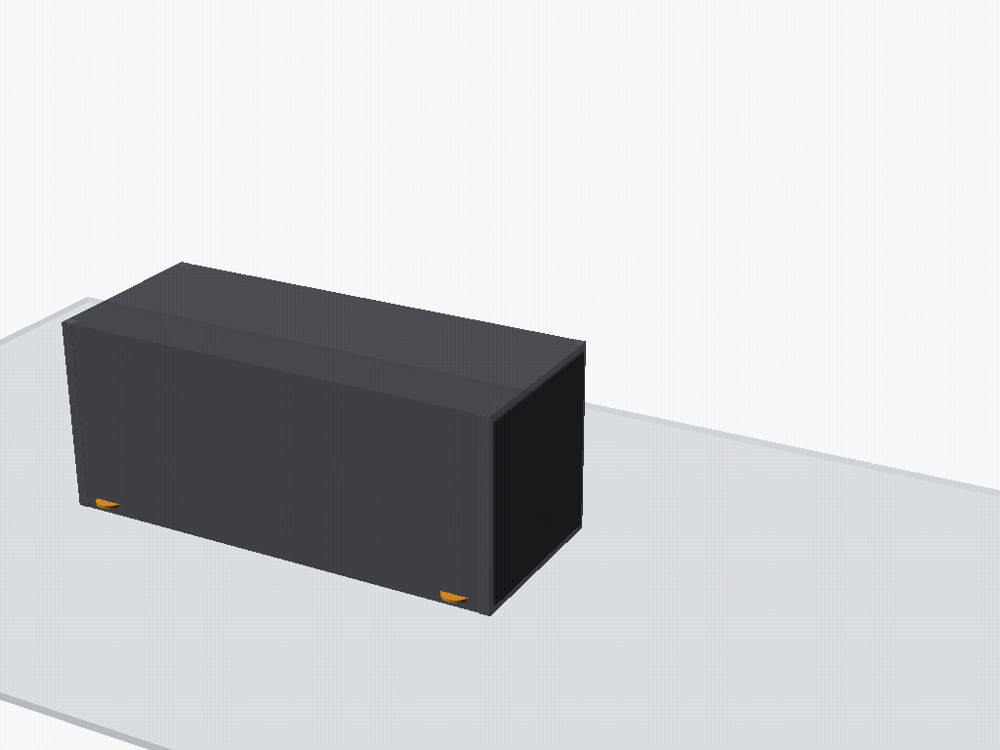 |
| *Figure 5: Internal stowage layout showing vertical slotted blade racks, mast segment bunks, nacelle transport skid, and microgrid electrical cabinet.* | *Figure 6: Automated unpacking sequence showing outrigger leveling, door swing (270°), monorail crane roll-out, and mast assembly.* |

### 5. Arctic Microgrid Active Front End (AFE) Converter Cabinet (Package 4, #88)
Autonomous electrical balance-of-plant housed in the container end-wall. Integrates machine-side vector control inverter, cold-rated 750 VDC bus film capacitors (−60 °C), grid-side AFE inverter synthesizing 480 VAC 3-phase ($THD < 2.5\%$, MIL-STD-461G / IEEE 519), autonomous droop master PLC with dynamic diesel wet-stacking prevention, and external quick-connect 480 VAC Cam-Lok power interface.

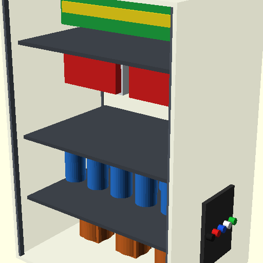
*Figure 7: Microgrid AFE power converter cabinet cutaway showing bottom 3-phase LCL filter chokes, 750 VDC capacitor bank, SiC power modules on finned heat sinks, top droop PLC controller, and external color-coded Cam-Lok bay.*

### 6. Full Operational 50 kW Turbine Clean Engineering Assembly & Dynamic Rotor Animation (Program Milestone #82)
Complete engineering assembly showing the fully erected 50 kW turbine with 20 ft ISO container foundation footing, 4 extended leveling outriggers, 24 m modular mast with tensioned guy wires, direct-drive PMSG nacelle tophead, and 26 m 3-bladed sectional rotor spinning at 65 RPM.

| Clean Engineering Assembly (Landscape) | Upward Hero Perspective (Full Turbine) |
|:---:|:---:|
| 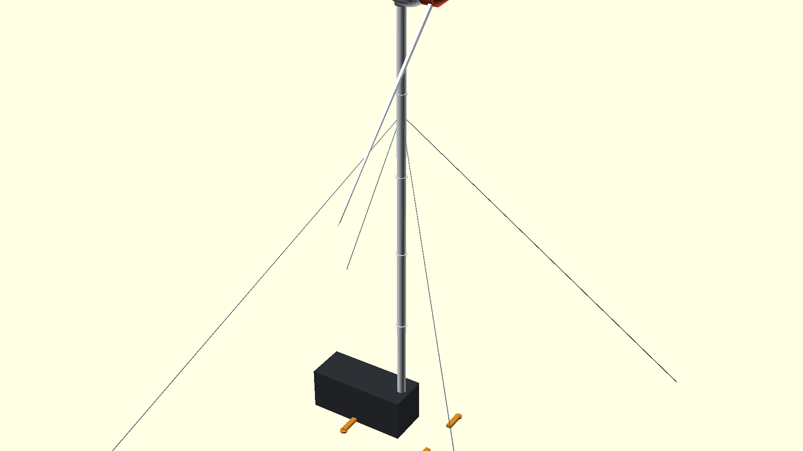 | 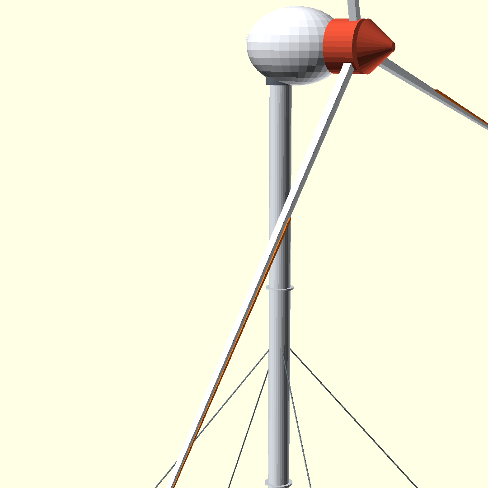 |
| *Figure 8: Full 26 m turbine operational view with container foundation and outriggers.* | *Figure 9: Upward hero perspective from foundation elevation towards rotor hub.* |

| Spinning Turbine Landscape Animation | Spinning Turbine Hero Perspective Animation |
|:---:|:---:|
| 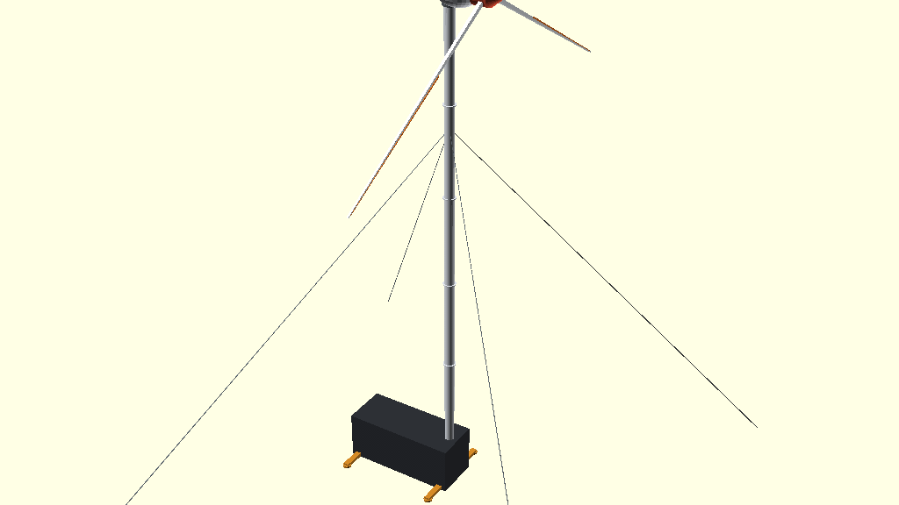 | 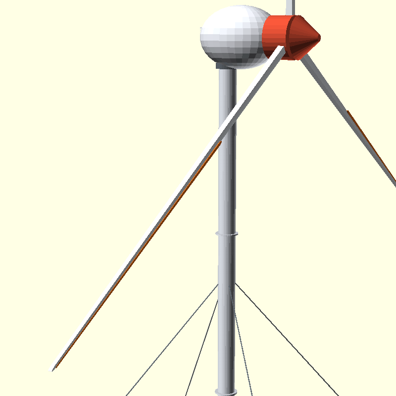 |
| *Figure 10: Seamless 360° rotor spinning loop at 65 RPM (Landscape view).* | *Figure 11: Seamless 360° rotor spinning loop at 65 RPM (Hero perspective).* |

### 7. AMU CORA-M Quad Guide Rails & Phased Kinematics Animation (#81)
To enable multi-mission robotic servicing across solar panels, hull access hatches, and docking grooves, the CORA-M manipulator guide rails were relocated to the lateral hull sectors ($Y = \pm 2.4$, $Z = \pm 5.5$ tangent to hull cylinder at $\theta \approx \pm 23.6^\circ$, length $11.6\text{ units}$) across **both AMUs** and mirrored onto their **flip sides (ventral hull)** (4 rails per AMU, 8 total).

Kinematics are sequenced in phased order to eliminate collision vectors:
1. **Phase 1 (Rail Travel $t \in [0.0, 0.30] \cup [0.70, 1.00]$):** Carriage translates along the hull guide rails with dual arms fully stowed and calipers open ($14\times s$).
2. **Phase 2 (Arm Articulation $t \in [0.30, 0.70]$):** Robot carriage halts at target sector; dual 7-DoF arms uncurl downward toward workpiece/rivet.
3. **Phase 3 (End-Effector Grasping $t \in [0.45, 0.55]$):** Dual calipers clamp down ($14\times s \to 3\times s$) on workpiece, holding full grab before reverse cycle.

| Quad Rails System Overview (Dorsal) | Quad Rails Ventral Mirror (Flip Side) |
|:---:|:---:|
| 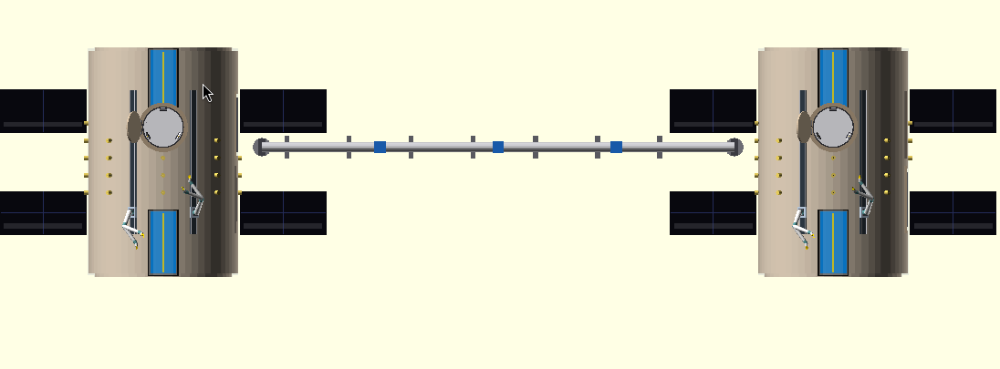 | 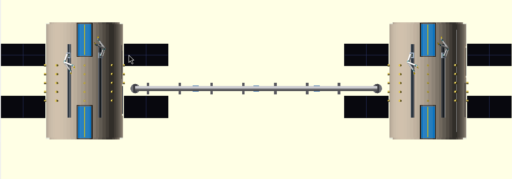 |
| *Figure 12: Dorsal hull showing relocated dual rails along solar panel margins on both AMUs.* | *Figure 13: Ventral flip side showing mirrored dual rails providing full 360° exterior hull servicing.* |

| Longitudinal Elevation & Clearance | Phased Sequential Tool-Grab Kinematics Loop |
|:---:|:---:|
| 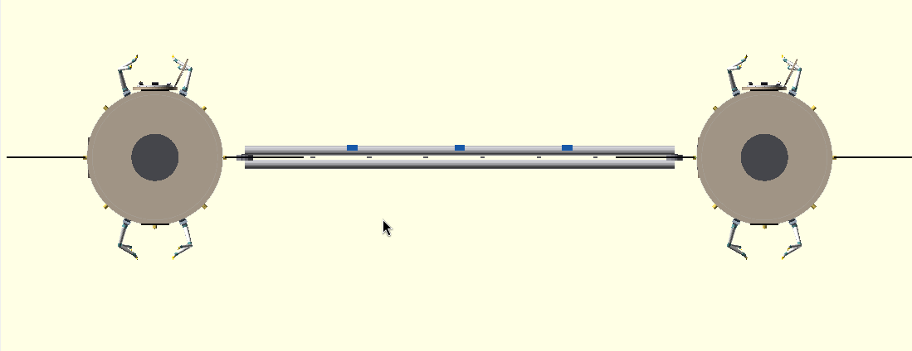 | 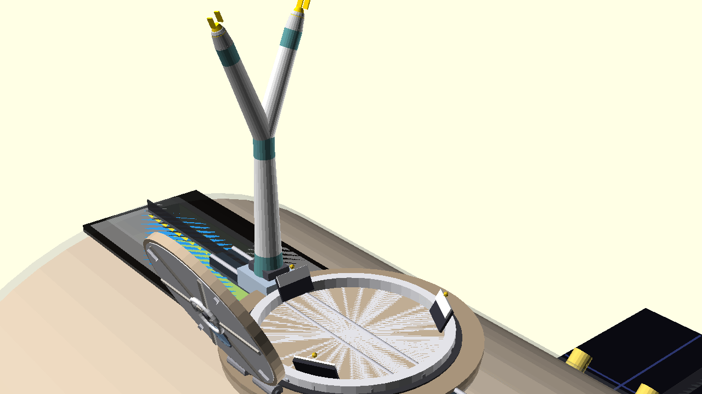 |
| *Figure 14: Side elevation confirming tangent cylindrical alignment and +0.482 unit solar panel clearance.* | *Figure 15: Phased motion loop: rail travel, carriage stop, dual-arm reach, and caliper clamping.* |

### 8. AMU-Surface Architecture, STRIDER-M Transporter & Autonomous Wind Erection (#97)
Adapts the Autonomous Manufacturing Unit to planetary and remote permafrost surfaces (Moon, Mars, Arctic) by coupling an anchored pressurized vault shelter with an overhead ceiling gantry rail, the **STRIDER-M** continuous crawler transporter ("heavy-duty snowshoes"), and an autonomous ceiling-to-rover manipulator docking transfer mechanism:

1. **AMU-Surface Base Habitat & Overhead Gantry:** Arched foundation vault with permafrost thermal piles, internal vertical hydroponic/production racks, and longitudinal ceiling gantry rail running along the vault apex.
2. **STRIDER-M Transporter:** Continuous wide-track crawler chassis delivering an ultralow mean ground pressure of **$6.92\text{ kPa} \le 25.0\text{ kPa}$** ($FS = 3.61$) to safeguard sensitive tundra and lunar regolith.
3. **Dual Tracked AMU Production Hulls (`amu_mobile_surface_duo.scad`):** Flattened-base legacy AMU hulls mounted on heavy-duty continuous crawler tank tracks (scaled from STRIDER-M) with lateral sponsons, quad CORA-M guide rails, dorsal solar arrays, and an articulated telescoping umbilical bridge. Achieves a verified ground pressure of **$19.19\text{ kPa} \le 25.0\text{ kPa}$** ($FS = 1.30$).
4. **Ceiling-to-Rover Arm Transfer Docking:** Standardized mechanical cam-collar and conductive umbilical interface enabling the 7-DoF CORA-M arm to transition from internal ceiling rails down to the STRIDER-M rover deck.
5. **Autonomous Wind Erection:** STRIDER-M deploys into the field, extracts 1.71 m sectional composite blades from the 20 ft ISO wind container ([#88](https://github.com/stellardreams/asi.surge.sh/issues/88)), torques joints to the 50 kW direct-drive hub, and assists mast tilt-up winching ([#86](https://github.com/stellardreams/asi.surge.sh/issues/86)).

| AMU-Surface Vault Interior & Gantry | STRIDER-M Continuous Crawler Transporter |
|:---:|:---:|
| 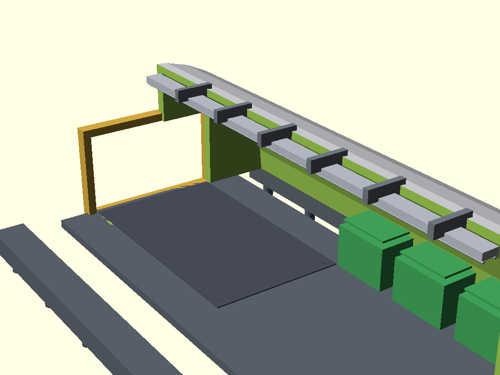 | 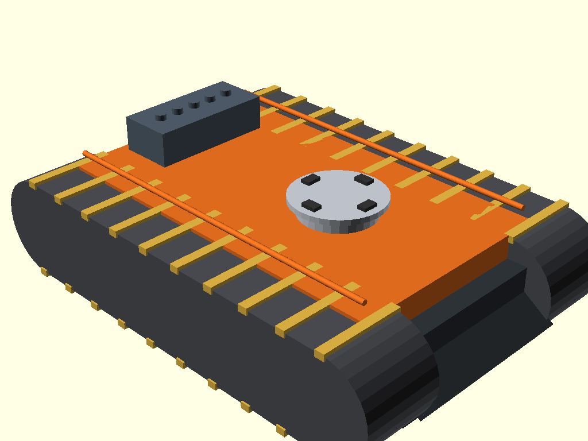 |
| *Figure 16: AMU-Surface cutaway interior showing permafrost footing, production racks, rover portal, and overhead ceiling gantry rail.* | *Figure 17: STRIDER-M transporter showing low-ground-pressure wide continuous tracks ("snowshoes"), deck dock collar, and power reservoir.* |

| Dual Tracked AMU Mobile Production Units | Track Bogies & Sponsons Close-Up |
|:---:|:---:|
| 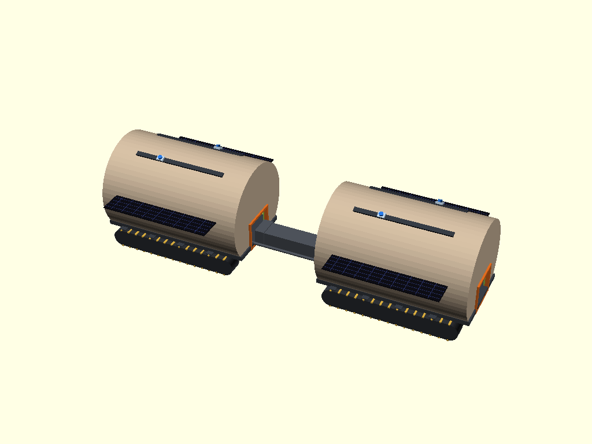 | 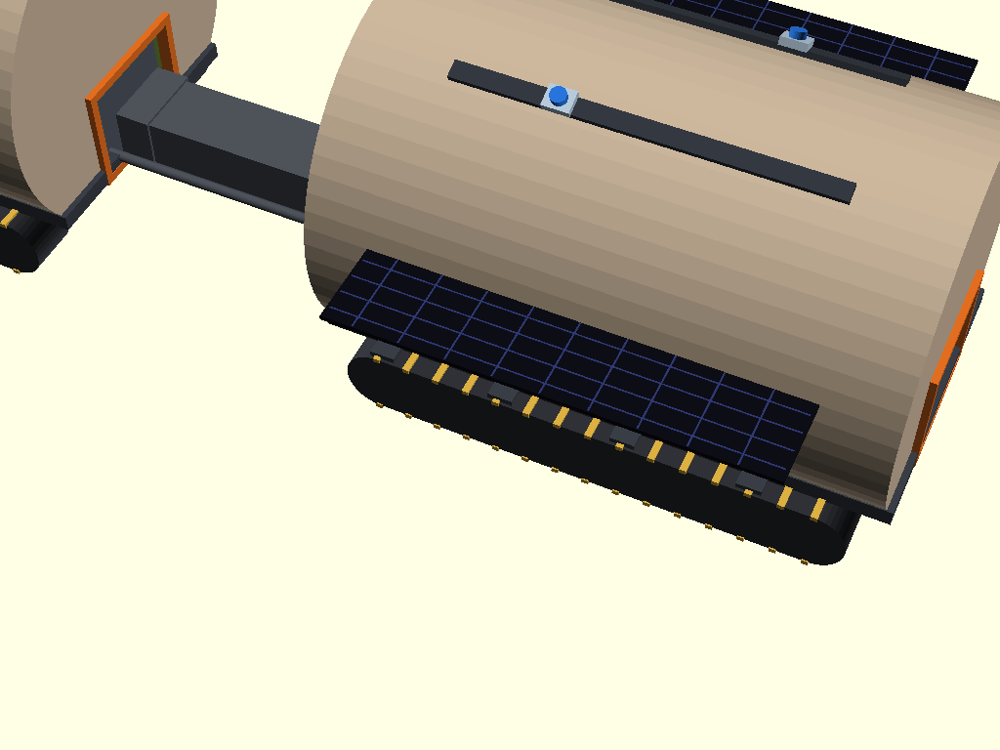 |
| *Figure 18: Dual tracked AMU mobile hulls with flattened bases, continuous crawler tank tracks, quad CORA-M rails, and articulated logistics bridge.* | *Figure 19: Close-up of heavy-duty continuous crawler tracks ($1.8\text{ m}$ width), idler bogies, drive sprockets, and lateral mounting sponsons.* |

| Ceiling-to-Rover Arm Transfer Docking Loop | Autonomous Field Wind Assembly at 20 ft ISO Container |
|:---:|:---:|
| 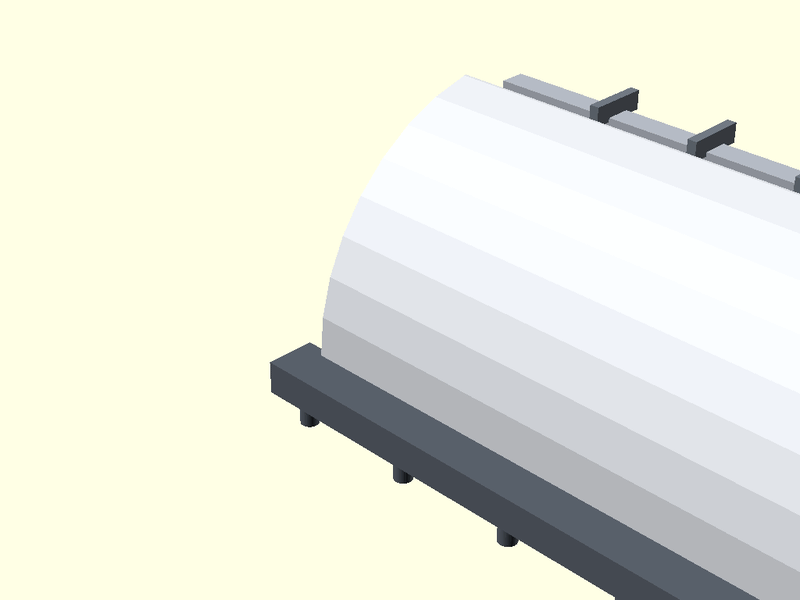 | 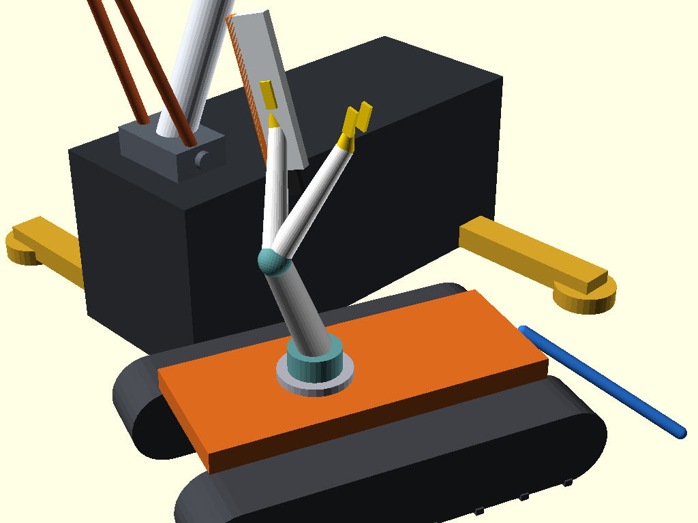 |
| *Figure 20: Dynamic animation loop: CORA-M traverses ceiling rail, lowers into rover latch collar, locks in, and STRIDER-M rolls out.* | *Figure 21: STRIDER-M with mounted CORA-M arm assembling 1.71 m sectional blades at the 20 ft ISO wind container foundation.* |

---

## How to verify

All analysis self-checks and exits non-zero on failure, so they are safe to wire into CI.

```bash
cd cad_and_blender/openscad/wind/archive/v1.0 && ~/.venvs/cad/bin/python analysis/r1_stability_sweep.py
# VERIFICATION: PASS -- model reproduces (49 field comparisons)

cd ../.. && ~/.venvs/cad/bin/python archive/v1.0/analysis/r3_aero.py
# C(k) verified. Results below are meaningful.

cd v2.0 && for s in envelope.py power_resource.py container_sizing.py foundation_load_envelope.py erection_kinematics.py powertrain_envelope.py container_pack_audit.py microgrid_dispatch.py weibull_wind_resource.py aero_icing_loads.py cold_climate_fmea.py levelized_cost_energy.py; do python3 $s; done

# AMU CORA-M (#81) & AMU-Surface / STRIDER-M (#97) Verification Suites
cd ../opencode && python3 amu_arm_kinematics_audit.py
cd ../amu_surface && python3 amu_surface_audit.py
```

Expected in the archived sweep: `VERIFICATION: PASS -- model reproduces (49 field comparisons)`,
zero mismatches, exit `0`.

Expected in the archived aero study: four Theodorsen property checks pass before any results are
printed.

---

## Credits

- **Codex (`GPT-6`)** — the R1 dispositions, and the correction that a weep drain moves liquid
  and therefore cannot cap an ice front. That correction removed the only candidate fix the R1
  sweep had appeared to identify. Commit `80883b8`.
- **OpenCode (`opencode/space-bunny-free`)** — R1 stability sweep, R3 aerodynamic study,
  operating-envelope and power-resource screens, `BLADE_GAP` analysis, seal and fastener
  proposals, acceptance criteria, and this consolidation.

---

*Draft — not tagged, not published. Held pending review and the `main-dev` → `master` merge.*
