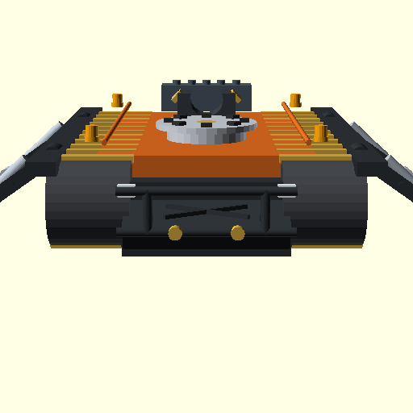
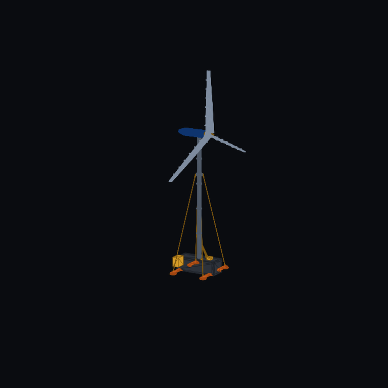

# Release Draft **`v1.3.1`** — branch `main-dev` · [DRAFT IN PROGRESS]

> **Status:** Under active development on `main-dev`. Not yet released or tagged.
>
> **Issues Tracked:**
> - [Issue #98](https://github.com/stellardreams/asi.surge.sh/issues/98): `AMU-Surface, CORA-M & STRIDER Polar Macrogrid Media Gallery & Cinematic Renders`
> - [Issue #100](https://github.com/stellardreams/asi.surge.sh/issues/100): `STRIDER-M v2 Transporter CAD & Kinematic Parametric Latch Assembly` (Child of [#98](https://github.com/stellardreams/asi.surge.sh/issues/98))
> - [Issue #101](https://github.com/stellardreams/asi.surge.sh/issues/101): `Hardware Invention & Model Registry (Authoritative CAD, Versions, Envelopes & Transition to FreeCAD)` (Child of [#82](https://github.com/stellardreams/asi.surge.sh/issues/82) & [#18](https://github.com/stellardreams/asi.surge.sh/issues/18))
> - [Issue #102](https://github.com/stellardreams/asi.surge.sh/issues/102): `Redo Website Portfolio & Technical Showcase with v1.3.0/v1.3.1 Proposed Hardware Designs` (Child of [#101](https://github.com/stellardreams/asi.surge.sh/issues/101))
> - [Issue #18](https://github.com/stellardreams/asi.surge.sh/issues/18): `low priority: give FreeCAD another shot` (Headless Verification & Parametric Transition)
> - [Issue #82](https://github.com/stellardreams/asi.surge.sh/issues/82): `Exploration: Retrofitting AMU Chassis for Modular Wind Applications` (Recursive Engineering Enhancements)
> - [Issue #96](https://github.com/stellardreams/asi.surge.sh/issues/96): `Standalone Repository Setup & CI Automation: Modular Arctic Wind Turbine (spin-off candidate)`
> - [Issue #104](https://github.com/stellardreams/asi.surge.sh/issues/104): `Modular Arctic Wind Turbine v3.0 FreeCAD Refinements & Rigging (TASK-03A)` (Child of [#82](https://github.com/stellardreams/asi.surge.sh/issues/82))
>
> **Range:** `v1.3.0` → `v1.3.1`

---

## 💡 Engineering Philosophy: Simple Innovation & Extreme Resourcefulness

> ### 💬 Ernest Rutherford Maxim
> *“We haven't got the money, so we've got to think.”*  
> — **Ernest Rutherford**, Nobel Prize-winning physicist *(courtesy of Google.com AI-powered search)*

This maxim encapsulates the core engineering ethos of the `v1.3.1` release:

- **Scarcity is the ultimate catalyst:** It flips the script on physical and operational limitations. When remote polar environments preclude the deployment of 100-ton hydraulic construction cranes, dedicated foundation piling barges, or massive capital equipment budgets, engineering necessity compels the creation of clever, streamlined architectural shortcuts. Rather than relying on heavy external infrastructure, our systems self-contain their entire lifecycle—from the crane-less container A-frame gin-pole winch and segmented $\le 1.90\text{ m}$ NACA airfoil sleeves, to STRIDER-M's integrated on-deck mast retention saddles and permafrost biting outriggers.
- **Intellect over resources:** The most durable, elegant engineering solutions are forged not in resource-saturated suites, but out of austere necessity and relentless design discipline. By treating strict physical constraints (such as the standard 20 ft ISO intermodal footprint, −60 °C structural metallurgy, and single-operator field assembly) as foundational design catalysts rather than hindrances, `v1.3.1` delivers resilient, autonomous infrastructure that achieves superior performance through smarter thinking.

---

## Work Package Tracking

### 1. [Issue #98](https://github.com/stellardreams/asi.surge.sh/issues/98) — High-Fidelity Media Gallery & Cinematic Motion Renders
- Visual Reference Asset Pack compilation for Gemini Flash-Lite high-coherence video generation:
  - Ceiling-to-Rover Gantry Transfer sequence (Apex traverse $\to$ Portal descent $\to$ Caliper lock $\to$ Polar rollout).
  - Multi-angle CAD reference stills (Isometric, Zoom, Close-up, Top).
- Production and repository tracking of Gemini Flash-Lite cinematic MP4 video renders in [`docs/assets/macrogrid_renders/`](../assets/macrogrid_renders/):

  [cora_transfer_render01.mp4](https://github.com/stellardreams/asi.surge.sh/blob/main-dev/docs/assets/macrogrid_renders/cora_transfer_render01.mp4) (4.0 MB) — Initial gantry ceiling-to-rover alignment and descent.

  <video src="https://github.com/user-attachments/assets/41f27734-6989-4353-a792-06c8eeb92043" controls="controls" width="100%" height="auto"></video>

  [cora_transfer_render02.mp4](https://github.com/stellardreams/asi.surge.sh/blob/main-dev/docs/assets/macrogrid_renders/cora_transfer_render02.mp4) (3.9 MB) — Refined flip-and-clamp arm mating, broader mounting rim, chassis outriggers, and transit park-mode lock during polar blizzard rollout.

  <video src="https://github.com/user-attachments/assets/84c5f39e-7e31-430c-9078-23ad5f38937d" controls="controls" width="100%" height="auto"></video>

- Polar Macrogrid conceptual stills (Superhub, Vault Station entrance, Quad Hub microgrid) published in `v1.3.0` release notes.
- [Issue #98](https://github.com/stellardreams/asi.surge.sh/issues/98) signed off with zero open items and closed.

### 2. [Issue #100](https://github.com/stellardreams/asi.surge.sh/issues/100) — STRIDER-M v2 Transporter CAD & Kinematic Parametric Latch Assembly
- Implemented `cad_and_blender/openscad/amu_surface/strider_m_transporter_v2.scad`:
  - Heavy knee-jointed A-frame outrigger trusses ("Spider Outriggers") with high clevis mounts, upper box boom, inverted hydraulic cylinders, and wide rectangular polar footpad shoes with permafrost biting cleats.
  - Front tubular bull-bar crash cage with X-brace and dual forged recovery shackles.
  - Transit park-mode U-saddle cradle with dual motorized clamping jaws to secure the folded 7-DoF CORA-M arm.
  - Broadened 8-lug mounting turret rim (`DOCK_COLLAR_R = 0.68`).
- Generated and tracked verification stills: `strider_m_transporter_v2_deployed_iso.png`, `strider_m_transporter_v2_recessed_iso.png`, `strider_m_transporter_v2_front_view.png`, and `strider_m_transporter_v2_deck_zoom.png`.

#### 🚜 STRIDER-M v2 Transporter Verification Stills
| Deployed Outriggers (Iso) | Recessed Transit Mode (Iso) | Front Elevation & Bull Bar | Deck Transit Park Saddle |
|:---:|:---:|:---:|:---:|
|  |  |  |  |

### 3. [Issue #101](https://github.com/stellardreams/asi.surge.sh/issues/101) — Hardware Invention & Model Registry & FreeCAD Transition Governance
- Established authoritative repository hardware registry at [`cad_and_blender/REGISTRY.md`](../../cad_and_blender/REGISTRY.md):
  - 5 Core Hardware Domains: Orbital Autonomous Manufacturing Units (AMU Heritage & CORA-M Mobile, ZeroClaw Octahedral Truss Node), STRIDER-M Heavy Rovers, CORA-M 7-DoF Manipulators, AMU-Surface Polar Habitats, and Containerized Arctic Wind Turbines (v2.0 & v3.0).
  - Version genealogy (`v1.0`, `v2.0`, `v3.0`), dimensional envelopes ($L \times W \times H$, ground pressure, DoF), CAD source paths, and associated cinematic renders/animations.
  - Promotion and archival policies ensuring immutable preservation of baseline designs.
  - Tracking FreeCAD model registration pipeline in direct coordination with [Issue #18](https://github.com/stellardreams/asi.surge.sh/issues/18).
- Integrated registry cross-reference into root [`README.md`](../../README.md).
- Established dedicated FreeCAD engineering structure under `cad_and_blender/freecad/`:
  - Subdirectories: `common/`, `amu_orbital/`, `amu_surface/`, `robotics/`, `mobility/`, `wind/`, and `step_exports/`.
  - Authored [`cad_and_blender/freecad/README.md`](../../cad_and_blender/freecad/README.md) with complete navigation guide (CAD vs OpenSCAD mouse styles, shortcut keys for views and zooming).
  - Published comprehensive OpenSCAD $\to$ FreeCAD migration mapping across all 5 domains.
  - Implemented and verified native FreeCAD parametric Python modules and compiled solid STEP models:
    - STRIDER-M v1.0 Transporter (`strider_m_v1.py` $\to$ `step_exports/strider_m_v1.step`, 583 KB)
    - STRIDER-M v2.1 Modular Wind Cargo Retention Transporter (`strider_m_v2.py` $\to$ `step_exports/strider_m_v2.step`, 1.6 MB)
    - CORA-M 7-DoF Manipulator Arm with Kinematic Solver (`cora_m_arm_v1.py` $\to$ `step_exports/cora_m_arm_v1.step`, 176 KB)
    - AMU-Surface Base Habitat (`surface_habitat_v1.py` $\to$ `step_exports/surface_habitat_v1.step`, 450 KB)
    - AMU Heritage Orbital Spacecraft (`amu_heritage_orbital_v1.py` $\to$ `step_exports/amu_heritage_orbital_v1.step`, 123 KB)
    - Modular Arctic Wind Turbine v2.0 (`modular_wind_turbine_v2.py` $\to$ `step_exports/modular_wind_turbine_v2.step`, 123 KB)
    - Modular Arctic Wind Turbine v3.1 (`modular_wind_turbine_v3.py` $\to$ `step_exports/modular_wind_turbine_v3.step`, 3.98 MB, 1,313 faces)
    - ZeroClaw Octahedral Truss Node (`zeroclaw_truss_node_v1.py` $\to$ `step_exports/zeroclaw_truss_node_v1.step`, 308 KB)
  - Authored authoritative technical specification: [`docs/specifications/modular_arctic_wind_architecture.md`](../specifications/modular_arctic_wind_architecture.md).
  - Committed reproducible multi-core turntable renderer script: [`scripts/render_freecad_turntables.py`](../../scripts/render_freecad_turntables.py).
  - Committed 15-second cinematic multi-view camera renderer script: [`scripts/render_wind_v3_cinematic.py`](../../scripts/render_wind_v3_cinematic.py).
  - Generated and embedded realistic multi-color 360° rotational turntable animations and cinematic camera fly-arounds (MP4 & looping GIF) for all models, rendered with distinct physical material color palettes (e.g. crawler steel `#2e3440`, safety orange `#e06c28`, aerospace silver `#b8c5d6`, anodized gold `#d49b28`, maritime blue `#1c5cb8`, and solar blue `#182c54`):

#### 🎬 FreeCAD STEP Multi-Color Turntable Showcase
| System / Model | 360° FreeCAD Color Turntable Animation (Looping GIF) | High-Definition Video | Material Color Scheme |
|:---|:---:|:---:|:---|
| **STRIDER-M v1.0** (Baseline Rover) |  | [`strider_m_v1_turntable.mp4`](../../cad_and_blender/freecad/mobility/renders/strider_m_v1_turntable.mp4) | Dark steel tracks, slate armored frame, safety orange deck, gold locking collar |
| **STRIDER-M v2.1** (Wind Cargo Retention) |  | [`strider_m_v2_turntable.mp4`](../../cad_and_blender/freecad/mobility/renders/strider_m_v2_turntable.mp4) | Steel tracks, slate frame, orange deck, chrome hydraulic outriggers, mast saddle racks, tie-down winches, golden crash cage |
| **CORA-M 7-DoF Arm** (Manipulator) |  | [`cora_m_arm_v1_turntable.mp4`](../../cad_and_blender/freecad/robotics/renders/cora_m_arm_v1_turntable.mp4) | Maritime blue joint housings, ceramic white booms, golden end-effector calipers |
| **AMU-Surface Habitat v1.1** (Vault Arch & Diagrid) |  | [`surface_habitat_v1_turntable.mp4`](../../cad_and_blender/freecad/amu_surface/renders/surface_habitat_v1_turntable.mp4) | Composite thermal shell, slate foundation grade beams & permafrost piles, silver gantry I-beam & mobile hoist, golden catenary ribs & staging arch |
| **AMU Heritage Orbital** (Spacecraft) |  | [`amu_heritage_orbital_v1_turntable.mp4`](../../cad_and_blender/freecad/amu_orbital/renders/amu_heritage_orbital_v1_turntable.mp4) | Micrometeoroid shielding tan hull, golden APAS collars, silver spine, deep photovoltaic blue panels |
| **Modular Arctic Wind Turbine v2.0** |  | [`modular_wind_turbine_v2_turntable.mp4`](../../cad_and_blender/freecad/wind/renders/modular_wind_turbine_v2_turntable.mp4) | Dark ISO container base, safety orange outriggers, steel mast, blue nacelle, white aerodynamic rotor |
| **Modular Arctic Wind Turbine v3.1** |  | [`modular_wind_turbine_v3_turntable.mp4`](../../cad_and_blender/freecad/wind/renders/modular_wind_turbine_v3_turntable.mp4) | Dark ISO container base, orange outriggers & pads, gold gin-pole & guy cables, steel mast, blue nacelle, white lofted NACA airfoil blades with sleeve collars |
| **Modular Arctic Wind Turbine v3.1** *(15s Cinematic Multi-View)* |  | [`modular_wind_turbine_v3_cinematic.mp4`](../../cad_and_blender/freecad/wind/renders/modular_wind_turbine_v3_cinematic.mp4) | Matrix bullet-time sweep, macro zoom into NACA 4415/4418 lofts & sleeve joints, mid-mast guy collar & clevis lugs, container roof gin-pole winch & helical outriggers |
| **ZeroClaw Truss Node** (Lattice) |  | [`zeroclaw_truss_node_v1_turntable.mp4`](../../cad_and_blender/freecad/amu_orbital/renders/zeroclaw_truss_node_v1_turntable.mp4) | Deep anodized blue spherical core, precision machined aerospace silver coupling arms |
- **Forward Release Roadmapping**:
  - `v1.3.1`: Polar Macrogrid Media Gallery, STRIDER-M v2 Outrigger CAD, Registry Architecture, and FreeCAD Transition Governance.
  - `v1.4.0` (Upcoming Track): Native Parametric FreeCAD CAD & STEP Solid Architecture.

### 4. [Issue #18](https://github.com/stellardreams/asi.surge.sh/issues/18) — FreeCAD Headless Verification & Asset Transition Evaluation
- Headless FreeCAD 1.0.0 testing verified on local host (successful Python import of `FreeCAD`/`Part` from `/usr/lib/freecad/lib` under Python 3.13.7 and verified STEP export).
- Cataloging OpenSCAD assets for parametric transition.

### 5. [Issue #82](https://github.com/stellardreams/asi.surge.sh/issues/82) — Recursive AMU & Modular Wind Enhancements
- Fine-tuning structural tolerance and kinematic envelope for autonomous mast erection.
- Multi-body dynamics validation for extreme polar gusts ($55\text{ m/s}$).

### 6. [Issue #96](https://github.com/stellardreams/asi.surge.sh/issues/96) — Independent Spin-Off Repository Tooling & CI Automation
- **Unified Local Test Runner** ([`scripts/test_wind_v2.sh`](../../scripts/test_wind_v2.sh)):
  - Executes all 12 Arctic physics, aerodynamic, structural, microgrid, and economic verification models (`envelope.py`, `power_resource.py`, `container_sizing.py`, `foundation_load_envelope.py`, `erection_kinematics.py`, `powertrain_envelope.py`, `container_pack_audit.py`, `microgrid_dispatch.py`, `weibull_wind_resource.py`, `aero_icing_loads.py`, `cold_climate_fmea.py`, `levelized_cost_energy.py`) in under 3 seconds with zero external dependencies (pure Python 3 stdlib).
  - Optional `--v3` extension flag verifying FreeCAD Modular Arctic Wind Turbine v3.0 B-Rep solid STEP export.
- **Path-Filtered Opt-In CI Workflow** ([`.github/workflows/wind-v2-verification.yml`](../../.github/workflows/wind-v2-verification.yml)):
  - Configured with `workflow_dispatch` (manual trigger) and path filtering strictly scoped to `cad_and_blender/openscad/wind/v2.0/**`, `scripts/test_wind_v2.sh`, and `.github/workflows/wind-v2-verification.yml`, preserving GitHub Actions quota.
- **Single-Command Surgical Extraction Script** ([`scripts/extract_wind_repo.sh`](../../scripts/extract_wind_repo.sh)):
  - Fully automated standalone repository exporter per [`docs/repo_extraction_manifest.md`](../repo_extraction_manifest.md) migrating CAD assets (OpenSCAD v2.0, archive v1.0, FreeCAD v2/v3, and STEP exports), specifications, and render pipelines.
  - Generates standalone `README.md`, isolated `scripts/test_wind.sh`, and GitHub Actions CI workflow in the target directory, followed by automated in-situ execution test verifying 100% test pass in the destination repository.

### 7. Documentation & Forward Engineering Artifact Templates
- **Standardized Forward Tasks Artifact Template** ([`docs/template/artifacts/forward_tasks_template.md`](../template/artifacts/forward_tasks_template.md)):
  - Established canonical template for forward engineering task tracking with clean dummy data and operational instructions.
  - Features simplified status tracking (`Active`), uncluttered `🎯 Zone of Current Focus` convention, structured two-tier `📋 Task Matrix` (Active & Forward Pipeline vs. Completed Milestones), and hierarchical ASCII tree lineage mapping.
  - Includes simple, actionable instructions for task lifecycle management, status indicators, and merge gate tracking.

### 8. [Issue #104](https://github.com/stellardreams/asi.surge.sh/issues/104) — Modular Arctic Wind Turbine v3.0 FreeCAD Refinements & Rigging (TASK-03A)
- **Continuous-Curvature Aerodynamic Blade Lofting**:
  - Discretized NACA 4415/4418 airfoil sections with 28 points per profile across 4 spanwise stations ($0.45\text{ m} \to 1.20\text{ m}$ chord, $10^\circ \to 1^\circ$ aerodynamic wash-out twist) using OpenCASCADE B-Rep surface lofts.
  - 7 modular structural sleeve joint collars per blade ($\le 1.90\text{ m}$ segment length) ensuring 100% container packing compliance inside a single 20 ft ISO container.
- **Structural Guy-Wire Rigging Collar ($z = 16.0\text{ m}$)**:
  - Structural mast collar fitted with 4x radial clevis lug ears, pinholes, and dual upper/lower turnbuckle tensioners anchoring 24 mm high-tensile steel cables down to the container outriggers.
- **Deployable Outriggers & Permafrost Helical Anchors**:
  - 4x deployable beams fitted with permafrost ground bearing pads, central helical screw anchor drive caps, hinge locking shear pins, and D-ring tie-down brackets.
- **Crane-Less Gin-Pole Erection Rigging**:
  - Container-mounted 4.2m A-frame with dual base pivot trunnions, apex sheave pulley wheel, electric planetary hoist winch drum, and steel hoist line routed to the lower mast lifting collar ($z = 6.0\text{ m}$).
- **Headless Solid STEP Model Export**:
  - Compiled [`cad_and_blender/freecad/step_exports/modular_wind_turbine_v3.step`](../../cad_and_blender/freecad/step_exports/modular_wind_turbine_v3.step): Valid B-Rep solid, **1,313 faces** (up from 590), volume $57.20\text{ m}^3$, file size 3.98 MB.
- **Coupled Numerical Verification**:
  - Executed `./scripts/test_wind_v2.sh --v3`: all 12 OpenSCAD physics benchmarks + FreeCAD headless solid validation passed in 2.34s (100% PASS).
- **Cinematic Media & 360° Color Turntables**:
  - Calibrated 37% slower 360° color turntable: [`modular_wind_turbine_v3_turntable.mp4`](../../cad_and_blender/freecad/wind/renders/modular_wind_turbine_v3_turntable.mp4) (117 KB, duration 5.04s) and looping GIF (510 KB).
  - 15-Second Cinematic Multi-View Fly-Around: [`modular_wind_turbine_v3_cinematic.mp4`](../../cad_and_blender/freecad/wind/renders/modular_wind_turbine_v3_cinematic.mp4) (734 KB, 180 frames @ 12.0 fps) and looping GIF (6.3 MB) featuring Matrix-style bullet-time orbit, rotor/blade macro zoom, guy collar downward swivel, and gin-pole winch inspection.
  - 16-Second Crane-Less Assembly & Tilt-Up Erection Animation: [`modular_wind_turbine_v3_erection.mp4`](../../cad_and_blender/freecad/wind/renders/modular_wind_turbine_v3_erection.mp4) (694 KB, 192 frames @ 12.0 fps, verified duration 16.000s) and looping GIF (2.53 MB) demonstrating full 5-stage kinematic deployment: outrigger lateral swing-out & ground anchoring, 5x modular mast horizontal sliding assembly on ground cribbing, tophead nacelle docking & 26m rotor blade installation, winch hoist rope tensioning over gin-pole apex sheave with continuous $0^\circ \to 90^\circ$ tilt-up arc, and vertical foundation socket locking with commissioning rotor spin.
- **Parametric Subsystem Component Breakdown**:
  - Modularized FreeCAD architecture into 6 dedicated standalone analytical solid components matching OpenSCAD v2.0 domain packages:
    1. **Foundation Sled & Outriggers** ([`wind_v3_foundation.py`](../../cad_and_blender/freecad/wind/components/wind_v3_foundation.py) $\to$ `wind_v3_foundation.step`, 92 faces, 39.81 m³, 110 KB).
    2. **Mast & Erection Rigging** ([`wind_v3_mast_erection.py`](../../cad_and_blender/freecad/wind/components/wind_v3_mast_erection.py) $\to$ `wind_v3_mast_erection.step`, 132 faces, 5.63 m³, 205 KB).
    3. **Direct-Drive Arctic Nacelle & Hub** ([`wind_v3_nacelle.py`](../../cad_and_blender/freecad/wind/components/wind_v3_nacelle.py) $\to$ `wind_v3_nacelle.step`, 37 faces, 6.59 m³, 66 KB).
    4. **NACA 4415/4418 Aerodynamic Blade & Sleeve Joints** ([`wind_v3_blade_joint.py`](../../cad_and_blender/freecad/wind/components/wind_v3_blade_joint.py) $\to$ `wind_v3_blade_joint.step`, 372 faces, 1.31 m³, 1.18 MB).
    5. **Arctic Microgrid Power Bay** ([`wind_v3_microgrid_cabinet.py`](../../cad_and_blender/freecad/wind/components/wind_v3_microgrid_cabinet.py) $\to$ `wind_v3_microgrid_cabinet.step`, 138 faces, 2.39 m³, 153 KB).
    6. **20 ft ISO Container Logistics & Stowage** ([`wind_v3_container_stowage.py`](../../cad_and_blender/freecad/wind/components/wind_v3_container_stowage.py) $\to$ `wind_v3_container_stowage.step`, 98 faces, 11.42 m³, 133 KB).
  - High-resolution isometric rendering script: [`scripts/render_wind_v3_components.py`](../../scripts/render_wind_v3_components.py).

#### 🔩 FreeCAD Wind Turbine v3.1 Subsystem Component Gallery
| Subsystem Component | 3D Analytical Isometric Render | Parametric FreeCAD Module | Solid STEP Model |
|:---|:---:|:---|:---|
| **Foundation Sled & Outriggers** |  | [`wind_v3_foundation.py`](../../cad_and_blender/freecad/wind/components/wind_v3_foundation.py) | `wind_v3_foundation.step` (92 faces) |
| **Mast & Erection Rigging** |  | [`wind_v3_mast_erection.py`](../../cad_and_blender/freecad/wind/components/wind_v3_mast_erection.py) | `wind_v3_mast_erection.step` (132 faces) |
| **Direct-Drive Nacelle & Hub** |  | [`wind_v3_nacelle.py`](../../cad_and_blender/freecad/wind/components/wind_v3_nacelle.py) | `wind_v3_nacelle.step` (37 faces) |
| **NACA Aerodynamic Blade & Joints** |  | [`wind_v3_blade_joint.py`](../../cad_and_blender/freecad/wind/components/wind_v3_blade_joint.py) | `wind_v3_blade_joint.step` (372 faces) |
| **Arctic Microgrid Power Bay** |  | [`wind_v3_microgrid_cabinet.py`](../../cad_and_blender/freecad/wind/components/wind_v3_microgrid_cabinet.py) | `wind_v3_microgrid_cabinet.step` (138 faces) |
| **20 ft ISO Container Stowage** |  | [`wind_v3_container_stowage.py`](../../cad_and_blender/freecad/wind/components/wind_v3_container_stowage.py) | `wind_v3_container_stowage.step` (98 faces) |

- **Issue Governance**:
  - Primary body sealed with zero open items (`✅ Zero Open`, 8/8 items closed).
  - Testing and inspection guide published to [Comment 6235751442](https://github.com/stellardreams/asi.surge.sh/issues/104#issuecomment-6235751442).
