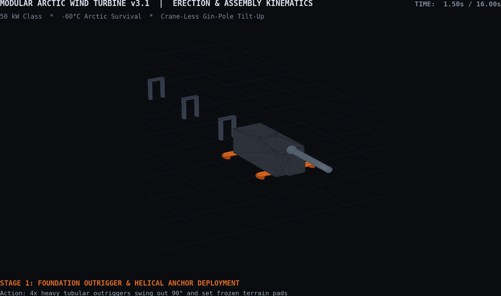
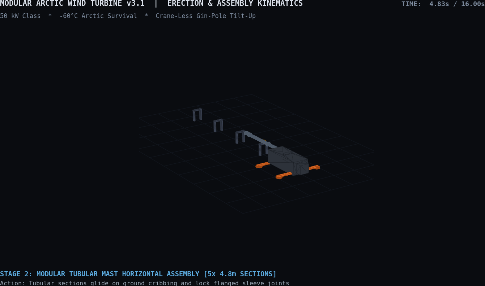
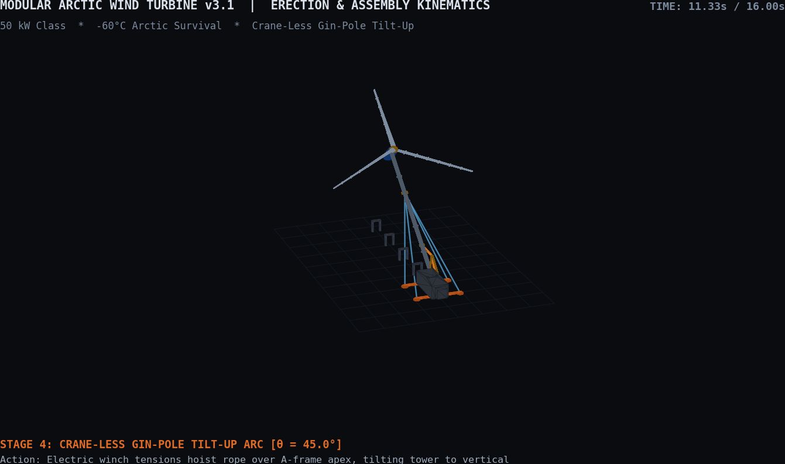

# Release **`v1.3.1`** — tag `v1.3.1` · branch `master` · 2026-10-17 · **[POLAR MACROGRID & FREECAD ARCHITECTURE]**

> **Status:** Published on `master` · Tag `v1.3.1` · 2026-10-17
>
> **Issues Tracked:**
> - [Issue #98](https://github.com/stellardreams/asi.surge.sh/issues/98): `AMU-Surface, CORA-M & STRIDER Polar Macrogrid Media Gallery & Cinematic Renders`
> - [Issue #100](https://github.com/stellardreams/asi.surge.sh/issues/100): `STRIDER-M v2 Transporter CAD & Kinematic Parametric Latch Assembly` (Child of [#98](https://github.com/stellardreams/asi.surge.sh/issues/98))
> - [Issue #101](https://github.com/stellardreams/asi.surge.sh/issues/101): `Hardware Invention & Model Registry (Authoritative CAD, Versions, Envelopes & Transition to FreeCAD)` (Child of [#82](https://github.com/stellardreams/asi.surge.sh/issues/82) & [#18](https://github.com/stellardreams/asi.surge.sh/issues/18))
> - [Issue #102](https://github.com/stellardreams/asi.surge.sh/issues/102): `Redo Website Portfolio & Technical Showcase with v1.3.0/v1.3.1 Proposed Hardware Designs` (Child of [#101](https://github.com/stellardreams/asi.surge.sh/issues/101))
> - [Issue #18](https://github.com/stellardreams/asi.surge.sh/issues/18): `low priority: give FreeCAD another shot` (Headless Verification & Parametric Transition)
> - [Issue #82](https://github.com/stellardreams/asi.surge.sh/issues/82): `Exploration: Retrofitting AMU Chassis for Modular Wind Applications` (Recursive Engineering Enhancements)
> - [Issue #96](https://github.com/stellardreams/asi.surge.sh/issues/96): `Standalone Repository Setup & CI Automation: Modular Arctic Wind Turbine (spin-off candidate)`
> - [Issue #104](https://github.com/stellardreams/asi.surge.sh/issues/104): `Modular Arctic Wind Turbine v3.0 FreeCAD Refinements & Rigging (TASK-03A)` (Child of [#82](https://github.com/stellardreams/asi.surge.sh/issues/82))
>
> **Range:** `v1.3.0` → `v1.3.1`

---

## 💡 Engineering Philosophy: Simple Innovation & Extreme Resourcefulness

> ### 💬 Ernest Rutherford Maxim
> *“We haven't got the money, so we've got to think.”*  
> — **Ernest Rutherford**, Nobel Prize-winning physicist *(courtesy of Google.com AI-powered search)*

This maxim encapsulates the core engineering ethos of the `v1.3.1` release:

- **Scarcity is the ultimate catalyst:** It flips the script on physical and operational limitations. When remote polar environments preclude the deployment of 100-ton hydraulic construction cranes, dedicated foundation piling barges, or massive capital equipment budgets, engineering necessity compels the creation of clever, streamlined architectural shortcuts. Rather than relying on heavy external infrastructure, our systems self-contain their entire lifecycle—from the crane-less container A-frame gin-pole winch and segmented $\le 1.90\text{ m}$ NACA airfoil sleeves, to STRIDER-M's integrated on-deck mast retention saddles and permafrost biting outriggers.
- **Intellect over resources:** The most durable, elegant engineering solutions are forged not in resource-saturated suites, but out of austere necessity and relentless design discipline. By treating strict physical constraints (such as the standard 20 ft ISO intermodal footprint, −60 °C structural metallurgy, and single-operator field assembly) as foundational design catalysts rather than hindrances, `v1.3.1` delivers resilient, autonomous infrastructure that achieves superior performance through smarter thinking.

---

## Work Package Tracking

### 1. [Issue #98](https://github.com/stellardreams/asi.surge.sh/issues/98) — High-Fidelity Media Gallery & Cinematic Motion Renders
- Visual Reference Asset Pack compilation for Gemini Flash-Lite high-coherence video generation:
  - Ceiling-to-Rover Gantry Transfer sequence (Apex traverse $\to$ Portal descent $\to$ Caliper lock $\to$ Polar rollout).
  - Multi-angle CAD reference stills (Isometric, Zoom, Close-up, Top).
- Production and repository tracking of Gemini Flash-Lite cinematic MP4 video renders in [`docs/assets/macrogrid_renders/`](../assets/macrogrid_renders/):

  [cora_transfer_render01.mp4](https://github.com/stellardreams/asi.surge.sh/blob/main-dev/docs/assets/macrogrid_renders/cora_transfer_render01.mp4) (4.0 MB) — Initial gantry ceiling-to-rover alignment and descent.

  <video src="https://github.com/user-attachments/assets/41f27734-6989-4353-a792-06c8eeb92043" controls="controls" width="100%" height="auto"></video>

  [cora_transfer_render02.mp4](https://github.com/stellardreams/asi.surge.sh/blob/main-dev/docs/assets/macrogrid_renders/cora_transfer_render02.mp4) (3.9 MB) — Refined flip-and-clamp arm mating, broader mounting rim, chassis outriggers, and transit park-mode lock during polar blizzard rollout.

  <video src="https://github.com/user-attachments/assets/84c5f39e-7e31-430c-9078-23ad5f38937d" controls="controls" width="100%" height="auto"></video>

- Polar Macrogrid conceptual stills (Superhub, Vault Station entrance, Quad Hub microgrid) published in `v1.3.0` release notes.
- [Issue #98](https://github.com/stellardreams/asi.surge.sh/issues/98) signed off with zero open items and closed.

### 2. [Issue #100](https://github.com/stellardreams/asi.surge.sh/issues/100) — STRIDER-M v2 Transporter CAD & Kinematic Parametric Latch Assembly
- Implemented `cad_and_blender/openscad/amu_surface/strider_m_transporter_v2.scad`:
  - Heavy knee-jointed A-frame outrigger trusses ("Spider Outriggers") with high clevis mounts, upper box boom, inverted hydraulic cylinders, and wide rectangular polar footpad shoes with permafrost biting cleats.
  - Front tubular bull-bar crash cage with X-brace and dual forged recovery shackles.
  - Transit park-mode U-saddle cradle with dual motorized clamping jaws to secure the folded 7-DoF CORA-M arm.
  - Broadened 8-lug mounting turret rim (`DOCK_COLLAR_R = 0.68`).
- Generated and tracked verification stills: `strider_m_transporter_v2_deployed_iso.png`, `strider_m_transporter_v2_recessed_iso.png`, `strider_m_transporter_v2_front_view.png`, and `strider_m_transporter_v2_deck_zoom.png`.

#### 🚜 STRIDER-M v2 Transporter Verification Stills
| Deployed Outriggers (Iso) | Recessed Transit Mode (Iso) | Front Elevation & Bull Bar | Deck Transit Park Saddle |
|:---:|:---:|:---:|:---:|
|  |  |  |  |

### 3. [Issue #101](https://github.com/stellardreams/asi.surge.sh/issues/101) — Hardware Invention & Model Registry & FreeCAD Transition Governance
- Established authoritative repository hardware registry at [`cad_and_blender/REGISTRY.md`](../../cad_and_blender/REGISTRY.md):
  - 5 Core Hardware Domains: Orbital Autonomous Manufacturing Units (AMU Heritage & CORA-M Mobile, ZeroClaw Octahedral Truss Node), STRIDER-M Heavy Rovers, CORA-M 7-DoF Manipulators, AMU-Surface Polar Habitats, and Containerized Arctic Wind Turbines (v2.0 & v3.0).
  - Version genealogy (`v1.0`, `v2.0`, `v3.0`), dimensional envelopes ($L \times W \times H$, ground pressure, DoF), CAD source paths, and associated cinematic renders/animations.
  - Promotion and archival policies ensuring immutable preservation of baseline designs.
  - Tracking FreeCAD model registration pipeline in direct coordination with [Issue #18](https://github.com/stellardreams/asi.surge.sh/issues/18).
- Integrated registry cross-reference into root [`README.md`](../../README.md).
- Established dedicated FreeCAD engineering structure under `cad_and_blender/freecad/`:
  - Subdirectories: `common/`, `amu_orbital/`, `amu_surface/`, `robotics/`, `mobility/`, `wind/`, and `step_exports/`.
  - Authored [`cad_and_blender/freecad/README.md`](../../cad_and_blender/freecad/README.md) with complete navigation guide (CAD vs OpenSCAD mouse styles, shortcut keys for views and zooming).
  - Published comprehensive OpenSCAD $\to$ FreeCAD migration mapping across all 5 domains.
  - Implemented and verified native FreeCAD parametric Python modules and compiled solid STEP models:
    - STRIDER-M v1.0 Transporter (`strider_m_v1.py` $\to$ `step_exports/strider_m_v1.step`, 583 KB)
    - STRIDER-M v2.1 Modular Wind Cargo Retention Transporter (`strider_m_v2.py` $\to$ `step_exports/strider_m_v2.step`, 1.6 MB)
    - CORA-M 7-DoF Manipulator Arm with Kinematic Solver (`cora_m_arm_v1.py` $\to$ `step_exports/cora_m_arm_v1.step`, 176 KB)
    - AMU-Surface Base Habitat (`surface_habitat_v1.py` $\to$ `step_exports/surface_habitat_v1.step`, 450 KB)
    - AMU Heritage Orbital Spacecraft (`amu_heritage_orbital_v1.py` $\to$ `step_exports/amu_heritage_orbital_v1.step`, 123 KB)
    - Modular Arctic Wind Turbine v2.0 (`modular_wind_turbine_v2.py` $\to$ `step_exports/modular_wind_turbine_v2.step`, 123 KB)
    - Modular Arctic Wind Turbine v3.1 (`modular_wind_turbine_v3.py` $\to$ `step_exports/modular_wind_turbine_v3.step`, 3.98 MB, 1,313 faces)
    - ZeroClaw Octahedral Truss Node (`zeroclaw_truss_node_v1.py` $\to$ `step_exports/zeroclaw_truss_node_v1.step`, 308 KB)
  - Authored authoritative technical specification: [`docs/specifications/modular_arctic_wind_architecture.md`](../specifications/modular_arctic_wind_architecture.md).
  - Committed reproducible multi-core turntable renderer script: [`scripts/render_freecad_turntables.py`](../../scripts/render_freecad_turntables.py).
  - Committed 15-second cinematic multi-view camera renderer script: [`scripts/render_wind_v3_cinematic.py`](../../scripts/render_wind_v3_cinematic.py).
  - Generated and embedded realistic multi-color 360° rotational turntable animations and cinematic camera fly-arounds (MP4 & looping GIF) for all models, rendered with distinct physical material color palettes (e.g. crawler steel `#2e3440`, safety orange `#e06c28`, aerospace silver `#b8c5d6`, anodized gold `#d49b28`, maritime blue `#1c5cb8`, and solar blue `#182c54`):

#### 🎬 FreeCAD STEP Multi-Color Turntable Showcase
| System / Model | 360° FreeCAD Color Turntable Animation (Looping GIF) | High-Definition Video | Material Color Scheme |
|:---|:---:|:---:|:---|
| **STRIDER-M v1.0** (Baseline Rover) |  | [`strider_m_v1_turntable.mp4`](../../cad_and_blender/freecad/mobility/renders/strider_m_v1_turntable.mp4) | Dark steel tracks, slate armored frame, safety orange deck, gold locking collar |
| **STRIDER-M v2.1** (Wind Cargo Retention) |  | [`strider_m_v2_turntable.mp4`](../../cad_and_blender/freecad/mobility/renders/strider_m_v2_turntable.mp4) | Steel tracks, slate frame, orange deck, chrome hydraulic outriggers, mast saddle racks, tie-down winches, golden crash cage |
| **CORA-M 7-DoF Arm** (Manipulator) |  | [`cora_m_arm_v1_turntable.mp4`](../../cad_and_blender/freecad/robotics/renders/cora_m_arm_v1_turntable.mp4) | Maritime blue joint housings, ceramic white booms, golden end-effector calipers |
| **AMU-Surface Habitat v1.1** (Vault Arch & Diagrid) |  | [`surface_habitat_v1_turntable.mp4`](../../cad_and_blender/freecad/amu_surface/renders/surface_habitat_v1_turntable.mp4) | Composite thermal shell, slate foundation grade beams & permafrost piles, silver gantry I-beam & mobile hoist, golden catenary ribs & staging arch |
| **AMU Heritage Orbital** (Spacecraft) |  | [`amu_heritage_orbital_v1_turntable.mp4`](../../cad_and_blender/freecad/amu_orbital/renders/amu_heritage_orbital_v1_turntable.mp4) | Micrometeoroid shielding tan hull, golden APAS collars, silver spine, deep photovoltaic blue panels |
| **Modular Arctic Wind Turbine v2.0** |  | [`modular_wind_turbine_v2_turntable.mp4`](../../cad_and_blender/freecad/wind/renders/modular_wind_turbine_v2_turntable.mp4) | Dark ISO container base, safety orange outriggers, steel mast, blue nacelle, white aerodynamic rotor |
| **Modular Arctic Wind Turbine v3.1** |  | [`modular_wind_turbine_v3_turntable.mp4`](../../cad_and_blender/freecad/wind/renders/modular_wind_turbine_v3_turntable.mp4) | Dark ISO container base, orange outriggers & pads, gold gin-pole & guy cables, steel mast, blue nacelle, white lofted NACA airfoil blades with sleeve collars |
| **Modular Arctic Wind Turbine v3.1**<br>*(15s Cinematic Multi-View)* |  | [`modular_wind_turbine_v3_cinematic.mp4`](../../cad_and_blender/freecad/wind/renders/modular_wind_turbine_v3_cinematic.mp4) | Matrix bullet-time sweep, macro zoom into NACA 4415/4418 lofts & sleeve joints, mid-mast guy collar & clevis lugs, container roof gin-pole winch & helical outriggers |
| **Modular Arctic Wind Turbine v3.1**<br>*(16s Assembly & Tilt-Up Erection)* |  | [`modular_wind_turbine_v3_erection.mp4`](../../cad_and_blender/freecad/wind/renders/modular_wind_turbine_v3_erection.mp4) | 5-stage deployment: outriggers swing out, 5x mast sections glide on cribbing, nacelle & blades dock, gin-pole winch tilts tower 0° $\to$ 90°, and rotor spins |
| **ZeroClaw Truss Node** (Lattice) |  | [`zeroclaw_truss_node_v1_turntable.mp4`](../../cad_and_blender/freecad/amu_orbital/renders/zeroclaw_truss_node_v1_turntable.mp4) | Deep anodized blue spherical core, precision machined aerospace silver coupling arms |
- **Forward Release Roadmapping**:
  - `v1.3.1`: Polar Macrogrid Media Gallery, STRIDER-M v2 Outrigger CAD, Registry Architecture, and FreeCAD Transition Governance.
  - `v1.4.0` (Upcoming Track): Native Parametric FreeCAD CAD & STEP Solid Architecture.

### 4. [Issue #18](https://github.com/stellardreams/asi.surge.sh/issues/18) — FreeCAD Headless Verification & Asset Transition Evaluation
- Headless FreeCAD 1.0.0 testing verified on local host (successful Python import of `FreeCAD`/`Part` from `/usr/lib/freecad/lib` under Python 3.13.7 and verified STEP export).
- Cataloging OpenSCAD assets for parametric transition.

### 5. [Issue #82](https://github.com/stellardreams/asi.surge.sh/issues/82) — Recursive AMU & Modular Wind Enhancements
- Fine-tuning structural tolerance and kinematic envelope for autonomous mast erection.
- Multi-body dynamics validation for extreme polar gusts ($55\text{ m/s}$).

### 6. [Issue #96](https://github.com/stellardreams/asi.surge.sh/issues/96) — Independent Spin-Off Repository Tooling & CI Automation
- **Unified Local Test Runner** ([`scripts/test_wind_v2.sh`](../../scripts/test_wind_v2.sh)):
  - Executes all 12 Arctic physics, aerodynamic, structural, microgrid, and economic verification models (`envelope.py`, `power_resource.py`, `container_sizing.py`, `foundation_load_envelope.py`, `erection_kinematics.py`, `powertrain_envelope.py`, `container_pack_audit.py`, `microgrid_dispatch.py`, `weibull_wind_resource.py`, `aero_icing_loads.py`, `cold_climate_fmea.py`, `levelized_cost_energy.py`) in under 3 seconds with zero external dependencies (pure Python 3 stdlib).
  - Optional `--v3` extension flag verifying FreeCAD Modular Arctic Wind Turbine v3.0 B-Rep solid STEP export.
- **Path-Filtered Opt-In CI Workflow** ([`.github/workflows/wind-v2-verification.yml`](../../.github/workflows/wind-v2-verification.yml)):
  - Configured with `workflow_dispatch` (manual trigger) and path filtering strictly scoped to `cad_and_blender/openscad/wind/v2.0/**`, `scripts/test_wind_v2.sh`, and `.github/workflows/wind-v2-verification.yml`, preserving GitHub Actions quota.
- **Single-Command Surgical Extraction Script** ([`scripts/extract_wind_repo.sh`](../../scripts/extract_wind_repo.sh)):
  - Fully automated standalone repository exporter per [`docs/repo_extraction_manifest.md`](../repo_extraction_manifest.md) migrating CAD assets (OpenSCAD v2.0, archive v1.0, FreeCAD v2/v3, and STEP exports), specifications, and render pipelines.
  - Generates standalone `README.md`, isolated `scripts/test_wind.sh`, and GitHub Actions CI workflow in the target directory, followed by automated in-situ execution test verifying 100% test pass in the destination repository.

### 7. Documentation & Forward Engineering Artifact Templates
- **Standardized Forward Tasks Artifact Template** ([`docs/template/artifacts/forward_tasks_template.md`](../template/artifacts/forward_tasks_template.md)):
  - Established canonical template for forward engineering task tracking with clean dummy data and operational instructions.
  - Features simplified status tracking (`Active`), uncluttered `🎯 Zone of Current Focus` convention, structured two-tier `📋 Task Matrix` (Active & Forward Pipeline vs. Completed Milestones), and hierarchical ASCII tree lineage mapping.
  - Includes simple, actionable instructions for task lifecycle management, status indicators, and merge gate tracking.

### 8. [Issue #104](https://github.com/stellardreams/asi.surge.sh/issues/104) — Modular Arctic Wind Turbine v3.0 FreeCAD Refinements & Rigging (TASK-03A)
- **Continuous-Curvature Aerodynamic Blade Lofting**:
  - Discretized NACA 4415/4418 airfoil sections with 28 points per profile across 4 spanwise stations ($0.45\text{ m} \to 1.20\text{ m}$ chord, $10^\circ \to 1^\circ$ aerodynamic wash-out twist) using OpenCASCADE B-Rep surface lofts.
  - 7 modular structural sleeve joint collars per blade ($\le 1.90\text{ m}$ segment length) ensuring 100% container packing compliance inside a single 20 ft ISO container.
- **Structural Guy-Wire Rigging Collar ($z = 16.0\text{ m}$)**:
  - Structural mast collar fitted with 4x radial clevis lug ears, pinholes, and dual upper/lower turnbuckle tensioners anchoring 24 mm high-tensile steel cables down to the container outriggers.
- **Deployable Outriggers & Permafrost Helical Anchors**:
  - 4x deployable beams fitted with permafrost ground bearing pads, central helical screw anchor drive caps, hinge locking shear pins, and D-ring tie-down brackets.
- **Crane-Less Gin-Pole Erection Rigging**:
  - Container-mounted 4.2m A-frame with dual base pivot trunnions, apex sheave pulley wheel, electric planetary hoist winch drum, and steel hoist line routed to the lower mast lifting collar ($z = 6.0\text{ m}$).
- **Headless Solid STEP Model Export**:
  - Compiled [`cad_and_blender/freecad/step_exports/modular_wind_turbine_v3.step`](../../cad_and_blender/freecad/step_exports/modular_wind_turbine_v3.step): Valid B-Rep solid, **1,313 faces** (up from 590), volume $57.20\text{ m}^3$, file size 3.98 MB.
- **Coupled Numerical Verification**:
  - Executed `./scripts/test_wind_v2.sh --v3`: all 12 OpenSCAD physics benchmarks + FreeCAD headless solid validation passed in 2.34s (100% PASS).
- **Cinematic Media & 360° Color Turntables**:
  - Calibrated 37% slower 360° color turntable: [`modular_wind_turbine_v3_turntable.mp4`](../../cad_and_blender/freecad/wind/renders/modular_wind_turbine_v3_turntable.mp4) (117 KB, duration 5.04s) and looping GIF (510 KB).
  - 15-Second Cinematic Multi-View Fly-Around: [`modular_wind_turbine_v3_cinematic.mp4`](../../cad_and_blender/freecad/wind/renders/modular_wind_turbine_v3_cinematic.mp4) (734 KB, 180 frames @ 12.0 fps) and looping GIF (6.3 MB) featuring Matrix-style bullet-time orbit, rotor/blade macro zoom, guy collar downward swivel, and gin-pole winch inspection.
  - 16-Second Crane-Less Assembly & Tilt-Up Erection Animation: [`modular_wind_turbine_v3_erection.mp4`](../../cad_and_blender/freecad/wind/renders/modular_wind_turbine_v3_erection.mp4) (694 KB, 192 frames @ 12.0 fps, verified duration 16.000s) and looping GIF (2.53 MB) demonstrating full 5-stage kinematic deployment: outrigger lateral swing-out & ground anchoring, 5x modular mast horizontal sliding assembly on ground cribbing, tophead nacelle docking & 26m rotor blade installation, winch hoist rope tensioning over gin-pole apex sheave with continuous $0^\circ \to 90^\circ$ tilt-up arc, and vertical foundation socket locking with commissioning rotor spin.
- **Parametric Subsystem Component Breakdown**:
  - Modularized FreeCAD architecture into 6 dedicated standalone analytical solid components matching OpenSCAD v2.0 domain packages:
    1. **Foundation Sled & Outriggers** ([`wind_v3_foundation.py`](../../cad_and_blender/freecad/wind/components/wind_v3_foundation.py) $\to$ `wind_v3_foundation.step`, 92 faces, 39.81 m³, 110 KB).
    2. **Mast & Erection Rigging** ([`wind_v3_mast_erection.py`](../../cad_and_blender/freecad/wind/components/wind_v3_mast_erection.py) $\to$ `wind_v3_mast_erection.step`, 132 faces, 5.63 m³, 205 KB).
    3. **Direct-Drive Arctic Nacelle & Hub** ([`wind_v3_nacelle.py`](../../cad_and_blender/freecad/wind/components/wind_v3_nacelle.py) $\to$ `wind_v3_nacelle.step`, 37 faces, 6.59 m³, 66 KB).
    4. **NACA 4415/4418 Aerodynamic Blade & Sleeve Joints** ([`wind_v3_blade_joint.py`](../../cad_and_blender/freecad/wind/components/wind_v3_blade_joint.py) $\to$ `wind_v3_blade_joint.step`, 372 faces, 1.31 m³, 1.18 MB).
    5. **Arctic Microgrid Power Bay** ([`wind_v3_microgrid_cabinet.py`](../../cad_and_blender/freecad/wind/components/wind_v3_microgrid_cabinet.py) $\to$ `wind_v3_microgrid_cabinet.step`, 138 faces, 2.39 m³, 153 KB).
    6. **20 ft ISO Container Logistics & Stowage** ([`wind_v3_container_stowage.py`](../../cad_and_blender/freecad/wind/components/wind_v3_container_stowage.py) $\to$ `wind_v3_container_stowage.step`, 98 faces, 11.42 m³, 133 KB).
  - High-resolution isometric rendering script: [`scripts/render_wind_v3_components.py`](../../scripts/render_wind_v3_components.py).

#### 🎬 FreeCAD Wind Turbine v3.1 Cinematic Media & Kinematics Gallery
| Animation Sequence | 3D Simulation & Motion Render (Looping GIF) | High-Definition Video | Description & Kinematics |
|:---|:---:|:---:|:---|
| **16-Second Assembly & Tilt-Up Erection** |  | [`modular_wind_turbine_v3_erection.mp4`](../../cad_and_blender/freecad/wind/renders/modular_wind_turbine_v3_erection.mp4) | 5-stage sequenced erection: outriggers extend to frozen ground, 5x modular mast sections glide and mate on ground cribbing, nacelle & 3x blades dock, winch tensions hoist rope over gin-pole apex for continuous $0^\circ \to 90^\circ$ tilt-up arc, and vertical socket lock with commissioning rotor spin. |
| **15-Second Cinematic Multi-View Fly-Around** |  | [`modular_wind_turbine_v3_cinematic.mp4`](../../cad_and_blender/freecad/wind/renders/modular_wind_turbine_v3_cinematic.mp4) | Matrix-style bullet-time orbit, macro zoom into NACA 4415/4418 lofts & sleeve joints, downward swivel over mid-mast guy collar ($z = 16.0\text{ m}$) & clevis lugs, and container roof gin-pole winch inspection. |
| **360° Color Turntable Inspection** |  | [`modular_wind_turbine_v3_turntable.mp4`](../../cad_and_blender/freecad/wind/renders/modular_wind_turbine_v3_turntable.mp4) | Full 360° rotational turntable showcase with calibrated slower spin speed, highlighting dark ISO base, safety orange outriggers, anodized gold rigging, steel mast, and maritime blue nacelle. |

#### 🏗️ FreeCAD Wind Turbine v3.1 5-Stage Kinematic Erection Stills Gallery
| Deployment Stage | 3D Kinematic Motion Still (150 DPI) | Time & Frame | Mechanical Kinematics & Deployment Details |
|:---|:---:|:---:|:---|
| **Stage 1: Outriggers & Helical Anchors** |  | $t = 1.50\text{ s}$<br>(Frame 18) | 4x lateral tubular outrigger beams swing out $90^\circ$ to $Y = \pm 3.42\text{ m}$; ground pads lower onto permafrost ($Z = 0.0\text{ m}$); central helical screw drive caps lock down. |
| **Stage 2: Mast Sections Horizontal Assembly** |  | $t = 4.83\text{ s}$<br>(Frame 58) | 5x modular mast sections ($4.8\text{ m}$ each) glide on ground cribbing stands; flanged sleeve joints bolt together; lifting collar docked at $X = -6.0\text{ m}$ and guy collar at $X = -16.0\text{ m}$. |
| **Stage 3: Direct-Drive Nacelle & Blade Docking** |  | $t = 8.00\text{ s}$<br>(Frame 96) | Direct-drive PMSG nacelle mounts onto tophead ($X = -24.0\text{ m}$); 3x aerodynamic NACA 4415/4418 blades slide radially into hub sockets; 4.2m gin-pole A-frame raises on container roof with winch hoist line threaded over apex sheave. |
| **Stage 4: Gin-Pole Winch Tilt-Up Arc** |  | $t = 11.33\text{ s}$<br>(Frame 136) | Electric winch tensions hoist rope over gin-pole apex sheave; entire assembled tower & 26m rotor smoothly tilts up through continuous cosine S-curve easing arc ($\theta = 0^\circ \to 90^\circ$) around base pivot trunnions; 4x high-tensile guy cables dynamically extend. |
| **Stage 5: Foundation Socket Lock & Commissioning Spin** |  | $t = 15.00\text{ s}$<br>(Frame 180) | Tower locks into vertical foundation seat socket ($\theta = 90^\circ$); 4x guy wires tension taut with locked turnbuckles; hoist cable slacks; aerodynamic rotor brake releases and accelerates through 2.5 revolutions ($900^\circ$) in Arctic wind. |

#### 🔩 FreeCAD Wind Turbine v3.1 Subsystem Component Gallery
| Subsystem Component | 3D Analytical Isometric Render | Parametric FreeCAD Module | Solid STEP Model |
|:---|:---:|:---|:---|
| **Foundation Sled & Outriggers** |  | [`wind_v3_foundation.py`](../../cad_and_blender/freecad/wind/components/wind_v3_foundation.py) | `wind_v3_foundation.step` (92 faces) |
| **Mast & Erection Rigging** |  | [`wind_v3_mast_erection.py`](../../cad_and_blender/freecad/wind/components/wind_v3_mast_erection.py) | `wind_v3_mast_erection.step` (132 faces) |
| **Direct-Drive Nacelle & Hub** |  | [`wind_v3_nacelle.py`](../../cad_and_blender/freecad/wind/components/wind_v3_nacelle.py) | `wind_v3_nacelle.step` (37 faces) |
| **NACA Aerodynamic Blade & Joints** |  | [`wind_v3_blade_joint.py`](../../cad_and_blender/freecad/wind/components/wind_v3_blade_joint.py) | `wind_v3_blade_joint.step` (372 faces) |
| **Arctic Microgrid Power Bay** |  | [`wind_v3_microgrid_cabinet.py`](../../cad_and_blender/freecad/wind/components/wind_v3_microgrid_cabinet.py) | `wind_v3_microgrid_cabinet.step` (138 faces) |
| **20 ft ISO Container Stowage** |  | [`wind_v3_container_stowage.py`](../../cad_and_blender/freecad/wind/components/wind_v3_container_stowage.py) | `wind_v3_container_stowage.step` (98 faces) |

##### 🖥️ Render Inspection & Playback Quick Commands
```bash
# High-definition video inspection (H.264 MP4):
xdg-open cad_and_blender/freecad/wind/renders/modular_wind_turbine_v3_erection.mp4
xdg-open cad_and_blender/freecad/wind/renders/modular_wind_turbine_v3_cinematic.mp4
xdg-open cad_and_blender/freecad/wind/renders/modular_wind_turbine_v3_turntable.mp4

# Looping web animation inspection (GIF):
xdg-open cad_and_blender/freecad/wind/renders/modular_wind_turbine_v3_erection.gif
xdg-open cad_and_blender/freecad/wind/renders/modular_wind_turbine_v3_cinematic.gif
xdg-open cad_and_blender/freecad/wind/renders/modular_wind_turbine_v3_turntable.gif

# Erection 5-stage analytical stills (PNG):
xdg-open cad_and_blender/freecad/wind/renders/modular_wind_turbine_v3_stage1_outriggers.png
xdg-open cad_and_blender/freecad/wind/renders/modular_wind_turbine_v3_stage2_mast_assembly.png
xdg-open cad_and_blender/freecad/wind/renders/modular_wind_turbine_v3_stage3_rotor_docking.png
xdg-open cad_and_blender/freecad/wind/renders/modular_wind_turbine_v3_stage4_tilt_up_arc.png
xdg-open cad_and_blender/freecad/wind/renders/modular_wind_turbine_v3_stage5_commissioning.png

# Component analytical renders (PNG):
xdg-open cad_and_blender/freecad/wind/renders/wind_v3_foundation.png
xdg-open cad_and_blender/freecad/wind/renders/wind_v3_mast_erection.png
xdg-open cad_and_blender/freecad/wind/renders/wind_v3_nacelle.png
xdg-open cad_and_blender/freecad/wind/renders/wind_v3_blade_joint.png
xdg-open cad_and_blender/freecad/wind/renders/wind_v3_microgrid_cabinet.png
xdg-open cad_and_blender/freecad/wind/renders/wind_v3_container_stowage.png
```

- **Gemini Photorealistic Video Generation Pack**:
  - Authored and published copy-ready 4K cinematic generation prompt and reference asset bundle in [Issue #104 Comment 6237154494](https://github.com/stellardreams/asi.surge.sh/issues/104#issuecomment-6237154494) assigned to @genidma to produce photorealistic video in Gemini Argon / Veo.

- **Local Reference Asset Staging (`/tmp`)**:
  - All 17 reference visuals (5x erection stills, 6x subsystem analytical components, 3x MP4 videos, 3x looping GIFs) staged under `/tmp/gemini_wind_v3_render_assets/` (12 MB) with companion `README.md` linking to Issue [#104](https://github.com/stellardreams/asi.surge.sh/issues/104) and [Comment 6237154494](https://github.com/stellardreams/asi.surge.sh/issues/104#issuecomment-6237154494).

- **Session Duration Tracking & App Attribution**:
  - Dedicated standalone tracking comment established at [Comment 6237681972](https://github.com/stellardreams/asi.surge.sh/issues/104#issuecomment-6237681972) tracking `- [ ] update [gmvrbr](https://kc-rhythm.web.app/)` with daily deep work duration sub-indents (10-16: 386 min; 10-17: 608 min), aggregated 52-session duration summary table (663.5 min / 11.06 hrs), and GitHub tip attribution courtesy of [KC-Rhythm](https://kc-rhythm.web.app/).

- **Forward Kinematics Parking**:
  - Multi-system field erection simulation (STRIDER-M v2.1 + CORA-M v1.1 + Wind Turbine v3.1) parked under [Issue #104 Comment 6237230081](https://github.com/stellardreams/asi.surge.sh/issues/104#issuecomment-6237230081) for post-`v1.3.1` execution.

- **Issue Governance**:
  - Primary body sealed with zero open items (`✅ Zero Open`, 11/11 items closed).
  - Verification & testing guide comments published to [Comment 6235751442](https://github.com/stellardreams/asi.surge.sh/issues/104#issuecomment-6235751442) (stills & components), [Comment 6236907409](https://github.com/stellardreams/asi.surge.sh/issues/104#issuecomment-6236907409) (erection kinematics), [Comment 6237154494](https://github.com/stellardreams/asi.surge.sh/issues/104#issuecomment-6237154494) (Gemini generation pack & local staging), and [Comment 6237681972](https://github.com/stellardreams/asi.surge.sh/issues/104#issuecomment-6237681972) (gmvrbr & KC-Rhythm session metrics).

---

### 9. Authoritative B-Rep Solid STEP Model Inventory (FreeCAD 1.0.0 & OpenCASCADE)

All 14 compiled STEP solid models across the 5 engineering domains and modular subsystems are verified valid B-Rep solids with OpenCASCADE analytical geometry:

| No. | System / Component Model | Authoritative Python Module | Compiled Solid STEP File | Solid Status | Face Count | File Size |
|:---:|:---|:---|:---|:---:|:---:|:---:|
| 1 | **STRIDER-M v1.0** (Baseline Rover) | [`strider_m_v1.py`](../../cad_and_blender/freecad/mobility/strider_m_v1.py) | [`strider_m_v1.step`](../../cad_and_blender/freecad/step_exports/strider_m_v1.step) | `Valid: True` | 453 | 569.9 KB |
| 2 | **STRIDER-M v2.1** (Wind Cargo Retention) | [`strider_m_v2.py`](../../cad_and_blender/freecad/mobility/strider_m_v2.py) | [`strider_m_v2.step`](../../cad_and_blender/freecad/step_exports/strider_m_v2.step) | `Valid: True` | 1,304 | 1,559.4 KB |
| 3 | **CORA-M Arm v1.1** (7-DoF Manipulator) | [`cora_m_arm_v1.py`](../../cad_and_blender/freecad/robotics/cora_m_arm_v1.py) | [`cora_m_arm_v1.step`](../../cad_and_blender/freecad/step_exports/cora_m_arm_v1.step) | `Valid: True` | 89 | 172.2 KB |
| 4 | **AMU-Surface Habitat v1.1** (Vault Arch) | [`surface_habitat_v1.py`](../../cad_and_blender/freecad/amu_surface/surface_habitat_v1.py) | [`surface_habitat_v1.step`](../../cad_and_blender/freecad/step_exports/surface_habitat_v1.step) | `Valid: True` | 387 | 439.1 KB |
| 5 | **AMU Heritage Orbital v1.0** (Spacecraft) | [`amu_heritage_orbital_v1.py`](../../cad_and_blender/freecad/amu_orbital/amu_heritage_orbital_v1.py) | [`amu_heritage_orbital_v1.step`](../../cad_and_blender/freecad/step_exports/amu_heritage_orbital_v1.step) | `Valid: True` | 96 | 120.4 KB |
| 6 | **Modular Wind Turbine v2.0** (Reference) | [`modular_wind_turbine_v2.py`](../../cad_and_blender/freecad/wind/modular_wind_turbine_v2.py) | [`modular_wind_turbine_v2.step`](../../cad_and_blender/freecad/step_exports/modular_wind_turbine_v2.step) | `Valid: True` | 67 | 120.9 KB |
| 7 | **Modular Wind Turbine v3.1** (Full Rigging) | [`modular_wind_turbine_v3.py`](../../cad_and_blender/freecad/wind/modular_wind_turbine_v3.py) | [`modular_wind_turbine_v3.step`](../../cad_and_blender/freecad/step_exports/modular_wind_turbine_v3.step) | `Valid: True` | 1,313 | 3,886.2 KB |
| 8 | **ZeroClaw Node v1.0** (Lattice Core) | [`zeroclaw_truss_node_v1.py`](../../cad_and_blender/freecad/amu_orbital/zeroclaw_truss_node_v1.py) | [`zeroclaw_truss_node_v1.step`](../../cad_and_blender/freecad/step_exports/zeroclaw_truss_node_v1.step) | `Valid: True` | 89 | 301.3 KB |
| 9 | **Foundation Sled & Outriggers** (Subsystem) | [`wind_v3_foundation.py`](../../cad_and_blender/freecad/wind/components/wind_v3_foundation.py) | [`wind_v3_foundation.step`](../../cad_and_blender/freecad/step_exports/wind_v3_foundation.step) | `Valid: True` | 92 | 108.2 KB |
| 10 | **Mast & Erection Rigging** (Subsystem) | [`wind_v3_mast_erection.py`](../../cad_and_blender/freecad/wind/components/wind_v3_mast_erection.py) | [`wind_v3_mast_erection.step`](../../cad_and_blender/freecad/step_exports/wind_v3_mast_erection.step) | `Valid: True` | 132 | 200.9 KB |
| 11 | **Direct-Drive Nacelle & Hub** (Subsystem) | [`wind_v3_nacelle.py`](../../cad_and_blender/freecad/wind/components/wind_v3_nacelle.py) | [`wind_v3_nacelle.step`](../../cad_and_blender/freecad/step_exports/wind_v3_nacelle.step) | `Valid: True` | 37 | 65.0 KB |
| 12 | **NACA Blade & Joint Collars** (Subsystem) | [`wind_v3_blade_joint.py`](../../cad_and_blender/freecad/wind/components/wind_v3_blade_joint.py) | [`wind_v3_blade_joint.step`](../../cad_and_blender/freecad/step_exports/wind_v3_blade_joint.step) | `Valid: True` | 372 | 1,160.3 KB |
| 13 | **Microgrid Control Cabinet** (Subsystem) | [`wind_v3_microgrid_cabinet.py`](../../cad_and_blender/freecad/wind/components/wind_v3_microgrid_cabinet.py) | [`wind_v3_microgrid_cabinet.step`](../../cad_and_blender/freecad/step_exports/wind_v3_microgrid_cabinet.step) | `Valid: True` | 138 | 149.4 KB |
| 14 | **Container Stowage & Racks** (Subsystem) | [`wind_v3_container_stowage.py`](../../cad_and_blender/freecad/wind/components/wind_v3_container_stowage.py) | [`wind_v3_container_stowage.step`](../../cad_and_blender/freecad/step_exports/wind_v3_container_stowage.step) | `Valid: True` | 98 | 130.3 KB |

---

## 🔍 How to Verify: Automated Verification & Test Commands

Every mathematical model, physics check, and geometry script self-verifies and exits non-zero on failure:

```bash
# 1. Modular Arctic Wind v2.0 Numerical Verification Suite (12 Physics Models + v3.1 FreeCAD STEP Solid)
./scripts/test_wind_v2.sh --v3
# Expected output:
# Summary: 12/12 Passed | 0 Failed | Total Elapsed: <3s
# FreeCAD Solid Model (modular_wind_turbine_v3.py) : PASS (STEP Solid Valid)
# ✅ All 12 Arctic engineering verification models passed successfully.

# 2. Standalone Wind Repository Surgical Extraction & In-Situ Automated Test
./scripts/extract_wind_repo.sh /tmp/wind_export_v131
# Expected output:
# Summary: 12/12 Passed | 0 Failed | Total Elapsed: <3s
# ✅ Standalone extraction verified: 100% test pass in destination repository.

# 3. Headless FreeCAD STEP Solid Geometry Validation (All 14 B-Rep Models)
python3 -c '
import sys, os
sys.path.insert(0, "/usr/lib/freecad/lib")
import FreeCAD, Part
step_dir = "cad_and_blender/freecad/step_exports"
for f in sorted(os.listdir(step_dir)):
    if f.endswith(".step"):
        s = Part.Shape(); s.read(os.path.join(step_dir, f))
        assert s.isValid(), f"Invalid B-Rep: {f}"
        print(f"PASS: {f} ({len(s.Faces)} faces)")
'

# 4. Planetary Transporter & Habitat Portal Clearance Solver
python3 -c '
import sys; sys.path.insert(0, "/usr/lib/freecad/lib")
import FreeCAD
from cad_and_blender.freecad.amu_surface.surface_habitat_v1 import verify_portal_and_gantry_clearances
verify_portal_and_gantry_clearances()
'

# 5. Clean Link Hygiene Audit (Zero Absolute File Paths)
git grep -n "file:///vms_and_github" -- docs/ cad_and_blender/
# Expected: 0 occurrences found
```

---

## 🗺️ Forward Engineering Roadmap (Post-`v1.3.1` Pipeline)

The engineering deliverables for the next development milestones under Parent Initiative [#82](https://github.com/stellardreams/asi.surge.sh/issues/82):

1. **TASK-03F: Multi-Body Field Deployment Kinematics** ([Issue #104 Comment 6237230081](https://github.com/stellardreams/asi.surge.sh/issues/104#issuecomment-6237230081)):
   - Native FreeCAD coupled kinematics simulating STRIDER-M v2.1 arriving at polar installation site, deploying A-frame spider outriggers onto permafrost, and CORA-M 7-DoF manipulator rolling $4.8\text{ m}$ mast tubes off aft transom rollers onto ground cribbing stands.
   - Kinematic alignment for gin-pole apex winch tilt-up and dynamic umbilical bus coupling.
2. **TASK-06: Formearth Rammed-Earth & Thermal Mass Ballast Foundations** ([Issue #103](https://github.com/stellardreams/asi.surge.sh/issues/103)):
   - Synthesize sustainable permafrost foundation ballast concepts from Formearth (`@Formearth` / `https://svhp.surge.sh/#good-news`).
   - Eliminate heavy imported concrete ballast in favor of local frozen aggregate and rammed-earth compaction vaults.
3. **Gemini High-Coherence Cinematic Video Generation**:
   - Production of 4K photorealistic field deployment video using the 17 staged reference assets in `/tmp/gemini_wind_v3_render_assets/` and the prompt from [Issue #104 Comment 6237154494](https://github.com/stellardreams/asi.surge.sh/issues/104#issuecomment-6237154494).
4. **Issue #102: Portfolio Website Modernization**:
   - Overhaul `asi.surge.sh` public showcase to feature interactive 3D WebGL / Three.js viewers for the compiled FreeCAD STEP solid models and 360° color turntables.

---

## 🌟 Credits & Attributions

- 🛸 🌌 ⚡ 🤖 **Google Antigravity powered by Gemini 3.8 (Flash low & Pro/High)** — Autonomous engineering pair programming, FreeCAD 1.0.0 parametric solid modeling, OpenCASCADE B-Rep lofts, 16s erection and 15s fly-around kinematics, 360° color turntable rendering engine, numerical verification test runner suite, standalone extraction automation, and strict verification gate reconciliation.
- **Google Gemini ([gemini.google.com](https://gemini.google.com/))** — High-coherence photorealistic video renders for polar macrogrid and ceiling-to-rover gantry arm transfer (`cora_transfer_render01.mp4`, `cora_transfer_render02.mp4`).
- **Ernest Rutherford Maxim** — *“We haven't got the money, so we've got to think.”* — Foundational engineering maxim on scarcity as catalyst and intellect over resources.
- **KC-Rhythm App ([https://kc-rhythm.web.app/](https://kc-rhythm.web.app/))** — Session duration tracking, deep work rhythm telemetry, and work breakdown ledger.

*Published from `main-dev` → `master` merge. Tag `v1.3.1`.*

