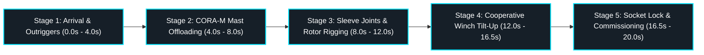

# Gemini Web Multi-System Simulation Architecture (v1.0 Technical Specification)

> **Document Class:** Technical Simulation Specification & Multimodal Choreography Guide  
> **Initiative:** Issue [#105](https://github.com/stellardreams/asi.surge.sh/issues/105) (TASK-03F: STRIDER-M + CORA-M + Wind Turbine v3.1 Cooperative Field Hoisting)  
> **Target Platforms:** Gemini on the Web / Google AI Studio / Google Antigravity Multimodal Engine  
> **CAD Ground Truth Modules:**  
> - `cad_and_blender/freecad/mobility/strider_m_v2.py` (STRIDER-M v2.1 Transporter)  
> - `cad_and_blender/freecad/robotics/cora_m_arm_v1.py` (CORA-M v1.1 7-DoF Manipulator)  
> - `cad_and_blender/freecad/wind/modular_wind_turbine_v3.py` (Modular Wind Turbine v3.1)  
> - `cad_and_blender/freecad/kinematics/field_assembly_scene.py` (Phase 1 Scene Alignment)  
> - `cad_and_blender/freecad/step_exports/field_assembly_phase1.step` (Analytical STEP Model)  
> **Prompt Manifest:** `cad_and_blender/freecad/kinematics/gemini_simulation_prompts.json`  

---

## 1. Executive Mission & Simulation Intent

The crane-less Arctic deployment of high-latitude infrastructure requires close cooperative coordination between autonomous surface robotics and modular mechanical energy hardware. Under **Issue #105**, this specification codifies how native OpenCASCADE analytical solid geometry (FreeCAD 1.0.0) is woven into high-coherence physical simulations executed through **Gemini on the web**.

By pairing FreeCAD rigid-body kinematics with Gemini's vision-generation and multimodal reasoning engines, engineering teams can validate field clearance corridors, mechanical assembly procedures, and robotic end-effector trajectories before physical hardware arrives in austere polar environments.

---

## 2. Spatial Ground Truth & Coordinate Alignment

All simulations maintain mathematical parity with the world coordinates verified in FreeCAD:

| Subsystem / Datum | World Coordinates $(X, Y, Z)$ | Elevation / Height | Boundary / Interface |
| :--- | :--- | :--- | :--- |
| **Ground Permafrost Datum** | Global Grid ($X \in [-32, +16\text{ m}]$, $Y \in [-14, +14\text{ m}]$) | $Z = 0.000\text{ m}$ | Hard-packed snow surface, $0.30\text{ m}$ frozen active layer |
| **Wind Turbine Foundation Sled** | Origin $(0.000, 0.000, 0.000\text{ m})$ | $Z_{\text{base}} = 0.000\text{ m}$, $Z_{\text{roof}} = 2.591\text{ m}$ | $6.058\text{ m L} \times 2.438\text{ m W} \times 2.591\text{ m H}$ ISO container footprint |
| **Roof Pivot Trunnions** | $(-0.120, 0.000, 2.591\text{ m})$ | $Z = 2.591\text{ m}$ | Dual cast-steel trunnion bosses for mast tilt-up hinge |
| **Horizontal Cribbing Stands** | Stations at $X = -4.50, -10.50, -16.50, -22.50\text{ m}$ | Saddle $Z = 2.337\text{ m}$ | Supports mast sections with centerline at $Z = 2.591\text{ m}$ |
| **STRIDER-M v2.1 Transporter** | Staging Position: $(+8.500, 0.000, +0.825\text{ m})$ | Track Bottom $Z = 0.000\text{ m}$ | Dual continuous crawler tracks, 4x spider outriggers ($9.35\text{ m}$ span) |
| **CORA-M v1.1 Manipulator Arm** | Turret Collar Base: $(+8.500, 0.000, +2.030\text{ m})$ | Shoulder Pivot $Z = 2.560\text{ m}$ | Concentric to STRIDER-M deck turret; $2.73\text{ m}$ reach envelope |
| **Inter-System Staging Corridor** | $X \in [+3.929, +5.000\text{ m}]$ | Clearance: $1.071\text{ m}$ | Safety margin between turbine power cabinet and STRIDER aft transom |

---

## 3. Five-Stage Simulation Choreography

The simulation pipeline divides the complete cooperative assembly into five sequential operational stages (20.00 seconds total, 240 frames @ 12.0 fps):

### Stage Details

1. **Stage 1 (0.0s – 4.0s) — STRIDER-M Arrival & Spider Outrigger Stabilization (Phase 2)**:
   - **Kinematics**: Transporter approaches across permafrost ($X = +13.5\text{ m} \to +8.5\text{ m}$). Track grousers rotate in contact with snow ($Z = 0.000\text{ m}$).
   - **Outriggers**: 4x spider outriggers swing out laterally; hydraulic rams push A-frame knees outward, extending wide polar footpads down to bite into permafrost ($Z = 0.000\text{ m}$).
   - **Camera**: Low-angle ground tracking shot emphasizing heavy track traction cleats and outrigger deployment.

2. **Stage 2 (4.0s – 8.0s) — CORA-M 7-DoF Unlatching & Robotic Mast Offloading (Phase 3)**:
   - **Kinematics**: CORA-M elevates from aft transit park latch cradle. Shoulder turret yaws towards starboard mast saddle.
   - **Offloading**: Golden end-effector calipers close around 4.8m tubular mast section. Arm articulates aft, translating the mast tube across dual bronze transom loading guide rollers ($X = +5.70\text{ m}$).
   - **Placement**: Mast deposits onto ground cribbing trestles, aligning collinear with roof trunnions at $Z = 2.591\text{ m}$.
   - **Camera**: Medium orbital crane framing golden caliper mechanics and transom roller translation.

3. **Stage 3 (8.0s – 12.0s) — Modular Mast Sleeve Coupling & 26m Rotor Rigging (Phase 3/4)**:
   - **Kinematics**: 5x modular 4.8m mast sections glide together on cribbing stands, locking flanged sleeve joint collars. Guy wire collar placed at 16.0m span ($X = -16.12\text{ m}$).
   - **Rotor**: Insulated nacelle mounts at tower tip ($X = -24.12\text{ m}$); hub and 3x 12m aerodynamic blades lock to pitch bearings.
   - **Rigging**: Gin-pole A-frame hoist line runs over apex sheave to lifting collar ($X = -6.12\text{ m}$); STRIDER-M auxiliary winch line attaches to forward bull-bar shackles.
   - **Camera**: Wide lateral crane glide tracking along horizontal tower from hub to container.

4. **Stage 4 (12.0s – 16.5s) — Cooperative Gin-Pole Winch Hoisting & Tilt-Up Erection Arc (Phase 4)**:
   - **Kinematics**: Container electric winch and STRIDER-M auxiliary winch line pull in tandem.
   - **Tilt-Up Arc**: Continuous smooth sinusoidal tilt-up arc $\theta(t) \in [0^\circ, 90^\circ]$ around trunnions $(-0.12, 0.0, 2.591\text{ m})$.
   - **Guy Wires**: 4x high-tensile steel guy cables dynamically expand from guy collar to container outrigger anchor pads.
   - **Tracking**: CORA-M manipulator arm elevates, tracking tower ascent to maintain sensor coverage.
   - **Camera**: Dramatic rising boom shot following tophead ascent to 24m vertical elevation.

5. **Stage 5 (16.5s – 20.0s) — Foundation Socket Lock, Microgrid Umbilical & Rotor Commissioning (Phase 5)**:
   - **Kinematics**: Tower seats into vertical base socket; 4x guy wires tension taut at $45^\circ$ angles.
   - **Umbilical**: CORA-M end-effector routes and locks heavy-duty 400V 3-phase Arctic microgrid umbilical cable between container power bay ($X = +3.93\text{ m}$) and STRIDER-M power bay ($X = +7.30\text{ m}$).
   - **Commissioning**: Aerodynamic 26m rotor executes 2.5 revolutions ($900^\circ$) dynamic excitation spin.
   - **Camera**: Majestic wide orbiting shot showcasing the fully operational polar microgrid cluster.

---

## 4. Prompt Engineering for Gemini on the Web

Prompt definitions are maintained in [`gemini_simulation_prompts.json`](../../cad_and_blender/freecad/kinematics/gemini_simulation_prompts.json). Key prompt guidelines:

- **Environmental Fidelity**: High Arctic tundra setting, −45 °C ambient, $8^\circ$ solar elevation (Arctic twilight), warm golden rim lighting against deep polar blue sastrugi snow drifts.
- **Material Realism**: Specular reflections on CORA-M golden calipers, industrial matte dark grey on STRIDER-M chassis, high-visibility yellow on spider outriggers, clean white on turbine mast sections.
- **Physical Dynamics**: Wind-drifted powder snow vortices off crawler tracks and blade tips, tensioned guy cables with realistic catenary sag, cable tension harmonics during winch hoist.

---

## 5. Multi-Core Renderer Alignment & Artifact Archiving

The multi-core Python renderer (`scripts/render_strider_cora_wind_erection.py`) generates authoritative video deliverables that serve as visual and kinematic ground truth:

1. **H.264 Video Asset**:  
   `cad_and_blender/freecad/wind/renders/strider_cora_wind_erection.mp4` (20.00s, 240 frames @ 12.0 fps)
2. **Looping Animated GIF**:  
   `cad_and_blender/freecad/wind/renders/strider_cora_wind_erection.gif` (Lanczos palette-optimized)
3. **Phase 1 Orthographic Stills**:  
   - Isometric: `cad_and_blender/freecad/wind/renders/phase1_field_scene_isometric.png`
   - Top Plan: `cad_and_blender/freecad/wind/renders/phase1_field_scene_top.png`
   - Side Elevation: `cad_and_blender/freecad/wind/renders/phase1_field_scene_side.png`
4. **Analytical STEP Solid**:  
   `cad_and_blender/freecad/step_exports/field_assembly_phase1.step` (ISO 10303 analytical solid)

---

## 6. Verification Gate Protocol

Every visual output and kinematic motion profile must pass four verification gates:
- **Gate 1 (Ground Seating)**: All ground contact points must seat on $Z = 0.000\text{ m} \pm 0.005\text{ m}$.
- **Gate 2 (Collinearity)**: Horizontal mast sections on cribbing must maintain centerline $Z = 2.591\text{ m} \pm 0.005\text{ m}$.
- **Gate 3 (Clearance)**: Inter-system transit corridor must maintain $\ge 1.00\text{ m}$ positive clearance.
- **Gate 4 (Kinematic Bounds)**: CORA-M joint angles must stay within verified limits (shoulder yaw $360^\circ$, shoulder pitch $-30^\circ$ to $+95^\circ$, elbow $-120^\circ$ to $+120^\circ$).
