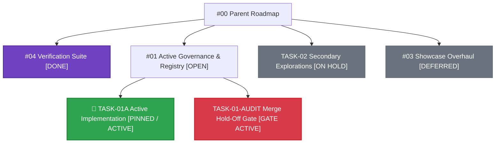

# Forward Tasks Artifact Template

<!-- =====================================================================
     TEMPLATES & INSTRUCTIONS: FORWARD ENGINEERING TASK TRACKER
     =====================================================================
     Usage Instructions:
     1. Copy this template when initializing a new multi-task initiative,
        subsystem redesign, or sprint tracking document.
     2. Replace the bracketed placeholders [LIKE_THIS] with project data.
     3. Keep the "Zone of Focus" lean, uncluttered, and placed directly at
        the top right after the title for zero-scroll visibility:
        - Structure around Single-Item Flow:
          * Use an outer double-lined rectangle around the active focus zone.
          * Use an inner single-lined rectangle within the outer rectangle to
            highlight the single-line current focal target.
          * 🔴 CURRENT FOCAL TARGET: Exactly ONE task being executed right now,
            with precise action cues, expected verification, and reporting flow.
          * 🟡 NEXT ON DECK: Exactly ONE preview of what follows immediately.
          * 📋 QUEUED INITIATIVES: 1-line pointers to other initiatives
            detailed in the Task Matrix below.
        - Do not accumulate finished task logs or extensive multi-task lists
          in the focus box.
        - When a task is completed, move it to the "Completed Milestones" table.
     4. Place administrative metadata (Status, Environment, Parent Initiatives,
        Active Child Packages, Target Release) at the very bottom under
        "📌 Initiative Metadata & Lineage" to prevent top-of-document clutter.
     5. Use standard status badges:
        - 📌 PINNED / ACTIVE
        - 🟢 ACTIVE
        - 🟡 AUDITED / HOLD_OFF_GATE
        - ⏸️ ON_HOLD / DEFERRED
        - ✅ DONE
     6. Maintain the Task Hierarchy & Lineage tree to show parent/child issues.
     7. Mermaid.js Visual Diagrams:
        - Embed fenced `mermaid` code blocks for visual dependency flows and system hierarchies.
        - Supported natively in Google Antigravity (AGY) markdown artifacts.
     ===================================================================== -->

# Forward Engineering Task Tracker ([Initiative / System Name])

> [!IMPORTANT]
> ### 🎯 ZONE OF FOCUS: Single-Item Active Execution
> 
> ```text
> ╔════════════════════════════════════════════════════════════════════════════╗
> ║ ZONE OF FOCUS: SINGLE-ITEM ACTIVE EXECUTION                                ║
> ║                                                                            ║
> ║  ┌──────────────────────────────────────────────────────────────────────┐  ║
> ║  │ CURRENT FOCAL TARGET: [TASK-ID] — [Task Name / One-Line Summary]     │  ║
> ║  └──────────────────────────────────────────────────────────────────────┘  ║
> ║                                                                            ║
> ║ • In-Issue Search String : [Search string to Ctrl+F find exact comment]    ║
> ║ • Assignee               : [Assignee / Lead / Agent]                       ║
> ║ • Action Required        : [Exact command, script, or verification step]   ║
> ║ • Verification / Criteria: [Concrete pass criteria or key check]           ║
> ║ • Gate Unlock            : [Next milestone or gate unlocked upon sign-off] ║
> ╚════════════════════════════════════════════════════════════════════════════╝
> ```
> 
> #### 🔴 CURRENT FOCAL TARGET: [Active Task Name]
> - **Task ID & Lineage**: 🔄 **TASK-01A** · [#01](https://github.com/owner/repo/issues/01) (Child of [#00](https://github.com/owner/repo/issues/00))
> - **Assignee**: [Username or Agent]
> - **In-Issue Search String**: [Search string to Ctrl+F find the exact comment/section in GitHub]
> - **Action Required (The Cue)**: [Exact command, script, or test to execute]
> - **Expected Verification**: [Concrete verification output or pass criteria]
> - **Reporting Flow**: [Where to report results: Issue comment, commit, or artifact]
> 
> ---
> 
> #### 🟡 NEXT ON DECK: [Next Task Name]
> - **Task ID & Lineage**: 📍 **TASK-01-AUDIT** · [#01](https://github.com/owner/repo/issues/01)
> - **Action**: [1-line preview of what unlocks once the current target completes]
> 
> ---
> 
> #### 📋 QUEUED INITIATIVES (Holding Pattern — Detailed in Task Matrix Below)
> - ⏸️ **TASK-02**: Secondary Concept Explorations ([#00](https://github.com/owner/repo/issues/00))
> - 🌐 **Issue #03**: Public Documentation & Showcase Overhaul ([#01](https://github.com/owner/repo/issues/01))

---

## 📋 Task Matrix

### 🟢 Active & Forward Pipeline

| ID | Task Description | Scope / Context | Parent / Origin | Status |
|:---|:---|:---|:---|:---|
| 📍 **TASK-01-AUDIT** | **[Verification & Audit Gate Review]** | [Maintain verification checklist and merge hold-off gate on main branch.] | • Tracked in: [#01](https://github.com/owner/repo/issues/01)<br>• Parent: [#00](https://github.com/owner/repo/issues/00) | 🟡 `AUDITED` (Gate Active) |
| 🔄 **TASK-01A** | **[Active Engineering Implementation]** | [Implement parametric core modules, kinematic solvers, and component solid models.] | • Subtask of TASK-01<br>• Tracked in: [#01](https://github.com/owner/repo/issues/01)<br>• Parent: [#00](https://github.com/owner/repo/issues/00) | 🟢 `ACTIVE` |
| ⏸️ **TASK-02** | **[Secondary Concept Explorations]** | [Synthesize experimental structural concepts and alternative component layouts.] | • Child of: [#00](https://github.com/owner/repo/issues/00) | ⏸️ `ON_HOLD` (Hold for now) |
| 🌐 **Issue #03** | **[Public Documentation & Showcase Overhaul]** | [Redesign public showcase pages and interactive 3D media viewers.] | • Parent: [#01](https://github.com/owner/repo/issues/01)<br>• Grandparent: [#00](https://github.com/owner/repo/issues/00) | ⏸️ `DEFERRED` (Tracked Separately) |

---

### ✅ Completed Milestones

| ID | Task Description | Scope / Context | Parent / Origin | Status |
|:---|:---|:---|:---|:---|
| ✅ **TASK-04** | **[Automated Verification Suite & Standalone Tooling]** | [Created unified local test runner running all domain physics models in <3s, opt-in CI workflow, and standalone extraction script. Closed Issue #04.] | • Tracked in: [#04](https://github.com/owner/repo/issues/04)<br>• Parent: [#00](https://github.com/owner/repo/issues/00) | ✅ `DONE` (Commit `abc1234`) |
| ✅ **TASK-05** | **[Subsystem Architecture & Solid STEP Exports]** | [Constructed native parametric 3D solids, verified B-Rep topology (valid solids, face counts, volume), and generated 360° rotational inspection animations.] | • Subtask of TASK-01<br>• Tracked in: [#01](https://github.com/owner/repo/issues/01)<br>• Parent: [#00](https://github.com/owner/repo/issues/00) | ✅ `DONE` (Commit `def5678`) |
| ✅ **TASK-06** | **[Technical Specification & Parameter Review]** | [Authored comprehensive engineering specification covering operational temperature envelope, load limits, and intermodal packaging constraints.] | • Subtask of TASK-01<br>• Tracked in: [#01](https://github.com/owner/repo/issues/01)<br>• Parent: [#00](https://github.com/owner/repo/issues/00) | ✅ `DONE` (Commit `7890abc`) |

---

## 🔍 Task Hierarchy & Lineage

### 📊 Visual Dependency Flow (Mermaid.js)



> [!NOTE]
> This forward engineering tracking artifact and its embedded Mermaid.js architecture diagrams are natively rendered, maintained, and verified within **Google Antigravity** (AGY).

### 🌳 Text Hierarchy Tree

```
#00 [Grandparent / High-Level Program Tracker]
 ├── ✅ #04 [Completed Child Work Package] (Closed ✅ Commit abc1234)
 │    ├── TASK-04A: [Local Test Harness] [Done ✅]
 │    ├── TASK-04B: [Path-Filtered CI Automation] [Done ✅]
 │    └── TASK-04C: [Standalone Extraction Tooling] [Done ✅]
 ├── 📍 #01 [Active Child Package / Registry & Governance] [Kept Open for Design Iterations]
 │    ├── 📍 TASK-01-AUDIT: [Verification Checklist & Hold-Off Gate Active] [Audited 🟡]
 │    ├── 🔄 TASK-01A: [Active Parametric Implementation] [Active Focus 🟢]
 │    ├── ✅ TASK-05: [Solid Modeling & Analytical STEP Verification] (Done ✅ Commit def5678)
 │    └── ✅ TASK-06: [Technical Architecture Specification Review] (Done ✅ Commit 7890abc)
 ├── ⏸️ TASK-02: [Secondary Concept Explorations] (On Hold ⏸️)
 └── ⏸️ #03: [Public Documentation & Portfolio Overhaul] (Deferred / Tracked Separately ⏸️)
```

---

## 📌 Initiative Metadata & Lineage

> **Status:** Active  
> **Environment:** Google Antigravity (AGY)  
> **Parent Initiatives:** [#00](https://github.com/owner/repo/issues/00) ([Parent Initiative Title])  
> **Active Child Packages:** [#01](https://github.com/owner/repo/issues/01) ([Package 1 Title]), [#02](https://github.com/owner/repo/issues/02) ([Package 2 Title])  
> **Target Release:** `vX.Y.Z` (tracked in `docs/release_notes/vX.Y.Z-draft.md`)

