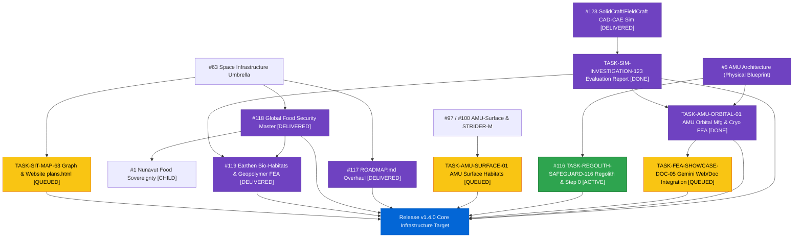

# Forward Engineering Task Tracker (Core Space Infrastructure & AMU Advancements)

> [!TIP]
> ### ❤️ THE WHY: Purpose, Humanity & Impact
> Building open, resilient, and human-affirming space infrastructure—enabling autonomous orbital manufacturing, safe surface habitats, and decentralized resource stewardship without human subjugation or extractive exploitation.

---

## 🎯 Current Operational Focus

```diff
+ ╔════════════════════════════════════════════════════════════════════════════╗
+ ║  ┌──────────────────────────────────────────────────────────────────────┐  ║
+ ║  │ ⏰ TIMESTAMP: 2026-11-03 17:44 EST / 22:44 UTC                       │  ║
+ ║  │ 📌 PRIMARY TARGET: TASK-REGOLITH-SAFEGUARD-116                       │  ║
+ ║  │    Assignee: @genidma, Argon & AGY                                   │  ║
+ ║  │    Branch Sync: main-dev & main synced                               │  ║
+ ║  │    Active Repo: https://github.com/stellardreams/asi.surge.sh        │  ║
+ ║  │    Deliverable: plans/plan-regolith-self-replication-safeguard.md    │  ║
+ ║  │    Parent Tracker: #116 (AMU Regolith Self-Replication & Step 0 Gate)│  ║
+ ║  │    In-Issue Search String ➡️ : 'TASK-REGOLITH-SAFEGUARD-116'         │  ║
+ ║  │    Focus Scope:                                                      │  ║
+ ║  │      • Step 0 Mandatory Pre-Gate: Astrobiological Lifeform Intercept │  ║
+ ║  │      • Non-thermal multi-spectral & chiral biosignature screening    │  ║
+ ║  │      • Vacuum carbothermal reduction & solar/microwave sintering     │  ║
+ ║  │      • Closed-loop von Neumann self-replication governance boundary  │  ║
+ ║  └──────────────────────────────────────────────────────────────────────┘  ║
+ ╚════════════════════════════════════════════════════════════════════════════╝
+ ╔════════════════════════════════════════════════════════════════════════════╗
+ ║  ┌──────────────────────────────────────────────────────────────────────┐  ║
+ ║  │ 🎯 NEXT PRIORITY 1 (Gemini 3.8 Flash Low): TASK-FEA-SHOWCASE-DOC-05  │  ║
+ ║  │    Scope: Document AMU Orbital Mars–Jupiter coupled FEA (#5:         │  ║
+ ║  │      amu_orbital_mars_jupiter_sim.json, amu_orbital_fea.png,         │  ║
+ ║  │      amu_orbital_thermal_fea.png, FoS_skin=2.33, FoS_root=1.28),     │  ║
+ ║  │      Andy Grove Bionic Hull Sentry Daemon, and Manna Vault FEA (#119)│  ║
+ ║  │      across website showcase (amu.html / plans.html) & tech docs.    │  ║
+ ║  └──────────────────────────────────────────────────────────────────────┘  ║
+ ╚════════════════════════════════════════════════════════════════════════════╝
+ ╔═════════════════════════════════════════════════════╗
+ ║  ┌───────────────────────────────────────────────┐  ║
+ ║  │ 🎯 NEXT PRIORITY 2: TASK-AMU-SURFACE-01       │  ║
+ ║  └───────────────────────────────────────────────┘  ║
+ ╚═════════════════════════════════════════════════════╝
+ ╔═════════════════════════════════════════════════════╗
+ ║  ┌───────────────────────────────────────────────┐  ║
+ ║  │ 🎯 NEXT PRIORITY 3: TASK-SIT-MAP-63           │  ║
+ ║  └───────────────────────────────────────────────┘  ║
+ ╚═════════════════════════════════════════════════════╝
```

---

### 📋 High-Level Action Checklist

| Priority | Task ID | Description | Status | Target |
| :---: | :--- | :--- | :---: | :--- |
| 🥇 | **TASK-REGOLITH-SAFEGUARD-116**| AMU Self-Replication Protocol: In-Situ Asteroid Regolith Manufacturing & Step 0 Safeguard | 🟢 `ACTIVE` | [#116](https://github.com/stellardreams/asi.surge.sh/issues/116) / `plans/` |
| 🥈 | **TASK-FEA-SHOWCASE-DOC-05** | Document Mars–Jupiter coupled FEA (`amu_orbital_mars_jupiter_sim.json`, `amu_orbital_fea.png`, `amu_orbital_thermal_fea.png`), Andy Grove Bionic Hull Sentry Daemon, & Manna Vault FEA across web showcase & docs *(for Gemini 3.8 Flash Low)* | 🟡 `QUEUED` | [#5](https://github.com/stellardreams/asi.surge.sh/issues/5) / [#123](https://github.com/stellardreams/asi.surge.sh/issues/123) / `amu.html` / `plans.html` |
| 🥉 | **TASK-AMU-SURFACE-01** | AMU-Surface habitat modules, regolith utilization & STRIDER-M transporter integration | 🟡 `QUEUED` | `plans/plan-amu-surface.md` / [#100](https://github.com/stellardreams/asi.surge.sh/issues/100) |
| 4️⃣ | **TASK-SIT-MAP-63** | Map high-level SIT governance and requirements graph to concrete plans and website `plans.html` | 🟡 `QUEUED` | [#63](https://github.com/stellardreams/asi.surge.sh/issues/63) / `plans.html` |
| 5️⃣ | **TASK-AMU-ORBITAL-01** | AMU Orbital manufacturing, MIL-STD-461G cryo umbilicals & Mars–Jupiter coupled FEA delivered | 🏁 `DONE` | [`plans/plan-amu-orbital.md`](plans/plan-amu-orbital.md) / [#5](https://github.com/stellardreams/asi.surge.sh/issues/5) |
| 6️⃣ | **TASK-EARTHEN-HABITAT-119** | 🏺 The New Manna Machine (Form Earth + Shangrila-VHP #45 + Sub-Zero Geopolymer FEA) | 🏁 `DONE` | [#119](https://github.com/stellardreams/asi.surge.sh/issues/119) / [`plans/plan-earthen-bio-habitats.md`](plans/plan-earthen-bio-habitats.md) |
| 7️⃣ | **TASK-SIM-INVESTIGATION-123** | SolidCraft + FieldCraft pure-Rust CAD/CAE evaluation & Argon verification delivered | 🏁 `DONE` | [`docs/tech_guide/SOLID_AND_FIELD_CRAFT_EVALUATION.md`](docs/tech_guide/SOLID_AND_FIELD_CRAFT_EVALUATION.md) / [#123](https://github.com/stellardreams/asi.surge.sh/issues/123) |
| 8️⃣ | **TASK-FOOD-SECURITY-118** | Global Food Security master umbrella architecture specification delivered | 🏁 `DONE` | `plans/plan-food-security.md` / [#118](https://github.com/stellardreams/asi.surge.sh/issues/118) |
| 9️⃣ | **TASK-ROADMAP-UPDATE-117** | Update `ROADMAP.md` with v1.3.3 milestones, decoupled Arctic Wind, and AMU priorities | 🏁 `DONE` | `ROADMAP.md` / [#117](https://github.com/stellardreams/asi.surge.sh/issues/117) |
| 🔟 | **CHORE-IDE-DOC-CLEANUP** | Audit, extract, decouple, and sanitize legacy documents, CAD solids, and specifications | 🏁 `DONE` | `scratch/`, `.sys_opt/`, root workspace |

---

### 🏆 Recently Completed Milestones

- [x] **AMU Orbital Manufacturing Blueprint & Mars–Jupiter Coupled FEA Delivered (`TASK-AMU-ORBITAL-01`)**: Authored [`plans/plan-amu-orbital.md`](plans/plan-amu-orbital.md) specifying the four-module orbital facility (Module I Autonomous Foundry & $3\text{ K}$ Radiative Flash-Freeze Vitrification, Module II Zero-Boil-Off Cryo Tank Farm & MIL-STD-461G 360° braided cryogenic umbilicals with iris/cone EMC compression glands, Module III Bioreactor Array, and Module IV $0.3\text{--}1.0g$ Variable-Gravity Habitat Ring with permanent purpose-segregation air-gap & FAA/FDA oversight), the $2\tau_{\text{OWLT}}$ Speed-of-Light Latency Blind-Spot Risk Registry, the Andy Grove Bionic Hull Sentry Daemon, and the Wikinomics `AbundanceDividend` model. Executed the Mars–Jupiter Main Belt Corridor coupled thermal-structural FEA in FieldCraft `v0.7.0` (`amu_orbital_mars_jupiter_sim.json`: $50\text{ mm}$ Al-Li 2195-T8 hull under $\Delta T = 205\text{ K}$ eclipse shock + $1\text{ atm}$ + $50\text{ kN}$ docking thrust; mid-wall $T = -82.71^\circ\text{C}$, mid-span skin $\sigma_{\text{vM}} = 239.87\text{ MPa}$ ($\text{FoS}=2.33$), aft root $\sigma_{\text{vM}} = 438.44\text{ MPa}$ ($\text{FoS}=1.28$)) and updated [`cad_and_blender/REGISTRY.md`](cad_and_blender/REGISTRY.md) per #101. Issue #5 kept OPEN pending review. ✅
- [x] **The New Manna Machine Sub-Zero Geopolymer Binder & Coupled FEA Delivered (`TASK-EARTHEN-HABITAT-119`)**: Specified potassium-silicate alkali-activated aluminosilicate geopolymer binder chemistry ($\text{K}_2\text{SiO}_3 + 8\text{ M KOH} + \text{CaAl}_2\text{O}_4$, liquidus depressed to $-22^\circ\text{C}$, $18.5\text{ MPa}$ 7-day sub-zero cure) and solved coupled steady-state thermal conduction ($-45^\circ\text{C}$ Arctic exterior to $+18^\circ\text{C}$ interior polyculture core) + gravity + $15\text{ kPa}$ snow overburden on the $550\text{ mm}$ catenary vault arch in FieldCraft `v0.7.0` (`manna_vault_thermal_structural_sim.json`, mid-wall $T = -15.06^\circ\text{C}$, crown $\delta_z = -1.175\text{ mm}$, peak foundation toe stress $\sigma_{\text{vM,max}} = 3.79\text{ MPa}, \text{FoS} = 4.88$). Updated [`plans/plan-earthen-bio-habitats.md`](plans/plan-earthen-bio-habitats.md) Section 6 and registered Section 4.3 in [`cad_and_blender/REGISTRY.md`](cad_and_blender/REGISTRY.md). Issue #119 kept OPEN pending review. ✅
- [x] **SolidCraft + FieldCraft CAD/CAE Evaluation & Argon Verification Delivered (`TASK-SIM-INVESTIGATION-123`)**: Completed full Experiment A/B/C verification in [`docs/tech_guide/SOLID_AND_FIELD_CRAFT_EVALUATION.md`](docs/tech_guide/SOLID_AND_FIELD_CRAFT_EVALUATION.md): parametric Aluminium L-Bracket ($100 \times 50 \times 5\text{ mm}$ with $R=4\text{ mm}$ inner fillet and $2\times \varnothing 8\text{ mm}$ mounting holes), `solidcraft/21` native CAD-to-FEA container bridge (`test_bracket_v21.solidcraft`), $10{,}837\text{ tet10}$ bracket stress FEA ($\sigma_{\text{vM,fillet}} = 141.65\text{ MPa}$), and 80-element quadratic `hex20` cantilever beam benchmark ($99.996\%$ Euler-Bernoulli convergence). Issue #123 kept OPEN pending review. ✅

- [x] **Global Food Security Master Architecture Delivered (`TASK-FOOD-SECURITY-118`)**: Authored [`plans/plan-food-security.md`](plans/plan-food-security.md) bridging closed-loop ECLSS with terrestrial crisis triage (DRC/WFP), linking Nunavut food sovereignty ([#1](https://github.com/stellardreams/asi.surge.sh/issues/1)) and automated earthen bio-habitats ([#119](https://github.com/stellardreams/asi.surge.sh/issues/119)), and establishing a zero-insect-farming biosafety policy. Pushed to `main-dev` (`b02f7d7`) and merged to `main` (`eaaae7a`). Issue #118 kept OPEN pending user review. ✅
- [x] **Roadmap Architecture Overhaul Delivered (`TASK-ROADMAP-UPDATE-117`)**: Overhauled [`ROADMAP.md`](ROADMAP.md) into a comprehensive Tier 0 through Tier 3 hierarchy incorporating delivered engineering assets across Releases `v1.1` through `v1.3.3` (AMU Heritage Orbital `v1.0`, CORA-M `v1.0`, STRIDER-M `v1.0`/`v2.1`, AMU-Surface Habitat `v1.1`, and The New Manna Machine `v1.0`). Pushed to `main-dev` (`da4f947`) and merged to `main` (`eaaae7a`). Issue #117 kept OPEN pending user review. ✅
- [x] **Draft Release Notes v1.3.4 Updated**: Documented repository decoupling, CAD archival, security remediations, and issues #117 / #118 in [`docs/release_notes/v1.3.4-draft.md`](docs/release_notes/v1.3.4-draft.md). ✅
- [x] **IDE Stale Document Cleanup & Audit Sealed (`CHORE-IDE-DOC-CLEANUP`)**: Extracted all actionable engineering specifications into active issues (`#5`, `#100`, `#119`), transferred wind models to upstream repository, archived residual notes and ideas in `_z_archives/`, and audited machine-specific paths with zero public repository exposure. ✅
- [x] **Modular Arctic Wind Upstream Decoupling & Hand-Off**: Decoupled full turbine engineering architecture into [`stellardreams/modular-arctic-wind`](https://github.com/stellardreams/modular-arctic-wind). Verified both branches intact on `main` and `main-dev`. ✅
- [x] **CAD & Spec Archival to `_z_archives`**: Archived `cad_and_blender/freecad/wind/` and wind `.step` exports to [`_z_archives/cad/`](_z_archives/cad/), modernized [`cad_and_blender/REGISTRY.md`](cad_and_blender/REGISTRY.md), archived proposal reviews and foundation/enclosure specs to [`_z_archives/sys_opt/`](_z_archives/sys_opt/). Commits `2703f0c`–`1904196`. ✅
- [x] **Universal TRL Framework**: Published [`docs/tech_guide/TRL_FRAMEWORK.md`](docs/tech_guide/TRL_FRAMEWORK.md) (100% sanitized TRL 1–9 exit gates). Commit `065e482`. ✅
- [x] **🏺 The New Manna Machine (Issue #119 Initial Baseline)**: Delivered architectural plan (`plans/plan-earthen-bio-habitats.md`), parametric OpenSCAD model with multi-tier food production, FreeCAD B-Rep solid model, neutral STEP export, and 360° turntable animations. Interlinked with Master Issue #118. Commits `db7b5a0`–`a19a17b`. ✅
- [x] **Release v1.3.3 (Mini Release)**: Notable Releases table updated with Releases v1.2, v1.3.0–v1.3.3; Aesop philosophy and insect farming exclusion integrated. Commits `87ae2a1`, `9c18457`. ✅

---

## 📋 Task Matrix

### 🟢 Active & Forward Pipeline

| ID | Task Description | Scope / Context | Parent / Origin | Status |
|:---|:---|:---|:---|:---|
| 🔄 **TASK-REGOLITH-SAFEGUARD-116**| **AMU Regolith Self-Replication & Step 0 Gate** | Define asteroid regolith vacuum refining/sintering and astrobiological lifeform intercept roadblock state machines. | • Tracked in: [#116](https://github.com/stellardreams/asi.surge.sh/issues/116)<br>• Target: `plans/` | 🟢 `ACTIVE` |
| 🔄 **TASK-FEA-SHOWCASE-DOC-05** | **Mars–Jupiter Coupled FEA & Bionic Sentry Web/Doc Integration** *(Gemini 3.8 Flash Low)* | Document the FieldCraft `v0.7.0` Mars–Jupiter coupled FEA (`amu_orbital_mars_jupiter_sim.json`, `amu_orbital_fea.png`, `amu_orbital_thermal_fea.png`: $50\text{ mm}$ Al-Li 2195-T8 hull, $\Delta T = 205\text{ K}$ eclipse shock, mid-wall $T = -82.71^\circ\text{C}$, $\text{FoS}_{\text{skin}} = 2.33$, $\text{FoS}_{\text{root}} = 1.28$), Andy Grove Bionic Hull Sentry Daemon, and Manna Vault coupled FEA across website showcase (`amu.html`, `plans.html`) and engineering docs. | • Tracked in: [#5](https://github.com/stellardreams/asi.surge.sh/issues/5), [#119](https://github.com/stellardreams/asi.surge.sh/issues/119), [#123](https://github.com/stellardreams/asi.surge.sh/issues/123)<br>• Target: `amu.html`, `plans.html` | 🟡 `QUEUED` |
| 🔄 **TASK-AMU-SURFACE-01** | **AMU-Surface Habitat Modules** | Define pressurized surface modules, regolith sintering / shielding shells, airlock interfaces, STRIDER-M sub-zero deck latches, and extreme NEMA 4X / IP68 enclosures. | • Parent Trackers: [#97](https://github.com/stellardreams/asi.surge.sh/issues/97) (Closed), [#100](https://github.com/stellardreams/asi.surge.sh/issues/100) (Open)<br>• Target: `plans/plan-amu-surface.md` | 🟡 `QUEUED` |
| 🔄 **TASK-SIT-MAP-63** | **SIT High-Level Graph Reconciliation** | Re-link graph nodes to targeted plan files and update the live website's `plans.html` showcase. | • Tracked in: [#63](https://github.com/stellardreams/asi.surge.sh/issues/63)<br>• Target: `plans.html` & `plans/` | 🟡 `QUEUED` |
| 🏁 **TASK-AMU-ORBITAL-01** | **AMU Orbital Manufacturing Architecture** | Autonomous in-space fabrication, beam welding, toolhead changer, microgravity metallurgy, MIL-STD-461G 360° braided cryogenic umbilical harness, and Mars–Jupiter coupled FEA delivered. | • Tracked in: [#5](https://github.com/stellardreams/asi.surge.sh/issues/5)<br>• Target: [`plans/plan-amu-orbital.md`](plans/plan-amu-orbital.md) | 🏁 `DONE` |
| 🏁 **TASK-EARTHEN-HABITAT-119** | **🏺 The New Manna Machine (Earthen Bio-Habitats)** | Dual-tier rammed earth (Form Earth) + self-replicating adobe printer (Shangrila-VHP #45) + AMU polyculture shell + sub-zero potassium-silicate geopolymer coupled FEA delivered. | • Tracked in: [#119](https://github.com/stellardreams/asi.surge.sh/issues/119)<br>• Parent: [#118](https://github.com/stellardreams/asi.surge.sh/issues/118) | 🏁 `DONE` |
| 🏁 **TASK-SIM-INVESTIGATION-123** | **SolidCraft + FieldCraft CAD/CAE Evaluation** | Pure-Rust CAD/CAE evaluation (Tangency Labs), Experiment A/B/C verification, `solidcraft/21` bridge, `hex20`/`tet10` FEA benchmarks, and MCP automation delivered. | • Tracked in: [#123](https://github.com/stellardreams/asi.surge.sh/issues/123)<br>• Target: `docs/tech_guide/SOLID_AND_FIELD_CRAFT_EVALUATION.md` | 🏁 `DONE` |
| 🏁 **TASK-FOOD-SECURITY-118** | **Global Food Security & Terrestrial AMU** | Coordinate high-latitude food sovereignty (Nunavut #1) and rapid crisis nutrition deployment (DRC, WFP). | • Tracked in: [#118](https://github.com/stellardreams/asi.surge.sh/issues/118)<br>• Child: [#1](https://github.com/stellardreams/asi.surge.sh/issues/1) | 🏁 `DONE` |
| 🏁 **TASK-ROADMAP-UPDATE-117** | **ROADMAP.md Architecture & Milestones** | Overhaul `ROADMAP.md` to incorporate delivered v1.1–v1.3.3 hardware/cad registries, Arctic Wind decoupling, and AMU priorities. | • Tracked in: [#117](https://github.com/stellardreams/asi.surge.sh/issues/117)<br>• Target: `ROADMAP.md` | 🏁 `DONE` |
| ⏸️ **TASK-TRL-READING** | **Universal TRL 1–9 Engineering Reference Track** | Review universal TRL 1–9 definitions and exit gates for maintainer reference. | • Target: [`docs/tech_guide/TRL_FRAMEWORK.md`](docs/tech_guide/TRL_FRAMEWORK.md) | ⏸️ `LOW_PRIORITY` |
| 🏁 **CHORE-IDE-DOC-CLEANUP** | **IDE Stale Document Cleanup & Audit** | Audit, archive or prune stale documents, scratch comments, legacy review drafts, and unreferenced artifacts inside the IDE workspace. | • Tracked in: `forward_tasks.md` (no GH ticket; logged across both repos)<br>• Target: `scratch/`, `.sys_opt/`, root workspace | 🏁 `DONE` |

---

## 🔍 Task Hierarchy & Lineage

### 📊 Visual Dependency Flow (Mermaid.js)



---

## 📌 Initiative Metadata & Lineage

> **Status:** Active  
> **Environment:** Google Antigravity (AGY — Gemini 4 Argon)  
> **Active Branch:** `main-dev`  
> **Parent Initiatives:** [#5](https://github.com/stellardreams/asi.surge.sh/issues/5), [#63](https://github.com/stellardreams/asi.surge.sh/issues/63), [#100](https://github.com/stellardreams/asi.surge.sh/issues/100), [#116](https://github.com/stellardreams/asi.surge.sh/issues/116), [#117](https://github.com/stellardreams/asi.surge.sh/issues/117), [#118](https://github.com/stellardreams/asi.surge.sh/issues/118), [#119](https://github.com/stellardreams/asi.surge.sh/issues/119), [#123](https://github.com/stellardreams/asi.surge.sh/issues/123)  
> **Slated for Release:** `v1.3.4` (currently in draft)  
> **Target Release:** `v1.4.0` (Core Space Infrastructure)
