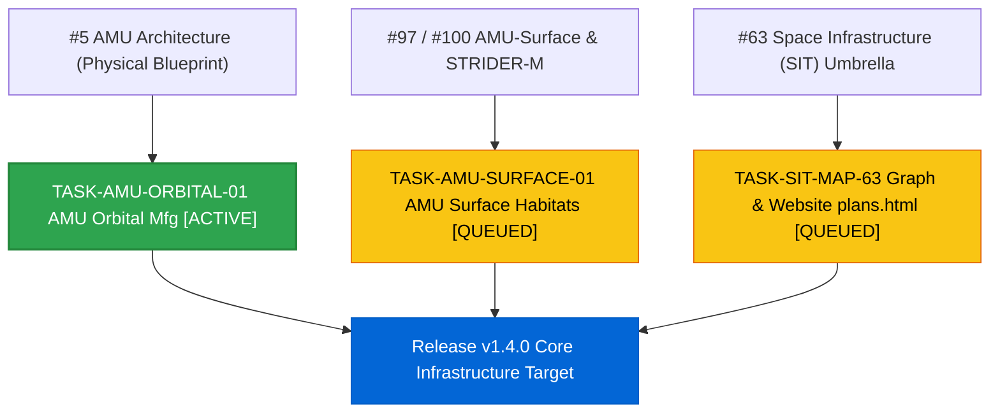

# Forward Engineering Task Tracker (Core Space Infrastructure & AMU Advancements)

> [!TIP]
> ### ❤️ THE WHY: Purpose, Humanity & Impact
> Building open, resilient, and human-affirming space infrastructure—enabling autonomous orbital manufacturing, safe surface habitats, and decentralized resource stewardship without human subjugation or extractive exploitation.

---

## 🎯 Current Operational Focus

```diff
+ ╔════════════════════════════════════════════════════════════════════════════╗
+ ║  ┌──────────────────────────────────────────────────────────────────────┐  ║
+ ║  │ ⏰ TIMESTAMP: 2026-10-23 06:10 EDT / 10:10 UTC                       │  ║
+ ║  │ 🎯 PRIMARY TARGET: TASK-AMU-ORBITAL-01 (AMU Orbital Spec)            │  ║
+ ║  │    Assignee: @genidma & AGY                                          │  ║
+ ║  │    Branch Sync: 9c18457 (main == main-dev)                           │  ║
+ ║  │    Active Repo: https://github.com/stellardreams/asi.surge.sh        │  ║
+ ║  │    Issue Sequence:                                                   │  ║
+ ║  │      1. #5   (Look 1st: AMU Physical Blueprint & Swarm Backbone)     │  ║
+ ║  │      2. #97  (Look 2nd: AMU-Surface Baseline & Habitat Envelope)     │  ║
+ ║  │      3. #100 (Look 3rd: STRIDER-M v2 Transporter CAD & Latches)      │  ║
+ ║  │      4. #63  (Look 4th: Umbrella Space Infrastructure Governance)    │  ║
+ ║  │    In-Issue Search String -> : 'AMU Orbital Architecture & Assembly' │  ║
+ ║  └──────────────────────────────────────────────────────────────────────┘  ║
+ ╚════════════════════════════════════════════════════════════════════════════╝
+ ╔═════════════════════════════════════════════════════╗
+ ║  ┌───────────────────────────────────────────────┐  ║
+ ║  │ 🎯 NEXT PRIORITY 1: TASK-AMU-SURFACE-01       │  ║
+ ║  └───────────────────────────────────────────────┘  ║
+ ╚═════════════════════════════════════════════════════╝
+ ╔═════════════════════════════════════════════════════╗
+ ║  ┌───────────────────────────────────────────────┐  ║
+ ║  │ 🎯 NEXT PRIORITY 2: TASK-SIT-MAP-63           │  ║
+ ║  └───────────────────────────────────────────────┘  ║
+ ╚═════════════════════════════════════════════════════╝
```

---

### 📋 High-Level Action Checklist

| Priority | Task ID | Description | Status | Target |
| :---: | :--- | :--- | :---: | :--- |
| 🥇 | **TASK-AMU-ORBITAL-01** | AMU Orbital manufacturing & in-space automated assembly architectural specification | 🟢 `ACTIVE` | `plans/plan-amu-orbital.md` / [#5](https://github.com/stellardreams/asi.surge.sh/issues/5) |
| 🥈 | **TASK-AMU-SURFACE-01** | AMU-Surface habitat modules, regolith utilization & STRIDER-M transporter integration | 🟡 `QUEUED` | `plans/plan-amu-surface.md` / [#100](https://github.com/stellardreams/asi.surge.sh/issues/100) |
| 🥉 | **TASK-SIT-MAP-63** | Map high-level SIT governance and requirements graph to concrete plans and website `plans.html` | 🟡 `QUEUED` | [#63](https://github.com/stellardreams/asi.surge.sh/issues/63) / `plans.html` |

---

### 🏆 Recently Completed Milestones

- [x] **Release v1.3.3 (Mini Release)**: Notable Releases table updated with Releases v1.2, v1.3.0–v1.3.3; Aesop philosophy and insect farming exclusion integrated. Commits `87ae2a1`, `9c18457`. ✅
- [x] **Issue #101 Sealed**: Hardware Invention & Model Registry completed (65/65 items). ✅
- [x] **Issue #102 Sealed**: Website Portfolio & Technical Showcase completed (25/25 items). ✅
- [x] **Issue #106 Sealed**: Notable Releases Section in README completed (2/2 items). ✅
- [x] **Arctic Wind Decoupling**: All Modular Arctic Wind tasks decoupled to `stellardreams/modular-arctic-wind`. ✅

---

## 📋 Task Matrix

### 🟢 Active & Forward Pipeline

| ID | Task Description | Scope / Context | Parent / Origin | Status |
|:---|:---|:---|:---|:---|
| 🔄 **TASK-AMU-ORBITAL-01** | **AMU Orbital Manufacturing Architecture** | Formulate autonomous in-space fabrication, beam welding, toolhead changer, and microgravity metallurgy specifications. | • Tracked in: [#5](https://github.com/stellardreams/asi.surge.sh/issues/5)<br>• Target: `plans/plan-amu-orbital.md` | 🟢 `ACTIVE` |
| 🔄 **TASK-AMU-SURFACE-01** | **AMU-Surface Habitat Modules** | Define pressurized surface modules, regolith sintering / shielding shells, airlock interfaces, and STRIDER-M chassis mounting. | • Parent Trackers: [#97](https://github.com/stellardreams/asi.surge.sh/issues/97) (Closed), [#100](https://github.com/stellardreams/asi.surge.sh/issues/100) (Open)<br>• Target: `plans/plan-amu-surface.md` | 🟡 `QUEUED` |
| 🔄 **TASK-SIT-MAP-63** | **SIT High-Level Graph Reconciliation** | Re-link graph nodes to targeted plan files and update the live website's `plans.html` showcase. | • Tracked in: [#63](https://github.com/stellardreams/asi.surge.sh/issues/63)<br>• Target: `plans.html` & `plans/` | 🟡 `QUEUED` |
| ⏸️ **TASK-DND-TRL-READING** | **DND / Canada.ca TRL 1–9 Reading Track** | Review DND TRL definitions (definitions only) for maintainer reference. | • Tracked in: `Feedback_0700.md` Part 4 | ⏸️ `LOW_PRIORITY` |

---

## 🔍 Task Hierarchy & Lineage

### 📊 Visual Dependency Flow (Mermaid.js)



---

## 📌 Initiative Metadata & Lineage

> **Status:** Active  
> **Environment:** Google Antigravity (AGY)  
> **Active Branch:** `main-dev` (synced with `main` at `9c18457`)  
> **Parent Initiatives:** [#5](https://github.com/stellardreams/asi.surge.sh/issues/5), [#63](https://github.com/stellardreams/asi.surge.sh/issues/63), [#100](https://github.com/stellardreams/asi.surge.sh/issues/100)  
> **Target Release:** `v1.4.0` (Core Space Infrastructure)
