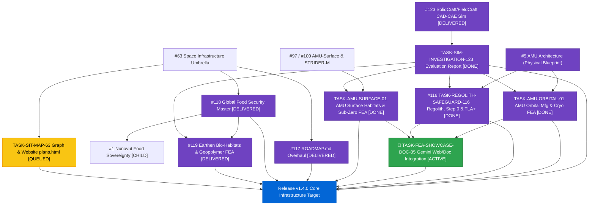

# Forward Engineering Task Tracker (Core Space Infrastructure & AMU Advancements)

> [!TIP]
> ### ❤️ THE WHY: Purpose, Humanity & Impact
> Building open, resilient, and human-affirming space infrastructure—enabling autonomous orbital manufacturing, safe surface habitats, and decentralized resource stewardship without human subjugation or extractive exploitation.

---

## 🎯 Current Operational Focus

```text
╔════════════════════════════════════════════════════════════════════════════╗
║  ┌──────────────────────────────────────────────────────────────────────┐  ║
║  │ ⏰ TIMESTAMP: 2026-11-03 18:35 EST / 23:35 UTC                       │  ║
║  │ 🎯 PRIMARY TARGET: TASK-FEA-SHOWCASE-DOC-05                         │  ║
║  │    Assignee: AGY (Gemini 3.8 Flash) & @genidma                       │  ║
║  │    Branch Sync: main & main-dev in sync                              │  ║
║  │    Active Repo: https://github.com/stellardreams/asi.surge.sh        │  ║
║  │    Deliverable: amu.html & plans.html multiphysics FEA showcase      │  ║
║  │    Parent Trackers: #5, #100, #116, #119, #123                       │  ║
║  │    In-Issue Search String ➡️ : 'Engineering Deliverable Summary — #5' │  ║
║  │    Focus Scope:                                                      │  ║
║  │      • Mars–Jupiter, Regolith, STRIDER-M & Manna Vault FEA galleries │  ║
║  │      • Andy Grove "Only the Paranoid Survive" Bionic Hull Sentry     │  ║
║  │      • Living blueprint spec cards in plans.html                     │  ║
║  └──────────────────────────────────────────────────────────────────────┘  ║
╚════════════════════════════════════════════════════════════════════════════╝
╔═════════════════════════════════════════════════════╗
║  ┌───────────────────────────────────────────────┐  ║
║  │ 🎯 NEXT PRIORITY 1: TASK-SIT-MAP-63           │  ║
║  └───────────────────────────────────────────────┘  ║
╚═════════════════════════════════════════════════════╝
```

#### 🎯 PRIMARY TARGET: TASK-FEA-SHOWCASE-DOC-05
- **Lineage**: [#5](https://github.com/stellardreams/asi.surge.sh/issues/5) · [#100](https://github.com/stellardreams/asi.surge.sh/issues/100) · [#116](https://github.com/stellardreams/asi.surge.sh/issues/116) · [#119](https://github.com/stellardreams/asi.surge.sh/issues/119) · [#123](https://github.com/stellardreams/asi.surge.sh/issues/123)
- **In-Issue Search String ➡️** : `'Engineering Deliverable Summary — #5'`
- **Assignee**: `AGY` (`Gemini 3.8 Flash`) & `@genidma`

#### 🎯 NEXT PRIORITY 1: TASK-SIT-MAP-63
- **Lineage**: [#63](https://github.com/stellardreams/asi.surge.sh/issues/63) (`plans.html` & `amu.html` Showcase Reconciliation)
- **In-Issue Search String ➡️** : `'TASK-SIT-MAP-63'`
- **Assignee**: `AGY` (`Gemini 3.8 Flash`) & `@genidma`

---

### 📋 High-Level Action Checklist

| Priority | Task ID | Description | Status | Target |
| :---: | :--- | :--- | :---: | :--- |
| 🥇 | **TASK-FEA-SHOWCASE-DOC-05** | Document Mars–Jupiter coupled FEA (#5), Sintered Regolith Shield FEA (#116), `STRIDER-M` `316L` Turret Collar FEA (#100), Manna Vault FEA (#119), & Andy Grove Bionic Hull Sentry Daemon in web showcase *(Gemini 3.8 Flash Low)* | 🟢 `ACTIVE` | [#5](https://github.com/stellardreams/asi.surge.sh/issues/5) / [#100](https://github.com/stellardreams/asi.surge.sh/issues/100) / [#116](https://github.com/stellardreams/asi.surge.sh/issues/116) / `amu.html` / `plans.html` |
| 🥈 | **TASK-SIT-MAP-63** | Map high-level SIT governance and requirements graph to concrete plans and website `plans.html` *(Gemini 3.8 Flash Low)* | 🟡 `QUEUED` | [#63](https://github.com/stellardreams/asi.surge.sh/issues/63) / `plans.html` |
| 3️⃣ | **TASK-AMU-SURFACE-01** | AMU-Surface habitat modules, `NEMA 4X / IEC IP66-IP68` `316L` enclosures, sub-zero anti-adfreeze latches & `STRIDER-M` v2 turret collar coupled FEA delivered | 🏁 `DONE` | [`plans/plan-amu-surface.md`](plans/plan-amu-surface.md) / [#100](https://github.com/stellardreams/asi.surge.sh/issues/100) / [#5](https://github.com/stellardreams/asi.surge.sh/issues/5) |
| 4️⃣ | **TASK-REGOLITH-SAFEGUARD-116**| AMU Self-Replication Protocol: In-Situ Asteroid Regolith Manufacturing, Step 0 Gate, `TLA+` Proof & Coupled FEA delivered | 🏁 `DONE` | [`plans/plan-regolith-self-replication-safeguard.md`](plans/plan-regolith-self-replication-safeguard.md) / [#116](https://github.com/stellardreams/asi.surge.sh/issues/116) |
| 5️⃣ | **TASK-AMU-ORBITAL-01** | AMU Orbital manufacturing, MIL-STD-461G cryo umbilicals & Mars–Jupiter coupled FEA delivered | 🏁 `DONE` | [`plans/plan-amu-orbital.md`](plans/plan-amu-orbital.md) / [#5](https://github.com/stellardreams/asi.surge.sh/issues/5) |
| 6️⃣ | **TASK-EARTHEN-HABITAT-119** | 🏺 The New Manna Machine (Form Earth + Shangrila-VHP #45 + Sub-Zero Geopolymer FEA) | 🏁 `DONE` | [#119](https://github.com/stellardreams/asi.surge.sh/issues/119) / [`plans/plan-earthen-bio-habitats.md`](plans/plan-earthen-bio-habitats.md) |
| 7️⃣ | **TASK-SIM-INVESTIGATION-123** | SolidCraft + FieldCraft pure-Rust CAD/CAE evaluation & Argon verification delivered | 🏁 `DONE` | [`docs/tech_guide/SOLID_AND_FIELD_CRAFT_EVALUATION.md`](docs/tech_guide/SOLID_AND_FIELD_CRAFT_EVALUATION.md) / [#123](https://github.com/stellardreams/asi.surge.sh/issues/123) |
| 8️⃣ | **TASK-FOOD-SECURITY-118** | Global Food Security master umbrella architecture specification delivered | 🏁 `DONE` | `plans/plan-food-security.md` / [#118](https://github.com/stellardreams/asi.surge.sh/issues/118) |
| 9️⃣ | **TASK-ROADMAP-UPDATE-117** | Update `ROADMAP.md` with v1.3.3 milestones, decoupled Arctic Wind, and AMU priorities | 🏁 `DONE` | `ROADMAP.md` / [#117](https://github.com/stellardreams/asi.surge.sh/issues/117) |
| 🔟 | **CHORE-IDE-DOC-CLEANUP** | Audit, extract, decouple, and sanitize legacy documents, CAD solids, and specifications | 🏁 `DONE` | `scratch/`, `.sys_opt/`, root workspace |

---

### 🏆 Recently Completed Milestones

- [x] **AMU-Surface Habitat Blueprint, Sub-Zero `NEMA 4X / IEC IP66-IP68` `316L` Enclosures, Anti-Adfreeze Latches & `STRIDER-M` v2 Turret Collar Coupled FEA Delivered (`TASK-AMU-SURFACE-01`)**: Authored [`plans/plan-amu-surface.md`](plans/plan-amu-surface.md) unifying the pressurized surface vault shelter ([`amu_surface_habitat_v1.scad`](cad_and_blender/openscad/amu_surface/amu_surface_habitat_v1.scad), $2.5\text{ m}$ sintered regolith dome, $\text{CO}_2$ thermosiphon piles), the standalone mobile tracked AMU ([`amu_mobile_surface_solo_v2_1.scad`](cad_and_blender/openscad/amu_surface/amu_mobile_surface_solo_v2_1.scad), $19.19\text{ kPa} \le 25.0\text{ kPa}$ ground pressure, $\text{FoS} = 1.30$), and the `STRIDER-M` v2 transporter ([`strider_m_transporter_v2.scad`](cad_and_blender/openscad/amu_surface/strider_m_transporter_v2.scad), $6.92\text{ kPa}$ ground pressure, $\text{FoS} = 3.61$, 4x A-frame spider outriggers). Specified laser-welded $3.0\text{ mm}$ `316L` (`UNS S31603`) `NEMA 4X / IEC IP66-IP68` enclosures, `MIL-STD-461G` 360° braided coaxial umbilical raceways (`BeCu` iris glands, $R_{\text{bond}} < 1.0\text{ m}\Omega$), and `PTFE + 15% MoS₂` anti-adfreeze dog liners ($\tau_{\text{ice}} < 18\text{ kPa}$) + $180\text{ W}$ electro-thermal / $28\text{ kHz}$ ultrasonic ice-shakers (#100 Comment `6530228137`). Solved the coupled 3D `hex20` FEA of the `STRIDER-M` v2 `316L` turret docking collar in FieldCraft `v0.7.0` ([`amu_surface_habitat_strider_sim.json`](cad_and_blender/tangency_eval/amu_surface_habitat_strider_sim.json): $+25^\circ\text{C}$ bore to $-125^\circ\text{C}$ polar rim, mid-wall $T = -59.4756^\circ\text{C}$, peak $\sigma_{\text{vM}} = 297.90\text{ MPa}$ on `G-10 CR` radial thrust mount, $\text{FoS}_y = 1.63, \text{FoS}_u = 3.16$) and updated [`cad_and_blender/REGISTRY.md`](cad_and_blender/REGISTRY.md) (#101). Issues #100 and #5 kept OPEN pending review. ✅

- [x] **AMU Self-Replication Protocol, Step 0 Astrobiological Gate, `TLA+` Proof & Sintered Regolith Shield Coupled FEA Delivered (`TASK-REGOLITH-SAFEGUARD-116`)**: Authored [`plans/plan-regolith-self-replication-safeguard.md`](plans/plan-regolith-self-replication-safeguard.md) specifying the 5-tier non-destructive Step 0 astrobiological assay (248.6 nm Deep-UV Raman/Fluorescence, Mid-IR FTIR, Chiral GC-MS $ee > 15\%$, $\text{SiN}_x$ Nanopore Polyanion Sequencer, and $2\,\mu\text{m}$ $\mu\text{CT}$/SQUID magnetometry), the $< 5\text{ ms}$ hardware mechanical interlock and $R \ge 100\text{ km}$ COSPAR Category V+ Planetary Reserve quarantine, Molten Oxide Electrolysis ($\text{MOE}$ at $1{,}600^\circ\text{C}$) + gaseous Mond carbonyl $\text{Fe-Ni}$ refining, `CLASS_A/B/C` `SiC` OTP hardware eFuse hygienic partitioning, 5-factor `AMU_GENESIS_ATTESTATION`, and the formal `TLA+` module (`AMUSelfReplicationSafeguard.tla`). Solved the coupled thermal-structural FEA of the $150\text{ mm}$ sintered basalt-$\text{FeNi}$ cermet radiation shield in FieldCraft `v0.7.0` (`regolith_sintering_shield_sim.json`: $+45^\circ\text{C}$ to $-155^\circ\text{C}$, mid-wall $T = -55.6125^\circ\text{C}$, extrados tensile $\sigma_{\text{vM}} = 80.58\text{ MPa}$ ($\text{FoS}_t = 2.30$), aft root $\sigma_{\text{vM}} = 146.09\text{ MPa}$ ($\text{FoS}_c = 2.19$)) and updated [`cad_and_blender/REGISTRY.md`](cad_and_blender/REGISTRY.md) per #101. Issue #116 kept OPEN pending review. ✅
- [x] **AMU Orbital Manufacturing Blueprint & Mars–Jupiter Coupled FEA Delivered (`TASK-AMU-ORBITAL-01`)**: Authored [`plans/plan-amu-orbital.md`](plans/plan-amu-orbital.md) specifying the four-module orbital facility (Module I Autonomous Foundry & $3\text{ K}$ Radiative Flash-Freeze Vitrification, Module II Zero-Boil-Off Cryo Tank Farm & MIL-STD-461G 360° braided cryogenic umbilicals with iris/cone EMC compression glands, Module III Bioreactor Array, and Module IV $0.3\text{--}1.0g$ Variable-Gravity Habitat Ring with permanent purpose-segregation air-gap & FAA/FDA oversight), the $2\tau_{\text{OWLT}}$ Speed-of-Light Latency Blind-Spot Risk Registry, the Andy Grove Bionic Hull Sentry Daemon, and the Wikinomics `AbundanceDividend` model. Executed the Mars–Jupiter Main Belt Corridor coupled thermal-structural FEA in FieldCraft `v0.7.0` (`amu_orbital_mars_jupiter_sim.json`: $50\text{ mm}$ Al-Li 2195-T8 hull under $\Delta T = 205\text{ K}$ eclipse shock + $1\text{ atm}$ + $50\text{ kN}$ docking thrust; mid-wall $T = -82.71^\circ\text{C}$, mid-span skin $\sigma_{\text{vM}} = 239.87\text{ MPa}$ ($\text{FoS}=2.33$), aft root $\sigma_{\text{vM}} = 438.44\text{ MPa}$ ($\text{FoS}=1.28$)) and updated [`cad_and_blender/REGISTRY.md`](cad_and_blender/REGISTRY.md) per #101. Merged to `main` (`5b0e1b8`). Issue #5 kept OPEN pending review. ✅
- [x] **The New Manna Machine Sub-Zero Geopolymer Binder & Coupled FEA Delivered (`TASK-EARTHEN-HABITAT-119`)**: Specified potassium-silicate alkali-activated aluminosilicate geopolymer binder chemistry ($\text{K}_2\text{SiO}_3 + 8\text{ M KOH} + \text{CaAl}_2\text{O}_4$, liquidus depressed to $-22^\circ\text{C}$, $18.5\text{ MPa}$ 7-day sub-zero cure) and solved coupled steady-state thermal conduction ($-45^\circ\text{C}$ Arctic exterior to $+18^\circ\text{C}$ interior polyculture core) + gravity + $15\text{ kPa}$ snow overburden on the $550\text{ mm}$ catenary vault arch in FieldCraft `v0.7.0` (`manna_vault_thermal_structural_sim.json`, mid-wall $T = -15.06^\circ\text{C}$, crown $\delta_z = -1.175\text{ mm}$, peak foundation toe stress $\sigma_{\text{vM,max}} = 3.79\text{ MPa}, \text{FoS} = 4.88$). Updated [`plans/plan-earthen-bio-habitats.md`](plans/plan-earthen-bio-habitats.md) Section 6 and registered Section 4.3 in [`cad_and_blender/REGISTRY.md`](cad_and_blender/REGISTRY.md). Merged to `main` (`efc34c6`). Issue #119 kept OPEN pending review. ✅
- [x] **SolidCraft + FieldCraft CAD/CAE Evaluation & Argon Verification Delivered (`TASK-SIM-INVESTIGATION-123`)**: Completed full Experiment A/B/C verification in [`docs/tech_guide/SOLID_AND_FIELD_CRAFT_EVALUATION.md`](docs/tech_guide/SOLID_AND_FIELD_CRAFT_EVALUATION.md): parametric Aluminium L-Bracket ($100 \times 50 \times 5\text{ mm}$ with $R=4\text{ mm}$ inner fillet and $2\times \varnothing 8\text{ mm}$ mounting holes), `solidcraft/21` native CAD-to-FEA container bridge (`test_bracket_v21.solidcraft`), $10{,}837\text{ tet10}$ bracket stress FEA ($\sigma_{\text{vM,fillet}} = 141.65\text{ MPa}$), and 80-element quadratic `hex20` cantilever beam benchmark ($99.996\%$ Euler-Bernoulli convergence). Merged to `main` (`efc34c6`). Issue #123 kept OPEN pending review. ✅
- [x] **Global Food Security Master Architecture Delivered (`TASK-FOOD-SECURITY-118`)**: Authored [`plans/plan-food-security.md`](plans/plan-food-security.md) bridging closed-loop ECLSS with terrestrial crisis triage (DRC/WFP), linking Nunavut food sovereignty ([#1](https://github.com/stellardreams/asi.surge.sh/issues/1)) and automated earthen bio-habitats ([#119](https://github.com/stellardreams/asi.surge.sh/issues/119)), and establishing a zero-insect-farming biosafety policy. Pushed to `main-dev` (`b02f7d7`) and merged to `main` (`eaaae7a`). Issue #118 kept OPEN pending user review. ✅
- [x] **Roadmap Architecture Overhaul Delivered (`TASK-ROADMAP-UPDATE-117`)**: Overhauled [`ROADMAP.md`](ROADMAP.md) into a comprehensive Tier 0 through Tier 3 hierarchy incorporating delivered engineering assets across Releases `v1.1` through `v1.3.3` (AMU Heritage Orbital `v1.0`, CORA-M `v1.0`, STRIDER-M `v1.0`/`v2.1`, AMU-Surface Habitat `v1.1`, and The New Manna Machine `v1.0`). Pushed to `main-dev` (`da4f947`) and merged to `main` (`eaaae7a`). Issue #117 kept OPEN pending user review. ✅
- [x] **Draft Release Notes v1.3.4 Updated**: Documented repository decoupling, CAD archival, security remediations, issues #5 / #116 / #117 / #118 / #119 / #123, FEA screenshot galleries, verified UTC work effort (`12h 04m`), and co-collaborator credits in [`docs/release_notes/v1.3.4-draft.md`](docs/release_notes/v1.3.4-draft.md). ✅
- [x] **IDE Stale Document Cleanup & Audit Sealed (`CHORE-IDE-DOC-CLEANUP`)**: Extracted all actionable engineering specifications into active issues (`#5`, `#100`, `#119`), transferred wind models to upstream repository, archived residual notes and ideas in `_z_archives/`, and audited machine-specific paths with zero public repository exposure. ✅
- [x] **Modular Arctic Wind Upstream Decoupling & Hand-Off**: Decoupled full turbine engineering architecture into [`stellardreams/modular-arctic-wind`](https://github.com/stellardreams/modular-arctic-wind). Verified both branches intact on `main` and `main-dev`. ✅
- [x] **CAD & Spec Archival to `_z_archives`**: Archived `cad_and_blender/freecad/wind/` and wind `.step` exports to [`_z_archives/cad/`](_z_archives/cad/), modernized [`cad_and_blender/REGISTRY.md`](cad_and_blender/REGISTRY.md), archived proposal reviews and foundation/enclosure specs to [`_z_archives/sys_opt/`](_z_archives/sys_opt/). Commits `2703f0c`–`1904196`. ✅
- [x] **Universal TRL Framework**: Published [`docs/tech_guide/TRL_FRAMEWORK.md`](docs/tech_guide/TRL_FRAMEWORK.md) (100% sanitized TRL 1–9 exit gates). Commit `065e482`. ✅
- [x] **🏺 The New Manna Machine (Issue #119 Initial Baseline)**: Delivered architectural plan (`plans/plan-earthen-bio-habitats.md`), parametric OpenSCAD model with multi-tier food production, FreeCAD B-Rep solid model, neutral STEP export, and 360° turntable animations. Interlinked with Master Issue #118. Commits `db7b5a0`–`a19a17b`. ✅
- [x] **Release v1.3.3 (Mini Release)**: Notable Releases table updated with Releases v1.2, v1.3.0–v1.3.3; Aesop philosophy and insect farming exclusion integrated. Commits `87ae2a1`, `9c18457`. ✅

---

## 📋 Task Matrix

### 🟢 Active & Forward Pipeline

| ID | Task Description | Scope / Context | Parent / Origin | Status |
|:---|:---|:---|:---|:---|
| 🔄 **TASK-FEA-SHOWCASE-DOC-05** | **Multiphysics FEA & Bionic Sentry Web/Doc Integration** *(Gemini 3.8 Flash Low)* | Integrate Mars–Jupiter coupled FEA (`amu_orbital_fea.png`, `amu_orbital_thermal_fea.png`), Sintered Regolith Shield FEA (`regolith_sintering_fea.png`), `STRIDER-M` `316L` Turret Collar FEA (`amu_surface_strider_fea.png`), Manna Vault FEA (`manna_vault_fea.png`), and Andy Grove Bionic Hull Sentry Daemon across `amu.html` and `plans.html`. | • Tracked in: [#5](https://github.com/stellardreams/asi.surge.sh/issues/5), [#100](https://github.com/stellardreams/asi.surge.sh/issues/100), [#116](https://github.com/stellardreams/asi.surge.sh/issues/116), [#119](https://github.com/stellardreams/asi.surge.sh/issues/119), [#123](https://github.com/stellardreams/asi.surge.sh/issues/123)<br>• Target: `amu.html`, `plans.html` | 🟢 `ACTIVE` |
| 🔄 **TASK-SIT-MAP-63** | **SIT High-Level Graph Reconciliation** *(Gemini 3.8 Flash Low)* | Re-link graph nodes to targeted plan files (`plan-amu-orbital.md`, `plan-amu-surface.md`, `plan-regolith-self-replication-safeguard.md`, `plan-food-security.md`, `plan-earthen-bio-habitats.md`) and update live `plans.html` showcase. | • Tracked in: [#63](https://github.com/stellardreams/asi.surge.sh/issues/63)<br>• Target: `plans.html` & `plans/` | 🟡 `QUEUED` |
| 🏁 **TASK-AMU-SURFACE-01** | **AMU-Surface Habitat Modules & `STRIDER-M` Sub-Zero Hardening** | Pressurized surface modules, $2.5\text{ m}$ regolith shielding dome, ceiling-to-rover airlock, `STRIDER-M` sub-zero anti-adfreeze deck latches, `NEMA 4X / IEC IP66-IP68` `316L` enclosures, and `STRIDER-M` `316L` turret collar coupled FEA delivered. | • Parent Trackers: [#97](https://github.com/stellardreams/asi.surge.sh/issues/97) (Closed), [#100](https://github.com/stellardreams/asi.surge.sh/issues/100) (Open), [#5](https://github.com/stellardreams/asi.surge.sh/issues/5) (Open)<br>• Target: [`plans/plan-amu-surface.md`](plans/plan-amu-surface.md) | 🏁 `DONE` |
| 🏁 **TASK-REGOLITH-SAFEGUARD-116**| **AMU Regolith Self-Replication & Step 0 Gate** | Step 0 astrobiological intercept gate, MOE/Mond carbonyl refining, `CLASS_A/B/C` `SiC` eFuse partitioning, `AMUSelfReplicationSafeguard.tla` `TLA+` proof, and Sintered Regolith Shield coupled FEA delivered. | • Tracked in: [#116](https://github.com/stellardreams/asi.surge.sh/issues/116)<br>• Target: [`plans/plan-regolith-self-replication-safeguard.md`](plans/plan-regolith-self-replication-safeguard.md) | 🏁 `DONE` |
| 🏁 **TASK-AMU-ORBITAL-01** | **AMU Orbital Manufacturing Architecture** | Autonomous in-space fabrication, beam welding, toolhead changer, microgravity metallurgy, MIL-STD-461G 360° braided cryogenic umbilical harness, and Mars–Jupiter coupled FEA delivered. | • Tracked in: [#5](https://github.com/stellardreams/asi.surge.sh/issues/5)<br>• Target: [`plans/plan-amu-orbital.md`](plans/plan-amu-orbital.md) | 🏁 `DONE` |
| 🏁 **TASK-EARTHEN-HABITAT-119** | **🏺 The New Manna Machine (Earthen Bio-Habitats)** | Dual-tier rammed earth (Form Earth) + self-replicating adobe printer (Shangrila-VHP #45) + AMU polyculture shell + sub-zero potassium-silicate geopolymer coupled FEA delivered. | • Tracked in: [#119](https://github.com/stellardreams/asi.surge.sh/issues/119)<br>• Parent: [#118](https://github.com/stellardreams/asi.surge.sh/issues/118) | 🏁 `DONE` |
| 🏁 **TASK-SIM-INVESTIGATION-123** | **SolidCraft + FieldCraft CAD/CAE Evaluation** | Pure-Rust CAD/CAE evaluation (Tangency Labs), Experiment A/B/C verification, `solidcraft/21` bridge, `hex20`/`tet10` FEA benchmarks, and MCP automation delivered. | • Tracked in: [#123](https://github.com/stellardreams/asi.surge.sh/issues/123)<br>• Target: `docs/tech_guide/SOLID_AND_FIELD_CRAFT_EVALUATION.md` | 🏁 `DONE` |
| 🏁 **TASK-FOOD-SECURITY-118** | **Global Food Security & Terrestrial AMU** | Coordinate high-latitude food sovereignty (Nunavut #1) and rapid crisis nutrition deployment (DRC, WFP). | • Tracked in: [#118](https://github.com/stellardreams/asi.surge.sh/issues/118)<br>• Child: [#1](https://github.com/stellardreams/asi.surge.sh/issues/1) | 🏁 `DONE` |
| 🏁 **TASK-ROADMAP-UPDATE-117** | **ROADMAP.md Architecture & Milestones** | Overhaul `ROADMAP.md` to incorporate delivered v1.1–v1.3.3 hardware/cad registries, Arctic Wind decoupling, and AMU priorities. | • Tracked in: [#117](https://github.com/stellardreams/asi.surge.sh/issues/117)<br>• Target: `ROADMAP.md` | 🏁 `DONE` |
| ⏸️ **TASK-TRL-READING** | **Universal TRL 1–9 Engineering Reference Track** | Review universal TRL 1–9 definitions and exit gates for maintainer reference. | • Target: [`docs/tech_guide/TRL_FRAMEWORK.md`](docs/tech_guide/TRL_FRAMEWORK.md) | ⏸️ `LOW_PRIORITY` |
| 🏁 **CHORE-IDE-DOC-CLEANUP** | **IDE Stale Document Cleanup & Audit** | Audit, archive or prune stale documents, scratch comments, legacy review drafts, and unreferenced artifacts inside the IDE workspace. | • Tracked in: `forward_tasks.md` (no GH ticket; logged across both repos)<br>• Target: `scratch/`, `.sys_opt/`, root workspace | 🏁 `DONE` |

---

## 🔍 Task Hierarchy & Lineage

### 📊 Visual Dependency Flow (Mermaid.js)



---

## ⏱️ Shift Handover & Operational Logs

| Date & Window | Lead / Pair | Completed Work & Context | Active Handoff / Next Up |
| :--- | :--- | :--- | :--- |
| **2026-11-03**<br>`20:50–21:40 UTC` | `@genidma`<br>`AGY` (`Gemini 3.8 Flash Low`) | • Overhauled [`ROADMAP.md`](ROADMAP.md) (`TASK-ROADMAP-UPDATE-117`, #117) and authored [`plans/plan-food-security.md`](plans/plan-food-security.md) (`TASK-FOOD-SECURITY-118`, #118); merged to `main` (`eaaae7a`).<br>• Initialized pure-Rust SolidCraft/FieldCraft evaluation report (`#123`) and prepared Argon hand-off package (`b31efe7`). | Handed over to **Argon (`Gemini 4 Argon`)** for Experiment A/B/C CAD-FEA verification & multiphysics simulations. |
| **2026-11-03**<br>`21:40–23:25 UTC` | `@genidma`<br>`AGY` (`Gemini 4 Argon`) | • Completed Experiment A/B/C verification (#123: `test_bracket.sc`, `test_bracket_v21.solidcraft`, `cantilever_hex20_sim.json` $99.996\%$ convergence, `lbracket_fea_sim.json` $10{,}837\text{ tet10}$) and Sub-Zero Geopolymer Manna Vault Coupled FEA (#119: `manna_vault_thermal_structural_sim.json`, $\text{FoS}=4.88$); merged to `main` (`efc34c6`).<br>• Delivered [`plans/plan-amu-orbital.md`](plans/plan-amu-orbital.md) + MIL-STD-461G cryo umbilicals + Mars–Jupiter Coupled FEA (#5: `amu_orbital_mars_jupiter_sim.json`, $\text{FoS}_{\text{skin}}=2.33, \text{FoS}_{\text{root}}=1.28$); merged to `main` (`5b0e1b8`).<br>• Delivered [`plans/plan-regolith-self-replication-safeguard.md`](plans/plan-regolith-self-replication-safeguard.md) + Step 0 Gate + `TLA+` proof + Sintered Regolith Shield Coupled FEA (#116: `regolith_sintering_shield_sim.json`, $\text{FoS}_t=2.30, \text{FoS}_c=2.19$); merged to `main` (`5fb4133`).<br>• Delivered [`plans/plan-amu-surface.md`](plans/plan-amu-surface.md) + `NEMA 4X / IEC IP66-IP68` `316L` enclosures + sub-zero anti-adfreeze latches + `STRIDER-M` v2 `316L` Turret Collar Coupled FEA (#100, #5: `amu_surface_habitat_strider_sim.json`, $\text{FoS}_y=1.63, \text{FoS}_u=3.16$). | **`TASK-FEA-SHOWCASE-DOC-05`** & **`TASK-SIT-MAP-63`** ([#63](https://github.com/stellardreams/asi.surge.sh/issues/63)) for **Gemini 3.8 Flash Low** to integrate all new FEA renders and plans into `amu.html` & `plans.html`. |

---

## 📌 Initiative Metadata & Lineage

> **Status:** Active  
> **Environment:** Google Antigravity (AGY — Gemini 4 Argon & Gemini 3.8 Flash Low)  
> **Active Branch:** `main-dev`  
> **Parent Initiatives:** [#5](https://github.com/stellardreams/asi.surge.sh/issues/5), [#63](https://github.com/stellardreams/asi.surge.sh/issues/63), [#100](https://github.com/stellardreams/asi.surge.sh/issues/100), [#116](https://github.com/stellardreams/asi.surge.sh/issues/116), [#117](https://github.com/stellardreams/asi.surge.sh/issues/117), [#118](https://github.com/stellardreams/asi.surge.sh/issues/118), [#119](https://github.com/stellardreams/asi.surge.sh/issues/119), [#123](https://github.com/stellardreams/asi.surge.sh/issues/123)  
> **Slated for Release:** `v1.3.4` (tracked in [`docs/release_notes/v1.3.4-draft.md`](docs/release_notes/v1.3.4-draft.md))  
> **Target Release:** `v1.4.0` (Core Space Infrastructure)
