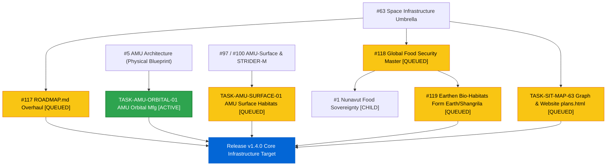

# Forward Engineering Task Tracker (Core Space Infrastructure & AMU Advancements)

> [!TIP]
> ### ❤️ THE WHY: Purpose, Humanity & Impact
> Building open, resilient, and human-affirming space infrastructure—enabling autonomous orbital manufacturing, safe surface habitats, and decentralized resource stewardship without human subjugation or extractive exploitation.

---

## 🎯 Current Operational Focus

```diff
+ ╔════════════════════════════════════════════════════════════════════════════╗
+ ║  ┌──────────────────────────────────────────────────────────────────────┐  ║
+ ║  │ ⏰ TIMESTAMP: 2026-10-30 15:26 EDT / 19:26 UTC                       │  ║
+ ║  │ 📌 PRIMARY TARGET: TASK-AMU-ORBITAL-01 (In-Space Manufacturing Plan) │  ║
+ ║  │    Assignee: @genidma & AGY                                          │  ║
+ ║  │    Branch Sync: 907dd43 (main-dev active)                            │  ║
+ ║  │    Active Repo: https://github.com/stellardreams/asi.surge.sh        │  ║
+ ║  │    Deliverable: plans/plan-amu-orbital.md                            │  ║
+ ║  │    Parent Tracker: #5 (AMU Physical Architecture Blueprint)          │  ║
+ ║  │    In-Issue Search String ➡️ : 'AMU-ORBITAL-01'                       │  ║
+ ║  │    Focus Scope:                                                      │  ║
+ ║  │      • Autonomous in-space electron beam welding                     │  ║
+ ║  │      • 6-DOF manipulator toolhead changer kinematics                 │  ║
+ ║  │      • Microgravity vacuum metallurgy & additive feedstocks          │  ║
+ ║  │      • MIL-STD-461G 360° braided cryogenic umbilical harness         │  ║
+ ║  └──────────────────────────────────────────────────────────────────────┘  ║
+ ╚════════════════════════════════════════════════════════════════════════════╝
+ ╔═════════════════════════════════════════════════════╗
+ ║  ┌───────────────────────────────────────────────┐  ║
+ ║  │ 🎯 NEXT PRIORITY 1: TASK-AMU-SURFACE-01       │  ║
+ ║  └───────────────────────────────────────────────┘  ║
+ ╚═════════════════════════════════════════════════════╝
+ ╔═════════════════════════════════════════════════════╗
+ ║  ┌───────────────────────────────────────────────┐  ║
+ ║  │ 🎯 NEXT PRIORITY 2: TASK-EARTHEN-HABITAT-119  │  ║
+ ║  └───────────────────────────────────────────────┘  ║
+ ╚═════════════════════════════════════════════════════╝
+ ╔═════════════════════════════════════════════════════╗
+ ║  ┌───────────────────────────────────────────────┐  ║
+ ║  │ 🎯 NEXT PRIORITY 3: TASK-FOOD-SECURITY-118    │  ║
+ ║  └───────────────────────────────────────────────┘  ║
+ ╚═════════════════════════════════════════════════════╝
```

---

### 📋 High-Level Action Checklist

| Priority | Task ID | Description | Status | Target |
| :---: | :--- | :--- | :---: | :--- |
| 🥇 | **TASK-AMU-ORBITAL-01** | AMU Orbital manufacturing & in-space automated assembly architectural specification | 🟢 `ACTIVE` | `plans/plan-amu-orbital.md` / [#5](https://github.com/stellardreams/asi.surge.sh/issues/5) |
| 🥈 | **TASK-AMU-SURFACE-01** | AMU-Surface habitat modules, regolith utilization & STRIDER-M transporter integration | 🟡 `QUEUED` | `plans/plan-amu-surface.md` / [#100](https://github.com/stellardreams/asi.surge.sh/issues/100) |
| 🥉 | **TASK-EARTHEN-HABITAT-119** | 🏺 The New Manna Machine (Form Earth slip-form + Shangrila-VHP #45 3D earth + AMU) | 🟡 `QUEUED` | [#119](https://github.com/stellardreams/asi.surge.sh/issues/119) / `plans/` |
| 4️⃣ | **TASK-FOOD-SECURITY-118** | Global Food Security umbrella coordination, Nunavut indoor farming (#1) & crisis triage | 🟡 `QUEUED` | [#118](https://github.com/stellardreams/asi.surge.sh/issues/118) / [#1](https://github.com/stellardreams/asi.surge.sh/issues/1) |
| 5️⃣ | **TASK-ROADMAP-UPDATE-117** | Update `ROADMAP.md` with v1.3.3 milestones, decoupled Arctic Wind, and AMU priorities | 🟡 `QUEUED` | [#117](https://github.com/stellardreams/asi.surge.sh/issues/117) / `ROADMAP.md` |
| 6️⃣ | **TASK-SIT-MAP-63** | Map high-level SIT governance and requirements graph to concrete plans and website `plans.html` | 🟡 `QUEUED` | [#63](https://github.com/stellardreams/asi.surge.sh/issues/63) / `plans.html` |
| 7️⃣ | **CHORE-IDE-DOC-CLEANUP** | Audit, extract, decouple, and sanitize legacy documents, CAD solids, and specifications | 🏁 `DONE` | `scratch/`, `.sys_opt/`, root workspace |

---

### 🏆 Recently Completed Milestones

- [x] **IDE Stale Document Cleanup & Audit Sealed (`CHORE-IDE-DOC-CLEANUP`)**: Extracted all actionable engineering specifications (umbilicals, NEMA 4X enclosures, geopolymers, permafrost foundations) into active issues (`#5`, `#100`, `#119`), transferred wind models to upstream repository, archived residual notes in `_z_archives/`, and audited machine-specific paths with zero public repository exposure. ✅
- [x] **Modular Arctic Wind Upstream Decoupling & Hand-Off**: Decoupled full turbine engineering architecture (FreeCAD parametric models, OpenSCAD sources, neutral STEP solids, renders, exploded blowup diagrams, and specifications) into [`stellardreams/modular-arctic-wind`](https://github.com/stellardreams/modular-arctic-wind). Verified both branches intact on `main` and `main-dev`. ✅
- [x] **CAD & Spec Archival to `_z_archives`**: Archived `cad_and_blender/freecad/wind/` and wind `.step` exports to [`_z_archives/cad/`](_z_archives/cad/), modernized [`cad_and_blender/REGISTRY.md`](cad_and_blender/REGISTRY.md), archived proposal reviews and foundation/enclosure specs to [`_z_archives/sys_opt/`](_z_archives/sys_opt/). Commits `2703f0c`–`1904196`. ✅
- [x] **Draft Release Notes v1.3.4 Updated**: Documented repository decoupling, CAD archival, security remediations, and universal TRL framework in [`docs/release_notes/v1.3.4-draft.md`](docs/release_notes/v1.3.4-draft.md). Commit `5162206`. ✅
- [x] **Universal TRL Framework**: Published [`docs/tech_guide/TRL_FRAMEWORK.md`](docs/tech_guide/TRL_FRAMEWORK.md) (100% sanitized TRL 1–9 exit gates). Commit `065e482`. ✅
- [x] **🏺 The New Manna Machine (Issue #119 Initial Baseline)**: Delivered architectural plan (`plans/plan-earthen-bio-habitats.md`), parametric OpenSCAD model with multi-tier food production, FreeCAD B-Rep solid model, neutral STEP export, and 360° turntable animations. Interlinked with Master Issue #118. Commits `db7b5a0`–`a19a17b`. ✅
- [x] **Release v1.3.3 (Mini Release)**: Notable Releases table updated with Releases v1.2, v1.3.0–v1.3.3; Aesop philosophy and insect farming exclusion integrated. Commits `87ae2a1`, `9c18457`. ✅
- [x] **Issue #101 Sealed**: Hardware Invention & Model Registry completed (65/65 items). ✅
- [x] **Issue #102 Sealed**: Website Portfolio & Technical Showcase completed (25/25 items). ✅
- [x] **Issue #106 Sealed**: Notable Releases Section in README completed (2/2 items). ✅
- [x] **Forward Tasks Initialized**: Added `forward_tasks.md` with single-item flow geometry and zero-open-items audits on #5 and #116. Commits `9bb6f42`, `eb87f71`, `040f6ff`. ✅

---

## 📋 Task Matrix

### 🟢 Active & Forward Pipeline

| ID | Task Description | Scope / Context | Parent / Origin | Status |
|:---|:---|:---|:---|:---|
| 🔄 **TASK-AMU-ORBITAL-01** | **AMU Orbital Manufacturing Architecture** | Formulate autonomous in-space fabrication, beam welding, toolhead changer, microgravity metallurgy, and MIL-STD-461G 360° braided cryogenic umbilical harness specifications. | • Tracked in: [#5](https://github.com/stellardreams/asi.surge.sh/issues/5)<br>• Target: `plans/plan-amu-orbital.md` | 🟢 `ACTIVE` |
| 🔄 **TASK-AMU-SURFACE-01** | **AMU-Surface Habitat Modules** | Define pressurized surface modules, regolith sintering / shielding shells, airlock interfaces, STRIDER-M sub-zero deck latches, and extreme NEMA 4X / IP68 enclosures. | • Parent Trackers: [#97](https://github.com/stellardreams/asi.surge.sh/issues/97) (Closed), [#100](https://github.com/stellardreams/asi.surge.sh/issues/100) (Open)<br>• Target: `plans/plan-amu-surface.md` | 🟡 `QUEUED` |
| 🔄 **TASK-EARTHEN-HABITAT-119** | **🏺 The New Manna Machine (Earthen Bio-Habitats)** | Design dual-tier rammed earth (Form Earth) + self-replicating adobe printer (Shangrila-VHP #45) + AMU controlled polyculture shell with sub-zero alkali geopolymers. | • Tracked in: [#119](https://github.com/stellardreams/asi.surge.sh/issues/119)<br>• Parent: [#118](https://github.com/stellardreams/asi.surge.sh/issues/118) | 🟡 `QUEUED` |
| 🔄 **TASK-FOOD-SECURITY-118** | **Global Food Security & Terrestrial AMU** | Coordinate high-latitude food sovereignty (Nunavut #1) and rapid crisis nutrition deployment (DRC, WFP). | • Tracked in: [#118](https://github.com/stellardreams/asi.surge.sh/issues/118)<br>• Child: [#1](https://github.com/stellardreams/asi.surge.sh/issues/1) | 🟡 `QUEUED` |
| 🔄 **TASK-ROADMAP-UPDATE-117** | **ROADMAP.md Architecture & Milestones** | Overhaul `ROADMAP.md` to incorporate delivered v1.1–v1.3.3 hardware/cad registries, Arctic Wind decoupling, and AMU priorities. | • Tracked in: [#117](https://github.com/stellardreams/asi.surge.sh/issues/117)<br>• Target: `ROADMAP.md` | 🟡 `QUEUED` |
| 🔄 **TASK-SIT-MAP-63** | **SIT High-Level Graph Reconciliation** | Re-link graph nodes to targeted plan files and update the live website's `plans.html` showcase. | • Tracked in: [#63](https://github.com/stellardreams/asi.surge.sh/issues/63)<br>• Target: `plans.html` & `plans/` | 🟡 `QUEUED` |
| ⏸️ **TASK-TRL-READING** | **Universal TRL 1–9 Engineering Reference Track** | Review universal TRL 1–9 definitions and exit gates for maintainer reference. | • Target: [`docs/tech_guide/TRL_FRAMEWORK.md`](docs/tech_guide/TRL_FRAMEWORK.md) | ⏸️ `LOW_PRIORITY` |
| 🏁 **CHORE-IDE-DOC-CLEANUP** | **IDE Stale Document Cleanup & Audit** | Audit, archive or prune stale documents, scratch comments, legacy review drafts, and unreferenced artifacts inside the IDE workspace. | • Tracked in: `forward_tasks.md`<br>• Target: `scratch/`, `.sys_opt/`, root workspace | 🏁 `DONE` |

---

## 🔍 Task Hierarchy & Lineage

### 📊 Visual Dependency Flow (Mermaid.js)



---

## 📌 Initiative Metadata & Lineage

> **Status:** Active  
> **Environment:** Google Antigravity (AGY)  
> **Active Branch:** `main-dev` (synced at `5162206`)  
> **Parent Initiatives:** [#5](https://github.com/stellardreams/asi.surge.sh/issues/5), [#63](https://github.com/stellardreams/asi.surge.sh/issues/63), [#100](https://github.com/stellardreams/asi.surge.sh/issues/100), [#117](https://github.com/stellardreams/asi.surge.sh/issues/117), [#118](https://github.com/stellardreams/asi.surge.sh/issues/118), [#119](https://github.com/stellardreams/asi.surge.sh/issues/119)  
> **Target Release:** `v1.4.0` (Core Space Infrastructure)

