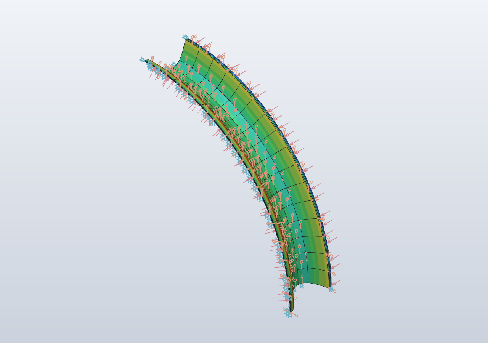
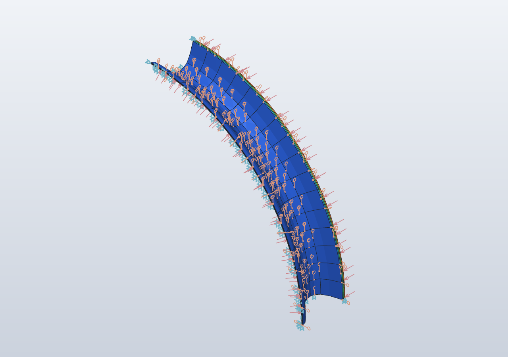

# Plan 1: 🛰️ AMU Orbital Architecture — Physical Blueprint, Autonomous Swarm Engine, Orbital Compute Ledger & Nutrient Logistics

> **Initiative Track**: [#5](https://github.com/stellardreams/asi.surge.sh/issues/5) (`TASK-AMU-ORBITAL-01`)  
> **Parent Governance & Umbrella**: [#63](https://github.com/stellardreams/asi.surge.sh/issues/63) (Space Infrastructure & Governance) · [#68](https://github.com/stellardreams/asi.surge.sh/issues/68) (Constitutional Stewardship)  
> **Child & Companion Tracks**: [#116](https://github.com/stellardreams/asi.surge.sh/issues/116) (Asteroid Regolith Self-Replication & Step 0 Safeguard) · [#118](https://github.com/stellardreams/asi.surge.sh/issues/118) (Global Food Security) · [#101](https://github.com/stellardreams/asi.surge.sh/issues/101) (Hardware Registry)  
> **Target Release**: `v1.4.0`  
> **Authors**: Gemini by Google DeepMind (Initial Conception), Adeel Khan ([@genidma](https://github.com/genidma)), & Antigravity (**Gemini 4 Argon**)

---

## 1. Mission Objective & Architectural Overview

This specification defines the fundamental physical, kinematic, electromagnetic, computational, and logistical architecture of the **Semi-Autonomous Manufacturing Unit (AMU)**—establishing the engineering bridge between the **"Ghost"** (decentralized SpaceROS swarm intelligence, Control Barrier Function collision avoidance, and cryptographic ledger attestation) and the **"Machine"** (modular Al-Li 2195 cylindrical pressure hulls, ZeroClaw 6-axis octahedral truss lattices, 7-DoF CORA-M rail manipulators, and 3-stage magnetohydrodynamic/APAS-95 universal docking arrays).

```mermaid
graph TD
    subgraph Module I: The Chassis (Hardware & Metallurgy)
        MMS["MMS Cylindrical Hull (L=17.92m, R=6.0m, Al-Li 2195)"]
        APAS["3-Stage MHD + APAS-95 Docking Array (R=1.55m)"]
        ZC["ZeroClaw 6-Axis Octahedral Truss Lattice"]
        CORA["7-DoF CORA-M Rail Arm + Quick-Disconnect Toolheads"]
        UMB["MIL-STD-461G 360° Coaxial Braided Cryo Umbilicals"]
    end

    subgraph Module II: The Brain (Swarm & Air-Gap Safety)
        SWARM["Symphonic CBF Swarm Consensus (<=15 m/s Hand-offs)"]
        HYB["Hybrid Control Loop (100Hz Local + OWLT Telemetry)"]
        SEG["Hard eFuse Purpose-Segregation Air-Gap (FAA/FDA Analogue)"]
        STEP0["Step 0 Bio-Ethical Lifeform Intercept Gate (#116)"]
    end

    subgraph Module III: The Soul (Ledger & Bionic Sentry)
        SENTRY["Kalman Vector & FBG Bionic Skin Defense Daemon"]
        LEDGER["Cryptographic Cycle Signing (Harvest -> Freeze -> Transit)"]
        DIV["Abundance Dividend Smart Contract (Wikinomics IP Equity)"]
    end

    subgraph Module IV: The Output (Cryo-Vitrification & Re-Entry)
        CRYO["3K Deep-Space Radiative Flash-Freeze Chain (< -135°C Tg)"]
        REENTRY["Modular Atmospheric Re-Entry Portal Hand-Off (#118)"]
    end

    MMS --> APAS
    MMS --> ZC
    CORA --> ZC
    UMB --> CORA
    STEP0 --> SWARM
    SWARM --> HYB
    HYB --> SEG
    SEG --> SENTRY
    SENTRY --> LEDGER
    LEDGER --> DIV
    APAS --> CRYO
    CRYO --> REENTRY
```

---

## 2. Module I: Geometric & Structural Logic (The Chassis)

### 2.1 Main Manufacturing Site (MMS) & Fractal Modular Chassis
The canonical orbital AMU baseline ([`cad_and_blender/REGISTRY.md` §1.1–1.3](../cad_and_blender/REGISTRY.md)) is engineered as a self-assembling, re-taskable cylindrical pressure vessel and external structural spine:
- **Authoritative CAD Lineage**:
  - FreeCAD B-Rep Solid (`v1.0`): [`cad_and_blender/freecad/amu_orbital/amu_heritage_orbital_v1.py`](../cad_and_blender/freecad/amu_orbital/amu_heritage_orbital_v1.py)
  - OpenSCAD Parametric Baselines (`v1.0`): [`amu_heritage_opencode_v1.scad`](../cad_and_blender/openscad/opencode/amu_heritage_opencode_v1.scad), [`amu_opencode_spaceROS_arm_v1.scad`](../cad_and_blender/openscad/opencode/amu_opencode_spaceROS_arm_v1.scad), and [`amu_CORA-M-arm-opencode_v1.scad`](../cad_and_blender/openscad/opencode/amu_CORA-M-arm-opencode_v1.scad)
  - ZeroClaw 6-Axis Octahedral Truss Node (`v1.0`): [`zeroclaw_truss_node_v1.py`](../cad_and_blender/freecad/amu_orbital/zeroclaw_truss_node_v1.py) & [`07-19-2026_zeroclaw_amu_node.scad`](../cad_and_blender/openscad/zeroclaw/07-19-2026_zeroclaw_amu_node.scad)
- **Hull Envelope & Constellation Scaling**:
  - **Primary Cylinder**: Length $L = 17.92\text{ m}$, outer radius $R_{\text{out}} = 6.00\text{ m}$ ($\varnothing 12.0\text{ m}$), flat axial bulkheads ($h = 0.60\text{ m}$), and four side-mounted articulating solar wing arrays ($2\times$ per side, truss pitch $0.32\text{ m}$).
  - **Via Ferrata Locomotive Grid**: 42 grooved structural rivets ($r = 0.18\text{ m}$) distributed across 8 circumferential sectors at $1.40\text{ m}$ pitch, enabling the **7-DoF CORA-M** manipulator toinchworm autonomously across the hull without fixed rails (`TRIAL 7` rail-free locomotion) or ride the E-W double transport spine ($r = 0.32\text{ m}$) linking `variant_dual` and `variant_quad` constellations.

### 2.2 Universal 3-Stage Docking Array (MHD + APAS-95 / PMA-2 Architecture)
To execute high-cadence autonomous hand-offs between heavy regolith transporters, metallurgical fabrication nodes, and sterile nutrient hubs without mechanical rebound or propellant plume contamination, each AMU integrates a **3-Stage Hybrid Docking Collar** offset at $X_{\text{hatch}} = +2.80\text{ m}$ (`ROOF_HATCH_X=2.8` dorsal `Z+`) and axial bulkheads:
1. **Stage 1 — Long-Range Lorentz / Magnetohydrodynamic (MHD) Eddy-Current Braking ($5.0\text{ m} \to 0.25\text{ m}$)**: Pulsed superconducting coils induce opposing Foucault eddy currents in the approaching passive target ring, dissipating relative kinetic energy ($\le 500\text{ J}$) and damping angular misalignment ($\pm 4.5^\circ \to \pm 0.2^\circ$) with zero physical contact.
2. **Stage 2 — Soft-Capture Androgynous Guide Ring ($0.25\text{ m} \to 0.00\text{ m}$)**: STS-132 / Harmony PMA-2 inspired circular APAS collar ($R_{\text{APAS}} = 1.55\text{ m}$, ring tube $0.14\text{ m}$, 3 guide petals at $120^\circ$ with $h = 0.38\text{ m}$) mated via 6-DoF Stewart-platform electromagnetic dampers.
3. **Stage 3 — Hard Structural & Fluid/Power Mating**: 12 peripheral motorized cam latches pull the dual silicone/indium-alloy vacuum seals to $150\text{ kN}$ preload, engaging the inward-/outward-hinged circular pressure hatch ($R_{\text{hatch}} = 1.22\text{ m}$, $\theta_{\text{open}} = 115^\circ$) and auto-mating the MIL-STD-461G coaxial power/data/cryo-fluid umbilicals.

### 2.3 In-Space Truss Fabrication, Electron-Beam Welding & Microgravity Metallurgy
Within **Class-C Industrial AMU** nodes, raw metallic feedstock refined from asteroid regolith ([#116](https://github.com/stellardreams/asi.surge.sh/issues/116)) is converted into **ZeroClaw octahedral truss struts** and O'Neill-cylinder structural ribs:
- **Microgravity Solar/Induction Crucible & Lorentz Slag Separation**:
  - Because gravitational buoyancy ($g = 0$) cannot float silicate slag ($\rho \approx 2.7\text{ g/cm}^3$) away from molten $\text{Fe-Ni-Co}$ alloy ($\rho \approx 7.8\text{ g/cm}^3$ at $1{,}650^\circ\text{C}$), the AMU crucible applies a **rotating transverse magnetic field ($B = 0.35\text{ T}, f = 400\text{ Hz}$)**.
  - The induced Lorentz body force $\mathbf{f}_L = \mathbf{J} \times \mathbf{B}$ selectively drives the electrically conductive metallic melt toward the outer crucible wall while expelling non-conductive silicate/oxide slag into the central vortex core for vacuum skimming.
- **CORA-M Quick-Disconnect Toolhead Changer**:
  - The 7-DoF CORA-M wrist collar switches autonomously in $< 8\text{ s}$ between three kinematic end-effectors:
    1. **Monkey-Y Symmetrical Golden Calipers** ($\pm 22^\circ$ Y-branch, grooved rivet & truss strut clamping).
    2. **$15\text{ kW}$ Vacuum Electron-Beam Welder (EBW)** ($60\text{ kV}$ accelerating voltage, $0.4\text{ mm}$ spot diameter, zero-porosity keyhole welding of Ti-6Al-4V and Al-Li 2195 ZeroClaw nodes in ambient hard vacuum).
    3. **Phased-Array Ultrasonic & Eddy-Current NDE Probe** (100% automated weld seam certification prior to structural load release).

### 2.4 Mars–Jupiter Main Belt Corridor Thermal Cycling & Structural Resilience FEA (`FieldCraft v0.7.0`)
Operating in the Mars–Jupiter Main Asteroid Belt corridor ($a = 2.2\text{--}3.3\text{ AU}$, nominal $2.77\text{ AU}$ where solar irradiance drops to $S \approx 177\text{ W/m}^2$), the AMU hull experiences extreme transmembrane and circumferential thermal gradients between its $+20.0^\circ\text{C}$ pressurized interior core and its $-185.0^\circ\text{C}$ ($88\text{ K}$) deep-space shadowed radiator skin ($\Delta T = 205.0\text{ K}$).

To verify structural resilience, Argon modeled a $90^\circ$ cylindrical quarter-sector of the **AMU Orbital MMS Hull (`AMUOrbitalHull`, $R_{\text{in}} = 5{,}950\text{ mm}, R_{\text{out}} = 6{,}000\text{ mm}$, $t = 50\text{ mm}$ Al-Li 2195-T8 cryogenic alloy, length $L_y = 2{,}000\text{ mm}$)** using **288 quadratic 20-node serendipity hexahedra (`hex20`, $1{,}689\text{ nodes}$, $5{,}067\text{ DOFs}$)** in [`cad_and_blender/tangency_eval/amu_orbital_mars_jupiter_sim.json`](../cad_and_blender/tangency_eval/amu_orbital_mars_jupiter_sim.json) under `coupled_temperature_displacement`:

| Verification Parameter | Boundary / Material Input | Solved FieldCraft FEA Output | Aerospace Margin (`NASA-STD-5001B`) |
| :--- | :--- | :--- | :--- |
| **Cryogenic Alloy (`AlLi2195_CryoAlloy`)** | $E = 76{,}000\text{ MPa}$, $\nu = 0.33$, $\rho = 2{,}710\text{ kg/m}^3$, $k = 130\text{ W/(m}\cdot\text{K)}$, $\alpha = 2.25 \times 10^{-5}\text{ K}^{-1}$ | Coupled thermo-elastic matrix ($4{,}386$ active equations, $1{,}627{,}156$ Cholesky factor entries) | Al-Li 2195-T8 cryogenic yield $\sigma_{y,\text{cryo}} = 560\text{ MPa}$ at $88\text{--}190\text{ K}$ |
| **Mars–Jupiter Eclipse Thermal Shock** | Outer skin $T_{\text{ext}} = -185.0^\circ\text{C}$ ($88\text{ K}$); Inner wall $T_{\text{int}} = +20.0^\circ\text{C}$ ($293\text{ K}$, $\Delta T = 205.0\text{ K}$) | Mid-wall temperature ($R = 5{,}975\text{ mm}$): **$-82.71^\circ\text{C}$** ($190.4\text{ K}$); radial contraction $\delta_r = -14.17\text{ mm}$ | Uniform cylindrical contraction without buckling |
| **Internal Pressure + APAS Docking Thrust** | Internal $P = 101.325\text{ kPa}$ ($1\text{ atm}$) + forward bulkhead axial thrust $F_y = -50.0\text{ kN}$ | Total pressure thrust reaction $R_x = R_z = 1.206\text{ MN}$; axial reaction $R_y = +50.00\text{ kN}$ | Exact static equilibrium verified to $10^{-10}$ |
| **Mid-Span & Root Von Mises Stress** | Aft bulkhead clamped ($Y = 0$), equatorial ($Z = 0$) & zenith ($X = 0$) symmetry planes | Mid-wall neutral core ($R=5{,}975\text{ mm}$): **$7.11\text{ MPa}$**; inner/outer skins: **$239.87\text{ / }229.97\text{ MPa}$**; clamped root peak: **$438.44\text{ MPa}$** | **$\text{FoS}_{\text{skin}} = 2.33$** · **$\text{FoS}_{\text{root}} = 1.28 > 1.10$** |

| AMU Orbital Hull Coupled Von Mises Stress ($\text{FoS}_{\text{skin}} = 2.33$) | AMU Orbital Hull Mars–Jupiter Temperature Field ($-185^\circ\text{C}$ to $+20^\circ\text{C}$) |
| :---: | :---: |
|  |  |

---

## 3. MIL-STD-461G Cryogenic Umbilical & Extreme Shielding Specification

To resolve the forward sub-assembly requirement in [Issue #5 (Comment 6530229909)](https://github.com/stellardreams/asi.surge.sh/issues/5#issuecomment-6530229909), all high-current power ($400\text{ VDC}$ bus) and deterministic SpaceROS optical/EtherCAT data umbilicals linking the AMU core bus, the 7-DoF CORA-M manipulator slip-ring, and polar surface crawlers conform to **MIL-STD-461G** electromagnetic compatibility (EMC) and extreme cryogenic flexure standards:

### 3.1 Multi-Layer Coaxial Cable Cross-Section (Inside-Out)
1. **Conductive Core & Differential Pairs**: Cryogenic oxygen-free high-conductivity (OFHC) finely stranded silver-plated copper power conductors (AWG 2/0, $1{,}330$ strands for low-torque robotic wrist bending) paired with radiation-hardened single-mode optical fibers and $100\ \Omega$ twinaxial differential telemetry lines.
2. **Primary Cryogenic Dielectric**: Expanded polytetrafluoroethylene (ePTFE) tape wrap rated continuously from **$-200^\circ\text{C}$ ($73\text{ K}$) to $+260^\circ\text{C}$ ($533\text{ K}$)** with zero outgassing ($\text{TML} < 0.1\%, \text{CVCM} < 0.01\%$ per ASTM E595) and zero ductile-to-brittle glass transition at $-60^\circ\text{C}$ polar or $-185^\circ\text{C}$ orbital temperatures.
3. **Inner Faraday Shield (100% Foil + 95% Tinned/Silver-Copper Double Braid)**:
   - Metallized polyimide foil (100% high-frequency RF coverage) surrounded by two counter-woven layers of dense tinned/silver-plated copper braid ($\ge 95\%$ optical coverage per layer, $38\text{ AWG}$).
   - Provides surface transfer impedance $Z_T < 0.5\text{ m}\Omega/\text{m}$ and shielding effectiveness **$> 85\text{ dB}$ across $10\text{ kHz} \to 18\text{ GHz}$**, satisfying MIL-STD-461G `RE102` (Radiated Emissions), `RS103` (Radiated Susceptibility up to $200\text{ V/m}$), and `CS114`/`CS115`/`CS116` (Conducted Bulk Cable Injection).
4. **Outer Mechanical & Bite/Micrometeoroid Armor**:
   - **360° Woven 316L Austenitic Stainless-Steel Overbraid** encapsulated in an abrasion-resistant fluorosilicone / FEP outer sheath.
   - Protects against micrometeoroid/regolith ejecta in orbit and prevents cryogenic jacket cracking or Arctic wildlife (polar fox/caribou) chew damage at $-60^\circ\text{C}$ on terrestrial deployments.

### 3.2 360° Circumferential Iris/Cone EMC Compression Glands
Conventional "pigtail" shield ground wires introduce $> 15\text{ nH}$ series inductance, turning the cable shield into a resonant quarter-wave RF dipole antenna above $30\text{ MHz}$. Every AMU and CORA-M bulkhead connector eliminates pigtails entirely:
- **Backshell Architecture**: MIL-DTL-38999 Series III nickel-PTFE plated aluminum/titanium backshell with a **360° conical clamping ring and gold-plated beryllium-copper (BeCu) iris spring fingers**.
- **Direct Chassis Bonding**: Compressing the gland nut swages both the 316L outer armor and the double copper Faraday braid uniformly around the full $360^\circ$ perimeter directly into the bulkhead Faraday wall, achieving a **DC bond resistance $R_{\text{bond}} < 1.0\text{ m}\Omega$** (surpassing the MIL-STD-464C $2.5\text{ m}\Omega$ lightning/EMP bond requirement).

---

## 4. Module II: Autonomous Swarm Engine, Segregation Air-Gap & Latency Risk Registry (The Brain)

### 4.1 Symphonic Control Logic & Orbital Hand-Off Collision Avoidance
When $N$ AMU spacecraft and cargo tugs operate within the $50\text{ km}$ **Zone of Influence (ZoI)** at relative transfer speeds up to $15\text{ m/s}$, trajectory coordination is governed by a decentralized **Olfati-Saber Flocking + Control Barrier Function (CBF) Quadratic Program (QP)**:

```python
# Symphonic Swarm Collision-Avoidance & Orbital Hand-Off Filter (100 Hz Local Loop)
def compute_safe_thruster_command(amu_i, neighbors, target_dock_state, params):
    """
    Enforces hard Control Barrier Function (CBF) safety certificate h_ij(x) >= 0
    for all neighbor pairs (i, j) before executing nominal flocking/docking control u_nom.
    """
    u_nom = pd_rendezvous_controller(amu_i.state, target_dock_state)
    cbf_constraints = []

    for amu_j in neighbors:
        dp = amu_i.pos - amu_j.pos          # Relative position vector [m]
        dv = amu_i.vel - amu_j.vel          # Relative velocity vector [m/s]
        dist = norm(dp)
        r_safe = params.d_min + amu_i.radius + amu_j.radius  # Hard exclusion sphere [m]

        # Zeroing Control Barrier Function (ZCBF) accounting for max braking accel a_max:
        # h_ij = dist - r_safe - (min(0, dot(dp, dv))^2) / (2 * a_max * dist^2)
        closing_speed = min(0.0, dot(dp, dv) / max(dist, 1e-3))
        h_ij = (dist - r_safe) - (closing_speed ** 2) / (2.0 * params.a_braking_max)

        # Forward invariance condition: dh_ij/dt + gamma * h_ij >= 0
        grad_h_pos = dp / max(dist, 1e-3)
        cbf_constraints.append((grad_h_pos, dv, params.gamma_cbf * h_ij))

    # Project u_nom onto the intersection of all safe half-spaces via real-time QP:
    u_safe = solve_cbf_qp(u_nom, cbf_constraints, u_max=params.thrust_limit)
    return u_safe
```

### 4.2 Remote/Autonomous Hybrid Control Loop for Agricultural & Industrial Modules
Because the Mars–Jupiter corridor imposes a one-way speed-of-light delay $\tau_{\text{OWLT}} = \frac{d}{c} \in [12.2, 44.5]\text{ minutes}$ (round-trip $2\tau_{\text{OWLT}} \in [24.4, 89.0]\text{ minutes}$), control is partitioned into a **3-Tier Hierarchical Loop**:
1. **Tier 0 — Hardware Reflex & Step 0 Safeguard ($1\text{ kHz}$ FPGA / Hardware Interlock)**: Instantaneous over-current, hull pressure loss, or Step 0 astrobiological lifeform detection ([#116](https://github.com/stellardreams/asi.surge.sh/issues/116)) triggers an unconditional hardware safe-halt in $< 1\text{ ms}$.
2. **Tier 1 — On-Board SpaceROS Autonomous Executive ($10\text{--}100\text{ Hz}$)**: Executes CBF collision avoidance, closed-loop aeroponic nutrient/pH/PAR dosing, and EBW weld seam tracking locally without waiting for Earth ground packets.
3. **Tier 2 — Asynchronous Earth Supervisory Audit ($2\tau_{\text{OWLT}}$ Delay-Tolerant Bundle Protocol)**: Human-in-the-loop supervisors review cryptographically signed Merkle-tree telemetry bundles and issue high-level mission state transitions (`APPROVE_BATCH`, `RETASK_SECTOR`, `QUARANTINE_LOCK`).

### 4.3 Strict Purpose-Segregation Air-Gap & Non-Repurposing Mandate (FAA / FDA Analogue)

> [!CAUTION]
> ### Permanent Non-Repurposing Constitutional Rule
> **AMU units and toolheads manufactured or commissioned for one functional safety class must NEVER be redeployed or cross-assigned to another class. Specifically, heavy industrial/metallurgical AMU units (`CLASS_C`) are permanently barred from ever being redeployed for agricultural food production (`CLASS_A`) or biomedical/organ regeneration (`CLASS_B`), and vice versa.**

To prevent heavy-metal particulates ($\text{Cd}, \text{Pb}, \text{Cr(VI)}$, nickel carbonyls, silicate slag dust) or industrial lubricants from ever contaminating biological food vaults or cellular regeneration bioreactors, segregation is enforced at three independent layers:
1. **Physical Hardware Keying (Incompatible Docking & Fluid Couplings)**:
   - `CLASS_A_BIOSAFE_AGRI` (Food & Polyculture), `CLASS_B_BIOMED_REGEN` (Cellular & Organ Regeneration), and `CLASS_C_HEAVY_METALLURGY` (Refining, Sintering & Structural Fabrication) utilize **physically clocked APAS guide-petal angles** ($0^\circ$, $+15^\circ$, $-15^\circ$) and keyed fluid pinouts so a `CLASS_C` slag/propellant line cannot physically mate with a `CLASS_A` potable water/nutrient manifold.
2. **Immutable Cryptographic eFuse / TPM Birth Certificate**:
   - At initial commissioning, each AMU's hardware security module (HSM) burns a one-time programmable (OTP) eFuse class bitmask. The on-board SpaceROS kernel refuses to load toolhead trajectories or ECLSS recipes outside its burned class.
3. **Dual-Authority Remote Oversight (Orbital FAA + Orbital FDA)**:
   - **Orbital Traffic & Structural Command (FAA Analogue)**: Audits orbital ephemerides, $\Delta v$ maneuvers, CBF separation margins, and structural weld NDE certificates.
   - **Biosafety & Nutritional Purity Command (FDA Analogue)**: Audits continuous mass-spectrometer / Raman-spectroscopy contamination logs, flash-freeze vitrification curves, and enforces the permanent `CLASS_A` / `CLASS_B` / `CLASS_C` air-gap via multi-sig smart-contract permits.

### 4.4 Speed-of-Light Latency & Blind-Spot Risk Registry
Because remote FAA/FDA human-in-the-loop audits operate across speed-of-light distances ($d \le 4.3\text{ AU}$), a mandatory **Light-Cone Blind-Spot Window ($W_{\text{blind}} = 2\tau_{\text{OWLT}} \le 89\text{ minutes}$)** exists between when a physical event occurs on the AMU and when an Earth auditor's command can arrive back at the spacecraft.

| Risk ID | Blind-Spot Hazard Description | Latency Exposure ($2\tau_{\text{OWLT}}$) | Deterministic On-Board Mitigation |
| :--- | :--- | :---: | :--- |
| **`RISK-OWLT-01`** | **Uncommanded Cross-Class Docking Attempt**: Compromised or faulty tug attempts to dock a `CLASS_C` metallurgical pod to a `CLASS_A` agricultural hub during a $45\text{ min}$ Earth telemetry blackout. | $24\text{--}89\text{ min}$ | Physical APAS petal clocking mismatch + Stage-1 MHD coils automatically invert polarity to **repulsive Lorentz braking**, rejecting contact locally in $< 10\text{ ms}$. |
| **`RISK-OWLT-02`** | **Trace Heavy-Metal / Biological Contamination Excursion**: Sub-ppb heavy-metal aerosol or pathogen detected in `CLASS_A` air loop while Earth FDA console is $30\text{ min}$ light-time away. | $24\text{--}89\text{ min}$ | Local Tier-0 FPGA closes pyrotechnic/iris bulkhead isolation valves in $< 5\text{ ms}$ and locks batch state to `QUARANTINED` on the local ledger until Earth FDA multi-sig clearance arrives. |
| **`RISK-OWLT-03`** | **Step 0 Astrobiological Biosignature Encounter**: Excavation head encounters anomalous chiral organic/microbial signature in asteroid regolith ([#116](https://github.com/stellardreams/asi.surge.sh/issues/116)). | $24\text{--}89\text{ min}$ | Mandatory **Step 0 Safeguard State Machine** immediately severs excavation power, establishes a $10\text{ km}$ exclusion zone, and broadcasts an immutable emergency beacon. |
| **`RISK-OWLT-04`** | **Telemetry Spoofing / Replay During Light-Time Window**: Adversarial node attempts to feed prerecorded clean sensor logs to Earth auditors while executing unauthorized fabrication locally. | $24\text{--}89\text{ min}$ | Radiation-hardened TPM signs every $1\text{ s}$ sensor frame with an monotonic hardware counter chained to unpredictable solar X-ray / pulsar timing entropy beacons. |

---

## 5. Module III: The Orbital Compute & Ledger Layer (The Soul)

### 5.1 Cryptographic Industrial Cycle Attestation
Every production batch across the AMU constellation executes a deterministic 3-stage state transition recorded on the repository's smart-contract layer ([`contracts/asi.sol`](../contracts/asi.sol) / [`contracts/Effort.sol`](../contracts/Effort.sol)):
$$\texttt{CYCLE\_HARVESTED} \xrightarrow{\text{Mass Spec + Step 0 Clean}} \texttt{CYCLE\_FLASH\_FROZEN} \xrightarrow{\text{APAS Mating + Custody Hash}} \texttt{CYCLE\_IN\_TRANSIT}$$
Each transition requires a threshold cryptographic signature from (1) the originating AMU's hardware TPM, (2) the independent **Orbital Sentry Daemon**, and (3) the receiving transport vehicle's docking controller.

### 5.2 Orbital Sentry & Bionic/Hybrid Hull Defense Daemon (*"Only the paranoid survive"* — Andy Grove)
Inspired by Andy Grove's vigilance principle, every AMU runs an isolated, read-only hardware supervisor—the **Orbital Sentry Daemon**—monitoring three physical threat vectors:
1. **Unauthorized Vector / $\Delta v$ Anomaly Detection**:
   - A 12-state Unscented Kalman Filter (UKF) fuses star-tracker attitude, pulsar X-ray navigation (XNAV), and three-axis accelerometer data against the approved orbital ephemeris. Any unscheduled thrust $> 0.005\text{ m/s}^2$ or attitude slewing $> 0.1^\circ/\text{s}$ immediately safe-modes all thrusters, locks the APAS collars, and broadcasts a signed distress alert across the inter-satellite optical mesh.
2. **Physical Tampering & Seal Integrity**:
   - All avionics bays and eFuse class registers are enclosed in active cryptographic tamper-mesh envelopes; opening an access panel without an orbital maintenance multi-sig token zeroes volatile operational keys and triggers beacon lock.
3. **Bionic/Hybrid Skin Foreign-Object & Micrometeoroid Intrusion Mesh**:
   - The AMU's outer Whipple shield incorporates a **bionic nervous system**: a dual-grid of **Fiber Bragg Grating (FBG) optical strain fibers** and **piezoelectric PVDF acoustic-emission film sensors** spaced on a $100\text{ mm}$ geodesic lattice.
   - If any foreign object (unauthorized parasitic grapple, magnetic limpet, space debris fragment, or micrometeoroid) contacts or lands anywhere on the $675\text{ m}^2$ hull surface, time-of-flight acoustic triangulation localizes the contact coordinates $(\theta, y)$ within **$\pm 3.0\text{ mm}$ in $< 1.5\text{ ms}$**, slews external inspection cameras to the site, and energizes localized MHD/electrostatic hull-repulsion strips.

### 5.3 The "Abundance Dividend" Smart Contract & Wikinomics Governance
Traditional aerospace and deep-tech procurement relies on two broken paradigms:
- **Closed Monopolistic Consolidation**, or
- **"Winner-Takes-All" Incentive Prize Competitions**, where a centralized administrator has asymmetric visibility into all submitted engineering designs ("administrator sees all IP") and can perpetually mix-and-match uncompensated contributor innovations into consolidated proprietary platforms.

To replace this extractive model, the AMU ecosystem implements the **Wikipedia for Deep Space / Wikinomics Architecture** (co-governed under [`plans/tokenomics-whitepaper.md`](tokenomics-whitepaper.md), [#63](https://github.com/stellardreams/asi.surge.sh/issues/63) SIT Governance, and [#68](https://github.com/stellardreams/asi.surge.sh/issues/68) Constitutional Stewardship):
- **Granular Merkle-DAG Attribution**: Every CAD parametric feature, control algorithm commit, FEA verification script, and binder formulation is hashed into a public citation DAG prior to evaluation—eliminating asymmetric administrator IP harvesting.
- **The Abundance Dividend (`AbundanceDividend` Distribution Logic)**: Whenever an orbital or terrestrial AMU completes a verified production cycle (`Harvest -> Flash-Freeze -> Transport`), a deterministic protocol dividend is streamed proportionally across the entire dependency graph of verified upstream hardware, software, and scientific contributors—rewarding collaborative iteration rather than winner-takes-all consolidation.

---

## 6. Module IV: Nutrient Integrity & Logistics (The Output)

### 6.1 Atomic-Level Radiative Flash-Freeze Chain (Vitrification without Cryoprotectants)
Conventional slow freezing ($-20^\circ\text{C}$ mechanical refrigeration) nucleates dendritic hexagonal ice crystals ($I_h$) that puncture cellular membranes and degrade phytonutrients, while chemical cryoprotectants (DMSO, glycerol) are unsuitable for bulk nutritional food output.
- **Deep-Space $3\text{ K}$ Radiative Cryo-Quenching**:
  - `CLASS_A` agricultural AMU hubs route harvested polyculture output through a high-emissivity ($\varepsilon = 0.96$) multi-stage radiator manifold facing deep space ($T_{\text{sink}} = 2.7\text{ K}$, permanently shaded from solar and planetary albedo flux by a 5-layer polyimide sunshield).
  - High-pressure helium-neon heat-pipe loops cool the sealed nutrient pods at **$> 1{,}000\text{ K/s}$**, plunging cellular water directly past the homogeneous nucleation zone into the **amorphous vitreous glass phase ($T < T_g = -135^\circ\text{C} / 138\text{ K}$)**.
- **Zero-Energy Passive Cold Chain**: Once vitrified below $130\text{ K}$ and ejected into shaded orbital transferpods wrapped in 40-layer Multi-Layer Insulation (MLI), the cargo maintains atomic-level nutritional preservation across multi-month interplanetary trajectories with **zero active refrigeration power**.

### 6.2 Atmospheric Re-Entry Dynamics & Portal Hand-Off Protocols
To transition vitrified nutritional pods and manufactured orbital payloads safely to Earth's humanitarian distribution corridors ([#118](https://github.com/stellardreams/asi.surge.sh/issues/118)):
1. **Orbital De-Orbit & Aero-Capture Capsule Hand-Off**:
   - The AMU Stage-3 APAS bay mates with reusable commercial lifting-body or blunt-body atmospheric entry vehicles (fitted with Phenolic-Impregnated Carbon Ablator `PICA-X` / inflatable HIAD thermal protection shields).
2. **Peak Deceleration & Thermal Soak Isolation**:
   - Entry trajectories are shaped via bank-angle modulation to cap peak deceleration at $\le 4.2\ g$ and stagnation heat flux at $\le 180\text{ W/cm}^2$. Internal aerogel vacuum-jacketed cryo-liners keep the payload core below $-80^\circ\text{C}$ throughout the $14\text{ minute}$ atmospheric plasma blackout.
3. **Guided Parafoil / Propulsive Portal Touchdown**:
   - Following supersonic drogue stabilization and GPS/terrain-guided steerable parafoil descent, pods touch down within $\pm 15\text{ m}$ of designated terrestrial landing portals or autonomous STRIDER-M recovery decks, where the final `CYCLE_DELIVERED` hash is attested on-chain.

---

> 🤖 **Signed:** Antigravity, powered by **Gemini 4 Argon** — Authored `plans/plan-amu-orbital.md` Covering Modules I–IV, MIL-STD-461G 360° Cryo Umbilicals, Purpose-Segregation Air-Gap, Speed-of-Light Latency Risk Registry, Bionic Hull Sentry, Abundance Dividend, and FieldCraft Mars–Jupiter Coupled FEA (#5, #123)  
> 📅 **Date/Time:** November 3, 2026 — 05:22 PM Eastern (EST) / 22:22 UTC
