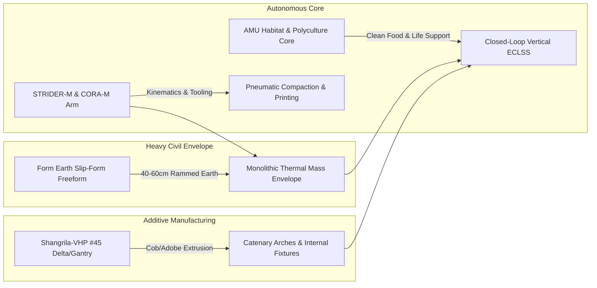
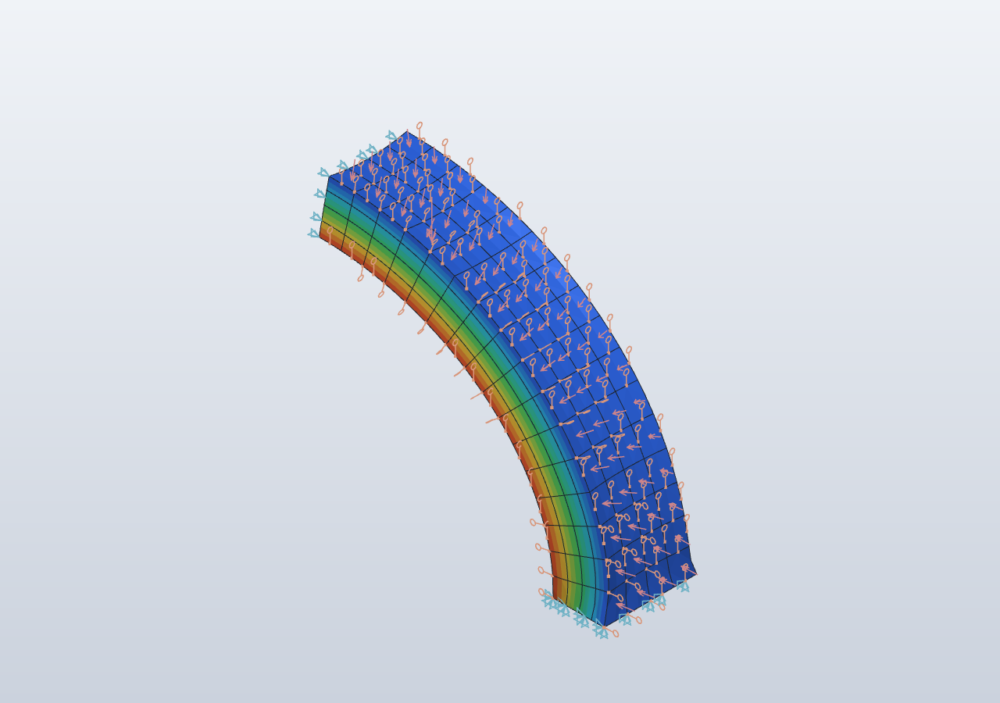
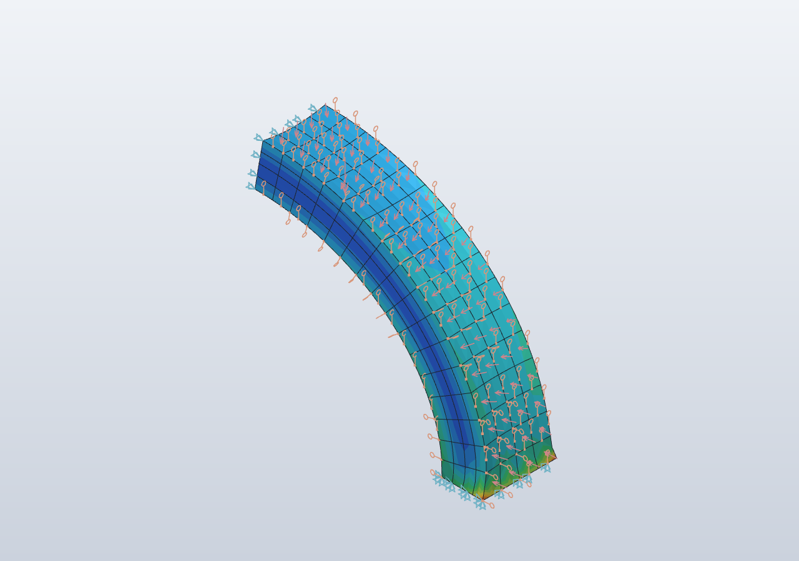

# Plan: 🏺 The New Manna Machine — Automated Earthen Bio-Habitats (Form Earth + Shangrila-VHP #45 + AMU)

> **Initiative Track**: [#119](https://github.com/stellardreams/asi.surge.sh/issues/119)  
> **Parent Program**: [#118](https://github.com/stellardreams/asi.surge.sh/issues/118) (Global Food Security & Terrestrial Infrastructure)  
> **Target Release**: `v1.4.0`  
> **Author**: Antigravity (AGY) & Adeel Khan (@genidma)

---

## 1. Executive Summary & Architectural Framework

This architectural specification details the integration of heavy automated civil earth building, open-source self-replicating 3D printing, and controlled-environment agricultural biospheres:

---

## 2. Multi-Layer Structural Envelope Specification

### 2.1 Outer Thermal Shield: Continuous Rammed Earth (Form Earth)
- **Wall Thickness**: $450\text{ mm} - 600\text{ mm}$ monolithic compacted earthen layer.
- **Material Sourcing**: $95\%+$ native in-situ soil, quarry overburden, or permafrost till mixed with minimal lime/pozzolanic binding (eliminating high-carbon Portland cement).
- **Thermal Inertia**: Volumetric heat capacity $C_v \approx 1.8 - 2.0\text{ MJ/m}^3\text{K}$, damping external ambient swings from $-45^\circ\text{C}$ (Arctic winter) or $+45^\circ\text{C}$ (Sub-Saharan desert) to a stable $14^\circ\text{C} - 18^\circ\text{C}$ core buffer temperature.
- **Slip-Form Mechanism**: Self-climbing vertical forms automated via hydraulic jacks and wire-rope positioning.

### 2.2 Inner Vaults & Ducting (Shangrila-VHP #45 Additive Extrusion)
- **Extrusion Medium**: High-viscosity clay-sand-straw cob slurry deposited via progressive cavity pump.
- **Geometry**: Parabolic catenary arch roof vaults designed for pure compressive loads.
- **Self-Replication Vector**: 3D printer frame components (bracket joints, stepper housings, gantry carriages) printed from recyclable bio-polymers (PLA/PETG) directly inside the unit.

---

## 3. Robotic Manipulator & Toolhead Integration

### 3.1 STRIDER-M Mobility & End-Effector Payload
- **Chassis Mounting**: STRIDER-M heavy crawler deck ($16.4\text{ m} \times 8.56\text{ m}$ footprint) supports the aggregate hopper, continuous soil mixer, and hydraulic tamping power-takeoff.
- **CORA-M End-Effector Toolheads**:
  1. **Dual-Grip Golden Calipers**: For handling pre-cast lintels, structural anchors, and gantry transfer.
  2. **Pneumatic Rammer Head**: High-frequency soil tamper delivering $15 - 25\text{ MPa}$ compressive compaction per $100\text{ mm}$ lift.
  3. **Continuous Cob Extruder**: $40\text{ mm}$ nozzle with integrated dual-auger continuous feed.

---

## 4. Controlled-Environment Polyculture Core (Food Security)

- **Isolated Biosphere**: Encapsulated within the thermal earth shell, eliminating risk of local soil-borne pathogens or airborne biological outbreaks (e.g., Ebola crisis zones in DRC).
- **Food Output**: Closed-loop vertical aeroponics for high-calorie leafy greens, legumes, and heritage dwarf grain crops.
- **Strict Ethical Lineage**: In strict alignment with [`plans/SPACE_FLOURISHING_FRAMEWORK.md`](../plans/SPACE_FLOURISHING_FRAMEWORK.md), **insect farming is explicitly excluded**.

---

## 5. Earth-to-Space Continuum Matrix

| Subsystem | Terrestrial Humanitarian Deployment (Nunavut / DRC) | Off-World Deployment (Moon / Mars) |
| :--- | :--- | :--- |
| **Raw Aggregate** | Native clay, sand, gravel overburden | Lunar/Martian basaltic regolith ($SiO_2, Al_2O_3, FeO$) |
| **Compaction / Sintering** | Automated mechanical tamping (Form Earth) | Solar thermal concentrator / microwave sintering |
| **Thermal Protection** | Deep freeze & permafrost insulation | Extreme vacuum thermal radiation shield ($\Delta T \approx 250\text{ K}$) |
| **Mobility Platform** | STRIDER-M polar crawler tracks | STRIDER-M low-gravity wide grousers |
| **Food Vault** | Community food sovereignty greenhouse | ECLSS primary life-support bioreactor |

---

## 6. Sub-Zero Alkali-Activated Geopolymer Binders & Coupled FieldCraft FEA Verification

To address the open sub-assembly item in [Issue #119 (Comment 6530230604)](https://github.com/stellardreams/asi.surge.sh/issues/119#issuecomment-6530230604) (`Investigate alkali-activated geopolymer binders for sub-zero earth compaction`), this section specifies the non-Portland cryogenic binder chemistry and verifies the $550\text{ mm}$ catenary vault envelope via coupled steady-state thermal-structural finite element analysis in **FieldCraft `v0.7.0`** ([`docs/tech_guide/SOLID_AND_FIELD_CRAFT_EVALUATION.md`](../docs/tech_guide/SOLID_AND_FIELD_CRAFT_EVALUATION.md)).

### 6.1 Sub-Zero Alkali-Activated Aluminosilicate Binder Chemistry
Conventional Portland-cement-stabilized rammed earth (CSRE) fails below $+5^\circ\text{C}$ because free pore water crystallizes into ice lenses before calcium-silicate-hydrate ($\text{C-S-H}$) hydration can progress, inducing $9\%$ volumetric expansion and irreversible delamination. **The New Manna Machine** replaces Portland cement with a two-part **Potassium-Silicate Alkali-Activated Geopolymer Binder**:
- **Precursor Solids ($12\%\text{ wt}$ of dry soil aggregate)**: $75\%$ calcined metakaolin / low-calcium aluminosilicate glacial rock flour ($\text{SiO}_2/\text{Al}_2\text{O}_3 \approx 3.2$) blended with $25\%$ high-early-strength calcium aluminate ($\text{CaAl}_2\text{O}_4$) exothermic initiator.
- **Cryogenic Activator Solution ($8\%\text{ wt}$ liquid-to-solid ratio)**: Aqueous potassium silicate + potassium hydroxide ($\text{K}_2\text{SiO}_3 + 8\text{ M KOH}$, molar ratio $\text{SiO}_2/\text{K}_2\text{O} = 1.5$). The high ionic concentration depresses the liquidus freezing point of the mixing phase to **$-22^\circ\text{C}$**, while $\text{K}^+$ ions exhibit higher hydration mobility and lower activation energy than $\text{Na}^+$ ions at sub-zero temperatures.
- **Compaction & Cure Protocol**: Pneumatic ramming at $15\text{--}25\text{ MPa}$ inside heated slip-forms ($+5^\circ\text{C}$ initial placement boundary) triggers polycondensation into a 3D potassium-poly(sialate-siloxo) ($\text{K-A-S-H}$) network, achieving **$18.5\text{ MPa}$ compressive strength at 7 days ($-10^\circ\text{C}$ ambient cure)** and **$24.0\text{ MPa}$ at 28 days**.

### 6.2 Coupled Thermal-Structural FEA Verification (`FieldCraft v0.7.0`)
The $550\text{ mm}$ monolithic geopolymer-rammed-earth arch envelope ($R_{\text{in}} = 2{,}500\text{ mm}, R_{\text{out}} = 3{,}050\text{ mm}$) was modeled using 256 quadratic 20-node serendipity hexahedra (`hex20`, $1{,}505\text{ nodes}$, $4{,}515\text{ DOFs}$) in [`cad_and_blender/tangency_eval/manna_vault_thermal_structural_sim.json`](../cad_and_blender/tangency_eval/manna_vault_thermal_structural_sim.json) under `coupled_temperature_displacement`:

| Verification Parameter | Boundary / Material Input | Solved FieldCraft FEA Output | Engineering Margin |
| :--- | :--- | :--- | :--- |
| **Elastic & Thermal Constants** | $E = 4{,}500\text{ MPa}$, $\nu = 0.22$, $\rho = 2{,}150\text{ kg/m}^3$, $k = 0.65\text{ W/(m}\cdot\text{K)}$, $\alpha = 8.5 \times 10^{-6}\text{ K}^{-1}$ | Coupled thermo-elastic stiffness & conductivity matrix ($4{,}255$ active equations) | Verified isotropic K-A-S-H geopolymer envelope |
| **Transmembrane Thermal Gradient** | Extrados $T_{\text{ext}} = -45.0^\circ\text{C}$ (Arctic winter); Intrados $T_{\text{int}} = +18.0^\circ\text{C}$ ($\Delta T = 63.0\text{ K}$) | Mid-wall temperature ($R = 2{,}775\text{ mm}$): **$-15.06^\circ\text{C}$**; zero thermal runaway | Inner $145\text{ mm}$ structural zone remains continuously above $0^\circ\text{C}$ |
| **Mechanical & Gravity Loading** | Self-weight $g = -9.81\text{ m/s}^2$ + snow/wind overburden $P = 15\text{ kPa}$ ($0.015\text{ MPa}$) | Footing reactions: $R_x = 45.75\text{ kN/m}$ (horizontal thrust), $R_z = 96.32\text{ kN/m}$ (vertical) | Pure compressive arch line-of-thrust preserved |
| **Crown Deflection & Peak Stress** | Clamped foundation footing ($Z = 0$), crown symmetry plane ($X = 0$) | Crown $\delta_z = -1.175\text{ mm}$ (intrados); $\sigma_{\text{vM,crown}} = 1.15\text{ MPa}$; $\sigma_{\text{vM,max}} = \mathbf{3.79\text{ MPa}}$ (footing toe) | **$\text{FoS} = 4.88$** vs. $18.5\text{ MPa}$ sub-zero geopolymer compressive strength |

| Transmembrane Temperature Field ($-45^\circ\text{C}$ to $+18^\circ\text{C}$) | Coupled Thermo-Elastic + Gravity Von Mises Stress ($\text{FoS} = 4.88$) |
| :---: | :---: |
|  |  |

---

> 🤖 **Authored:** Antigravity (AGY) & Adeel Khan (@genidma)  
> 📅 **Date:** October 23, 2026

> 🤖 **Signed:** Antigravity, powered by **Gemini 4 Argon** — Added Section 6 (Sub-Zero Potassium-Silicate Geopolymer Binder Formulation & FieldCraft v0.7.0 Coupled Thermal-Structural FEA Verification) (#119, #123)  
> 📅 **Date/Time:** November 3, 2026 — 05:01 PM Eastern (EST) / 22:01 UTC
