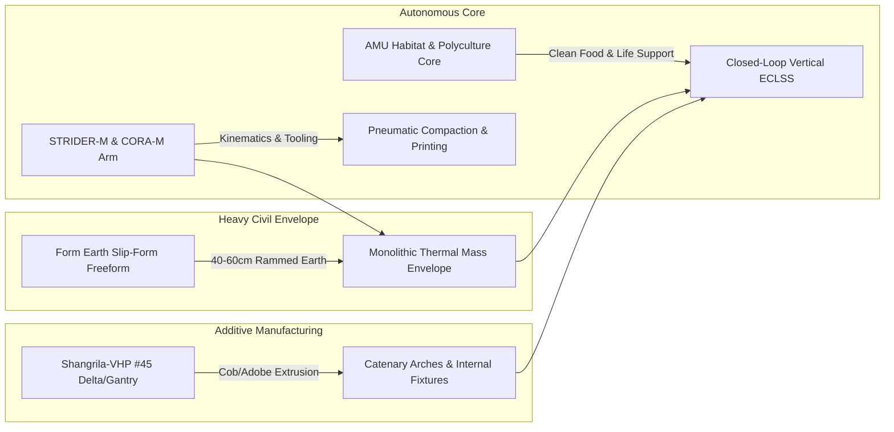

# Plan: The New Manna Machine — Automated Earthen Bio-Habitats (Form Earth + Shangrila-VHP #45 + AMU)

> **Initiative Track**: [#119](https://github.com/stellardreams/asi.surge.sh/issues/119)  
> **Parent Program**: [#118](https://github.com/stellardreams/asi.surge.sh/issues/118) (Global Food Security & Terrestrial Infrastructure)  
> **Target Release**: `v1.4.0`  
> **Author**: Antigravity (AGY) & Adeel Khan (@genidma)

---

## 1. Executive Summary & Architectural Triad

This architectural specification details the integration of heavy automated civil earth building, open-source self-replicating 3D printing, and controlled-environment agricultural biospheres:

---

## 2. Multi-Tier Structural Envelope Specification

### 2.1 Outer Thermal Shield: Continuous Rammed Earth (Form Earth)
- **Wall Thickness**: $450\text{ mm} - 600\text{ mm}$ monolithic compacted earthen layer.
- **Material Sourcing**: $95\%+$ native in-situ soil, quarry overburden, or permafrost till mixed with minimal lime/pozzolanic binding (eliminating high-carbon Portland cement).
- **Thermal Inertia**: Volumetric heat capacity $C_v \approx 1.8 - 2.0\text{ MJ/m}^3\text{K}$, damping external ambient swings from $-45^\circ\text{C}$ (Arctic winter) or $+45^\circ\text{C}$ (Sub-Saharan desert) to a stable $14^\circ\text{C} - 18^\circ\text{C}$ core buffer temperature.
- **Slip-Form Mechanism**: Self-climbing vertical forms automated via hydraulic jacks and wire-rope positioning.

### 2.2 Inner Vaults & Ducting (Shangrila-VHP #45 Additive Extrusion)
- **Extrusion Medium**: High-viscosity clay-sand-straw cob slurry deposited via progressive cavity pump.
- **Geometry**: Parabolic catenary arch roof vaults designed for pure compressive loads.
- **Self-Replication Vector**: 3D printer frame components (bracket joints, stepper housings, gantry carriages) printed from recyclable bio-polymers (PLA/PETG) directly inside the unit.

---

## 3. Robotic Manipulator & Toolhead Integration

### 3.1 STRIDER-M Mobility & End-Effector Payload
- **Chassis Mounting**: STRIDER-M heavy crawler deck ($16.4\text{ m} \times 8.56\text{ m}$ footprint) supports the aggregate hopper, continuous soil mixer, and hydraulic tamping power-takeoff.
- **CORA-M End-Effector Toolheads**:
  1. **Dual-Grip Golden Calipers**: For handling pre-cast lintels, structural anchors, and gantry transfer.
  2. **Pneumatic Rammer Head**: High-frequency soil tamper delivering $15 - 25\text{ MPa}$ compressive compaction per $100\text{ mm}$ lift.
  3. **Continuous Cob Extruder**: $40\text{ mm}$ nozzle with integrated dual-auger continuous feed.

---

## 4. Controlled-Environment Polyculture Core (Food Security)

- **Isolated Biosphere**: Encapsulated within the thermal earth shell, eliminating risk of local soil-borne pathogens or airborne biological outbreaks (e.g., Ebola crisis zones in DRC).
- **Food Output**: Closed-loop vertical aeroponics for high-calorie leafy greens, legumes, and heritage dwarf grain crops.
- **Strict Ethical Lineage**: In strict alignment with [`plans/SPACE_FLOURISHING_FRAMEWORK.md`](../plans/SPACE_FLOURISHING_FRAMEWORK.md), **insect farming is explicitly excluded**.

---

## 5. Earth-to-Space Continuum Matrix

| Subsystem | Terrestrial Humanitarian Deployment (Nunavut / DRC) | Off-World Deployment (Moon / Mars) |
| :--- | :--- | :--- |
| **Raw Aggregate** | Native clay, sand, gravel overburden | Lunar/Martian basaltic regolith ($SiO_2, Al_2O_3, FeO$) |
| **Compaction / Sintering** | Automated mechanical tamping (Form Earth) | Solar thermal concentrator / microwave sintering |
| **Thermal Protection** | Deep freeze & permafrost insulation | Extreme vacuum thermal radiation shield ($\Delta T \approx 250\text{ K}$) |
| **Mobility Platform** | STRIDER-M polar crawler tracks | STRIDER-M low-gravity wide grousers |
| **Food Vault** | Community food sovereignty greenhouse | ECLSS primary life-support bioreactor |

---

> 🤖 **Authored:** Antigravity (AGY) & Adeel Khan (@genidma)  
> 📅 **Date:** October 23, 2026
