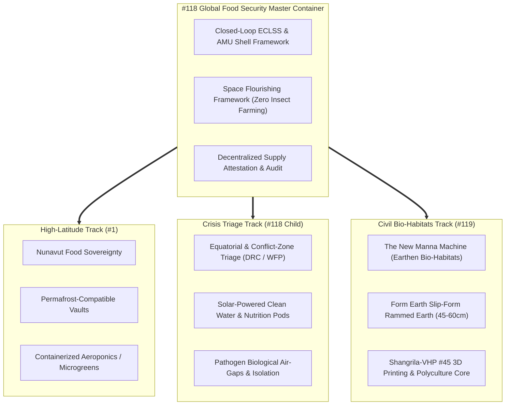

# Master Architecture: Global Food Security & Terrestrial AMU Deployment

> **Initiative Track**: [#118](https://github.com/stellardreams/asi.surge.sh/issues/118) (Master Umbrella Container)  
> **Parent Program**: [#63](https://github.com/stellardreams/asi.surge.sh/issues/63) (Space & Terrestrial Infrastructure Management)  
> **Target Release**: `v1.4.0` (Tracked in `v1.3.4-draft.md`)  
> **Governing Framework**: [`plans/SPACE_FLOURISHING_FRAMEWORK.md`](SPACE_FLOURISHING_FRAMEWORK.md)  
> **Related Child Tracks**: [#1](https://github.com/stellardreams/asi.surge.sh/issues/1) (Nunavut Food Sovereignty), [#119](https://github.com/stellardreams/asi.surge.sh/issues/119) (The New Manna Machine: Automated Earthen Bio-Habitats)

---

## 1. Context & Motivation

Mounting global food insecurity, compounded by extreme climate events, permafrost degradation, biological outbreaks (such as Ebola resurgence in the DRC as reported by the WFP), and fragile centralized supply chains, demands resilient, localized food systems.

The space infrastructure developed across `asi.surge.sh`—specifically Autonomous Manufacturing Units (AMU), closed-loop Environmental Control and Life Support Systems (ECLSS), and heavy robotics (STRIDER-M & CORA-M)—possesses direct dual-use capability for humanitarian crisis relief and extreme-environment food sovereignty on Earth.

---

## 2. Program Child Tracks & Regional Architectures

### 2.1 Track A: Nunavut & High-Latitude Food Sovereignty ([#1](https://github.com/stellardreams/asi.surge.sh/issues/1))
- **Challenge**: Arctic food insecurity, extreme shipping costs ($10–$20/kg fresh produce air freight), winter temperatures below $-50^\circ\text{C}$, and unstable discontinuous permafrost foundations.
- **Implementation**:
  - **Insulated Foundation Shells**: Elevated or thermally isolated multi-layer composite shells preventing thermal bridging and permafrost thaw.
  - **Containerized Aeroponics & Hydroponics**: High-density vertical farming modules delivering fresh leafy greens, brassicas, legumes, and dwarf berries year-round.
  - **Mechanical Integration**: Compatibility with subterranean earth-sheltered vaults and boring machine excavations for extreme thermal mass buffering.

### 2.2 Track B: Equatorial & Conflict-Zone Rapid Crisis Triage (DRC / Sub-Saharan)
- **Challenge**: Displaced populations, drought, biological pathogen spread (Ebola, cholera), and interrupted distribution corridors.
- **Implementation**:
  - **Rapid-Deploy Micro-Pods**: Self-contained shipping container units integrating deployable photovoltaic/battery microgrids, atmospheric water generators (AWG), and multi-stage filtration (UF + RO + UV disinfection).
  - **Continuous Nutrient Output**: Sterile closed-loop bioreactors producing spirulina/chlorella microalgal paste and precision-fermented protein bases without open agricultural land requirements.
  - **Biosecurity Air-Gaps**: Positive-pressure HEPA/ULPA air filtration and airlock entry to operate safely within biological epidemic zones without crop contamination.

### 2.3 Track C: Automated Earthen Bio-Habitats ([#119](https://github.com/stellardreams/asi.surge.sh/issues/119), [`plans/plan-earthen-bio-habitats.md`](plan-earthen-bio-habitats.md))
- **Challenge**: High embodied carbon and expense of conventional concrete/steel structures in remote regions.
- **Implementation**:
  - **Monolithic Rammed Earth**: $450\text{ mm} - 600\text{ mm}$ continuous slip-form envelope utilizing $95\%+$ native in-situ soils and mineral binders (Form Earth technology).
  - **Self-Replicating Additive Printing**: Shangrila-VHP #45 continuous extrusion for catenary interior vaults, thermal ducting, and internal fixtures.
  - **AMU Polyculture Core**: Automated vertical plant cultivation chambers embedded directly within the protective earthen thermal mass.

---

## 3. Core Technical Specifications

### 3.1 Biosafety & Ethical Nutrition Baseline
- **Strict Moral Stance**: In mandatory alignment with [`plans/SPACE_FLOURISHING_FRAMEWORK.md`](SPACE_FLOURISHING_FRAMEWORK.md), **insect farming is strictly prohibited**. Systems focus exclusively on:
  1. Plant polyculture (legumes, leafy greens, tubers, dwarf grains).
  2. Precision biomass fermentation and cellular agriculture.
  3. Microalgae photobioreactors.
- **Closed-Loop Water & Nutrient Recovery**: $98\%+$ water recovery efficiency via closed condensing dehumidification coils and membrane bioreactors.

### 3.2 Mechanical & Robotic Integration
- **Platform**: STRIDER-M heavy mobility chassis configured with agricultural toolhead swarms.
- **Manipulators**: CORA-M 7-DoF robotic arms handling tray indexing, automated harvesting, optical plant health spectrometry, and pruning.
- **Excavation & Subterranean Grow Vaults**: Direct interface with rotary boring heads and earth-sheltered trenches, creating subterranean bunkers protected from surface climatic extremes.

### 3.3 Decentralized Logistics & Supply Attestation
- **Immutable Provenance**: Batch yield cryptographic attestation logged to public ledgers for transparent donor auditing, UN/WFP relief tracking, and fair local distribution.
- **Zero-Knowledge Distribution Receipts**: Cryptographic verification that nutritional aid reaches beneficiaries without exposing vulnerable civilian personal identity data.

---

## 4. Milestone Roadblocks & Verification

| Milestone | Target | Exit Criteria | Verification Artifact |
| :--- | :--- | :--- | :--- |
| **M1: Architecture Unification** | Q4 2026 | Interlink #1, #118, #119, and ROADMAP.md | `plans/plan-food-security.md` ✅ |
| **M2: Bio-Habitat CAD Solid** | Q1 2027 | Parametric FreeCAD/STEP model for earthen grow vault | FreeCAD Python script & STEP solid in `cad_and_blender/` |
| **M3: ECLSS Micro-Pod Spec** | Q2 2027 | Detailed P&ID flow diagrams for containerized water/aeroponics | Technical P&ID specification doc |
| **M4: Pilot Prototype Test** | Q4 2027 | High-latitude containerized growing trial validation | Verification report & yield sensor logs |

---

> 🤖 **Authored:** Antigravity (AGY) & Adeel Khan (@genidma)  
> 📅 **Date:** November 3, 2026  
> 🏷️ **Reference:** Issues [#63](https://github.com/stellardreams/asi.surge.sh/issues/63), [#118](https://github.com/stellardreams/asi.surge.sh/issues/118), [#1](https://github.com/stellardreams/asi.surge.sh/issues/1), [#119](https://github.com/stellardreams/asi.surge.sh/issues/119)
