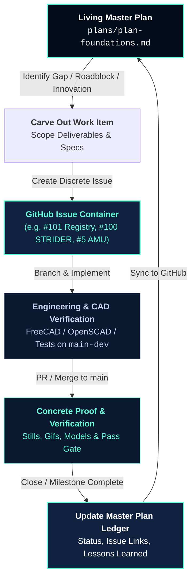

# Ledger: Interplanetary Foundations

> [!NOTE]
> ### 🏛️ Living Architecture & GitHub Issue Containers
> This master plan serves as the high-level technical blueprint and strategic compass for developing our flagship hardware systems and industrial space infrastructure.
> 
> **How work is executed**:
> - Execution within this plan is organized into **GitHub Issue Containers**. Rather than letting strategy remain abstract, every tactical workstream, design effort, or engineering package maps directly to a discrete, trackable GitHub issue (open or closed) in this repository or its dedicated sister repositories.
> - As engineering advances, new containers are carved out from this document into dedicated issues, and milestone completions are continuously reflected back into this living ledger.

---

## 🗺️ Work Extraction & Plan Update Workflow

### Operational Protocol for Carving Out Work:
1. **Identify the Core Challenge**: Pick a specific roadmap item, bottleneck (e.g. LEO orbital debris, non-rocket space launch, dust mitigation), or hardware innovation from the plan below.
2. **Open a GitHub Issue Container**: Frame the issue with clear parent/child linkages, verifiable scope checkboxes, and technical acceptance criteria.
3. **Execute via `git-branching-workflow`**: Develop on `main-dev`, tag commits with `#<issue_number>`, verify models/simulations, seek approval, merge to `main`, and push.
4. **Reconcile the Plan**: Update the mapping table below, marking the task status, linking the commit/release, and capturing technical discoveries.

---

## 📦 Active & Historical GitHub Issue Container Mapping

| Container (Issue) | State | Domain / Innovation Focus | Primary Deliverable / Milestone |
| :--- | :---: | :--- | :--- |
| [**#5**](https://github.com/stellardreams/asi.surge.sh/issues/5) | `OPEN` | **AMU Architecture Physical Blueprint** | Foundational physical architecture, mass budgets, and modular staging specifications for Autonomous Manufacturing Units. |
| [**#101**](https://github.com/stellardreams/asi.surge.sh/issues/101) | `OPEN` | **Hardware Invention & Model Registry** | Authoritative CAD model catalog, envelopes, STEP/STL export pipelines, and migration to FreeCAD. |
| [**#100**](https://github.com/stellardreams/asi.surge.sh/issues/100) | `OPEN` | **STRIDER-M Heavy Transporter CAD** | v2 parametric chassis, dual rubber continuous tracks, articulated outriggers, and kinematic latch assembly. |
| [**#18**](https://github.com/stellardreams/asi.surge.sh/issues/18) | `OPEN` | **Parametric CAD & FreeCAD Tooling** | Transition from legacy OpenSCAD to FreeCAD 1.0 for engineering tolerances, FEM analysis, and kinematic rigging. |
| [**#12**](https://github.com/stellardreams/asi.surge.sh/issues/12) | `OPEN` | **Stage-2 AMU Bioreactor Scaffolding** | Microgravity cellular scaffolding, nutrient fluidics, and closed-loop life support interfaces. |
| [**#4**](https://github.com/stellardreams/asi.surge.sh/issues/4) | `OPEN` | **Digital Spinal Cord & Swarm Engine** | Swarm tele-operation, autonomous task scheduling, and decentralized multi-agent AMU coordination. |
| [**#63**](https://github.com/stellardreams/asi.surge.sh/issues/63) | `OPEN` | **Space Infrastructure Token (SIT) Governance** | Economic incentives, decentralized auditing, and legal stewardship commons for space infrastructure. |
| [**#71**](https://github.com/stellardreams/asi.surge.sh/issues/71) | `OPEN` | **Space-Earth Sovereign Ledger & Simulation** | Two-way sovereign data routing, telemetry validation, and high-latency orbital simulation loop. |
| [**#110**](https://github.com/stellardreams/asi.surge.sh/issues/110) | `OPEN` | **Polar Sealift & Marine Logistics (Blue Fin)** | Multi-modal container envelopes, barge transport, and low-acoustic marine deployment for extreme environments. |
| [**#112**](https://github.com/stellardreams/asi.surge.sh/issues/112) | `OPEN` | **AI Technical Illustration Pipeline** | Automated engineering diagrams, kinematic workflows, and ControlNet hardware illustration pipelines. |
| [**#97**](https://github.com/stellardreams/asi.surge.sh/issues/97) | `CLOSED` | **AMU-Surface & STRIDER-M Docking Architecture** | Interface between mobile surface habitats, transporter cradles, and autonomous tilt-up handling. |
| [**#98**](https://github.com/stellardreams/asi.surge.sh/issues/98) | `CLOSED` | **Kinematic Visuals & Cinematic Verification** | High-fidelity FreeCAD turntable GIFs and cinematic MP4 simulations for surface robotics and handling. |
| [**#105**](https://github.com/stellardreams/asi.surge.sh/issues/105) | `CLOSED` | **STRIDER-M + CORA-M + Wind Cooperative Hoisting** | Collaborative 7-DoF robotic manipulation, outrigger vector calculus, and autonomous field gin-pole deployment. |
| [**#108**](https://github.com/stellardreams/asi.surge.sh/issues/108) | `CLOSED` | **FreeCAD Headless Render Benchmark** | Benchmark and establish headless FreeCAD automation pipeline on Linux hardware. |
| [**#82**](https://github.com/stellardreams/asi.surge.sh/issues/82) | `CLOSED` | **AMU Polar Wind Spin-off Architecture** | Conceptualization of modular wind turbine masts and polar ground interfaces (now extracted to standalone repo). |
| [**#102**](https://github.com/stellardreams/asi.surge.sh/issues/102) | `OPEN` | **Website Portfolio & Technical Showcase** | Overhaul public showcase (`asi.surge.sh`) with modern CAD models, parallel efforts, and clean deployment hygiene. |

---

## 🎯 SMART Goal: Type III Industrial Backbone
Parent Initiative: `#378`

### Project Status & Priority
- **Overall Status**: Active Research & Parametric Prototyping
- **Priority**: Critical / High
- **Dependencies**: Orbital Stewardship Ledger (`plan-stewardship.md`), Lamport Distributed Systems Engineering (`plan-lamport-systems-engineering.md`), International Partnerships & Treaties

---

### 🔬 Specific Objectives & Technical Roadblocks

#### 1. Core Logistical Spine & Industrial AMU Backbone
- Construct the primary logistical spine and manufacturing backbone between Mars and the Asteroid Belt.
- **Key Challenges & Hard Problems**:
  - **Mass Transfer to & from L.E.O.**: Moving significant mass from Earth's gravity well into orbit and returning refined materials safely without compounding space environmental hazards.
  - **Orbital Dust & Particulate Pollution Hazard**:
    - If and when micro-dust and fine debris accrete in orbit, humanity faces an immense, persistent hazard.
    - *Lunar & Orbital Dust Reality*: In orbital vacuum, you cannot simply vacuum dust—there is no atmospheric medium to suck particles into filters. Artemis missions and future surface architectures risk creating persistent orbital and sub-orbital dust halos unless electrostatic or magnetic capture systems are engineered.
  - **Shipyard & Orbital Orbital Facility Integrity**:
    - A centralized orbital manufacturing or staging facility (shipyard) is required to assemble large-scale structures and stage AMU swarms.
    - *Catastrophic Disintegration Risk*: If an orbital facility suffers structural compromise or explosive decompression, Kessler Syndrome acceleration becomes exponential. Debris fragments and dust shards dispersed in high energy states would render key orbits unusable for generations.
  - **Non-Rocket Spacelaunch (NRS) & High-Cadence Transport**:
    - Relying exclusively on expendable multi-stage chemical rocketry to sustain long-term orbital infrastructure and lunar missions is economically and environmentally untenable.
    - NRS pathways (space elevators, orbital mass drivers, kinetic launch loops, or rotating skyhooks) must be assessed rigorously as TRL levels evolve ([Launch Comparison Reference](https://en.wikipedia.org/wiki/Non-rocket_spacelaunch#Comparison_of_space_launch_methods)).
    - *Space Elevator Historical Assessment*: Preliminary email inquiries established; formal engineering validation and tether materials science remain an active area for review.

#### 2. Risk Modeling, Civilizational Resilience & The Great Filter
- **Codification of Legal Norms**: A lack of transparent, verifiable rules and norms codified into an open legal structure drastically increases the emergence of catastrophic risk.
- **Civilizational RTO (Recovery Time Objective)**: If outer space does not open up safely, sustainably, and equitably, human civilization risks permanent trap conditions when facing converging terrestrial crises (climate displacement, food and water security stressors, and ecological degradation). No quantitative civilizational RTO currently exists for rebooting advanced technological infrastructure post-collapse.
- **The Great Filter Crossing**: Surviving the transition to a Type III civilization requires crossing the Great Filter through transparent coordination, post-scarcity industrial foundations, and permanent multi-body redundancy.

---

### 📊 Measurable Targets

- **Interplanetary Transport Network (ITN)**: Map low-energy ballistic resonance transfer corridors across Sun-Earth and Earth-Moon Lagrange points (L1–L5).
- **Deep Space Energy Parity**:
  - Direct point-to-point transport for large mass volumes across astronomical distances is constrained unless high-efficiency fusion power, nuclear thermal propulsion, or space-based solar power beaming matures.
  - Micro-scale interstellar probes (credit-card scale chipcraft) represent the immediate exception for rapid exploratory reconnaissance.
- **Project-001 Industrial Hubs**: Establish the first cluster of 10 operational autonomous manufacturing factory hubs in the Asteroid Belt.
- **Asteroid Mapping & Spectral Prospecting**: Coordinate with planetary resource surveys and spectral classification frameworks for real-estate identification and water-ice/metal assaying.
- **Sovereign Infrastructure on Blockchain (Project-008)**: Deploy decentralized audit nodes for autonomous resource telemetry and open governance tracking.
- **Stakeholder Alignment & Pre-emption**:
  - Anticipate regulatory and economic resistance from legacy resource cartels; formulate equitable integration plans.
  - Deploy workforce transition and coaching frameworks aligned with long-term technological evolution.

---

### 📐 Project Parameters
- **Achievable**: Utilizing modular self-replicating AMU clusters (Project-001) paired with autonomous deep-space trajectory planning. Detailed breakdown mapped in [Issue #5](https://github.com/stellardreams/asi.surge.sh/issues/5).
- **Relevant**: Forms the irreplaceable foundation for long-term multi-planetary expansion and Earth biosphere remediation.
- **Time-bound**: Orbital AMU prototype by 2028; full logistics backbone operational by 2035.

---

## 📋 Actionable Tasks & Container Linkages

1. [ ] **Backbone Trajectory & ITN Mapping**: Chart high-efficiency resonance trajectories for AMU orbital hub placement.  
   *Target: Month 6 · Priority: High · Container: [Issue #5](https://github.com/stellardreams/asi.surge.sh/issues/5) · Dependency: Orbital Stewardship Ledger*
2. [ ] **Interplanetary Legal Framework Ledger**: Deploy v1 open legal protocol and audit mechanisms on public ledger infrastructure.  
   *Target: Month 8 · Priority: High · Container: [Issue #63](https://github.com/stellardreams/asi.surge.sh/issues/63) / [Issue #71](https://github.com/stellardreams/asi.surge.sh/issues/71)*
3. [ ] **Autonomous Self-Replication Pilot**: Validate simulated closed-loop self-replication cycles for AMU structural components in simulated microgravity.  
   *Target: Month 12 · Priority: Medium · Container: [Issue #5](https://github.com/stellardreams/asi.surge.sh/issues/5) / [Issue #101](https://github.com/stellardreams/asi.surge.sh/issues/101)*
4. [ ] **Long-Range Logistical Transport Spine**: Initiate first autonomous orbital-to-surface material transport cycle with zero-debris containment.  
   *Target: Month 24 · Priority: Medium · Container: [Issue #100](https://github.com/stellardreams/asi.surge.sh/issues/100) / [Issue #110](https://github.com/stellardreams/asi.surge.sh/issues/110)*
5. [ ] **Wikipedia-Model Real-Time Auditing Node**: Deploy open-source, community-governed dashboard for real-time telemetry, CAD verification, and ethical audit trails.  
   *Target: Month 30 · Priority: Medium · Container: [Issue #4](https://github.com/stellardreams/asi.surge.sh/issues/4) / [Issue #102](https://github.com/stellardreams/asi.surge.sh/issues/102)*

---

## 🏆 Key Milestones

- **M1 — Genesis Architecture Block**: Deployment of decentralized registry and formal specification for AMU swarm interactions.
- **M2 — Closed-Loop AMU Replication**: First successful physical AMU-to-AMU tool and structural replication sequence (surface test followed by low-Earth orbit test).
- **M3 — Operational Earth-Mars Transport Spine**: Continuous high-cadence logistical corridor established between cis-lunar space and Mars orbital nodes.

---

## 🛠️ Resources & Collaborative Ecosystem

- **Robotics & Kinematics Engineering**: Parametric design teams, SpaceROS developers, and FreeCAD modeling contributors.
- **Architectural & Habitat Designers**: Pressurized module, environmental seal, and O'Neill habitat structural engineers.
- **Remote & Harsh-Environment Operations**: Polar logistics experts, deep-mine autonomous operators, and harsh-environment telemetry engineers.
- **Strategic Peace & Commons Mandates**: Space law scholars, Outer Space Treaty ethicists, and international commons liaisons.
- **Formal Systems Verification**: Distributed computing specialists applying Leslie Lamport's formal methods (TLA+) for multi-agent swarm consensus ([`plan-lamport-systems-engineering.md`](plan-lamport-systems-engineering.md)).
- **AI Safety & Alignment**: Researchers designing ethical boundaries, human-in-the-loop overrides, and autonomy constraints for self-replicating systems.
